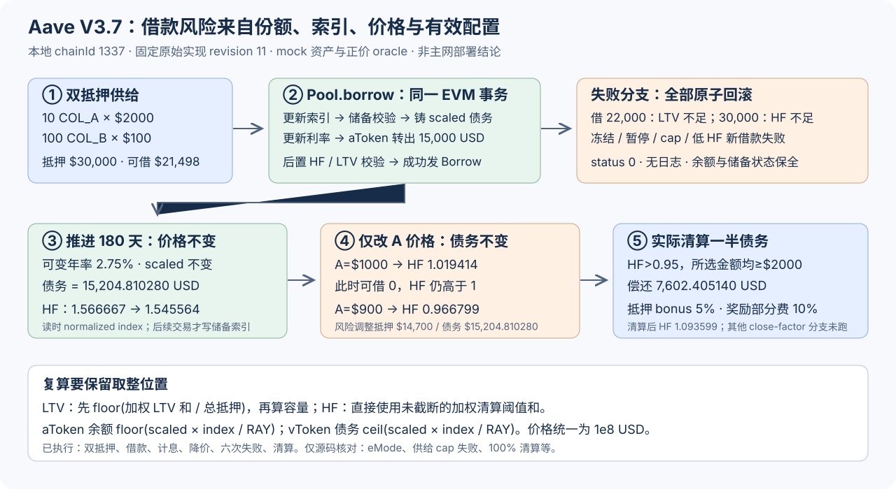

# Aave V3：借款、利息与健康因子

## 1. 问题与结论 {#question}

抵押资产值 30,000，为什么不能借 22,000？价格没动，健康因子为什么还会下降？借款函数已经转出代币，最后才发现抵押不足，资金会不会留下？

Aave 将**新增借款约束**和**清算资格**分开。LTV 限制新增债务，清算阈值参与健康因子（HF）；债务随可变债务指数增长，抵押价值随预言机价格变化，两条路径都会改变 HF。本文直接运行 V3.7.0：双抵押借入 15,000 USD，推进 180 天后债务变为 15,204.810280；价格下跌使 HF 从约 1.54556 降至 0.966799，随后一笔清算偿还一半债务。三种账户风险失败及冻结、暂停、借款上限失败均实际回滚。

该版本 `BorrowLogic.executeBorrow` 在铸债和底层资产转移后调用 `validateHFAndLtv`；失败会撤销此前全部状态、转账和日志。这是 EVM 同一事务的原子性，不是“先转出就成功”。[借款实现](https://github.com/aave-dao/aave-v3-origin/blob/cff15de6d1271b0c800fc001f4aea4c263e8a597/src/contracts/protocol/libraries/logic/BorrowLogic.sol#L41-L110)

### 版本与研究部署 {#versions}

核查日 **2026-11-19**：官方 [aave-dao/aave-v3-origin 稳定发布](https://github.com/aave-dao/aave-v3-origin/releases/tag/v3.7.0) 为 **v3.7.0**，发布时间 `2026-08-05T11:29:41Z`，固定提交 **`cff15de6d1271b0c800fc001f4aea4c263e8a597`**，提交时间 `2026-08-05T11:28:12Z`。旧 [aave/aave-v3-core](https://github.com/aave/aave-v3-core) 已归档，本篇使用维护中的 Origin；不将旧 V3.0 教程或 V4 规则混入。

官方 npm 包 `@aave-dao/aave-v3-origin` 的 `latest` 仍是 **3.6.0**，`gitHead=5a230ec82fcb10afc7fe7cffa8978752fb17aa2b`；3.7 tag 内 package.json 的 version 也尚为 3.6.0。本文按明确发布的 3.7.0 tag/commit 取源码，不用落后的包标签代替稳定发布。稍后重复 GitHub API 请求触发 403 限流，保留该事实。

**研究部署是本地 chainId 1337 的 V3.7 实现，不是主网快照。** solc `0.8.27`、optimizer `200`、Shanghai、metadata hash `none` 对齐固定仓库 [foundry.toml](https://github.com/aave-dao/aave-v3-origin/blob/cff15de6d1271b0c800fc001f4aea4c263e8a597/foundry.toml)。部署未改写的 `PoolInstance`（revision 11）、aToken/vToken 实现、五个外部链接逻辑库和真实 `DefaultReserveInterestRateStrategyV2`；Pool 经真实 `PoolAddressesProvider.setPoolImpl` 建立代理，aToken/vToken 使用仓库原代理初始化。

实验记录保存代理/实现地址、EIP-1967 implementation 槽、revision、构造参数、链接库地址、部署交易和运行码 Keccak。24 个显式部署合约均按编译运行码核对：屏蔽构造 immutable、链接地址及 Solidity 库自身地址后逐字节匹配，不能把这种匹配说成“主网字节码一致”。

夹具只有普通 ERC20、可设置价格的 MockOracle、EOA 配置管理员；借款/计息/风险/清算公式均来自实际 Aave 实现。直接调用受配置管理员限制的 `initReserve/setConfiguration`，没有部署 PoolConfigurator、ACLManager、治理执行器、生产喂价器或激励控制器；因此验证范围不含配置治理和主网价格安全。测试币、价格和风险参数都是人为构造，**没有查询或声称当前 Ethereum 市场采用这些参数**。

## 2. 最小模型：资产、份额、价格与账户 {#model}



- Pool 是用户入口和状态存储，逻辑库经链接调用操作 Pool 的 storage。AddressesProvider 提供 Pool、配置管理员和价格源地址。
- 底层代币实际存放在 aToken 地址。供给换来 aToken 份额；借款产生不可普通转让的可变债务份额，底层资产从 aToken 转给借款调用者。
- 余额不是每秒写入 storage：`scaledBalance × normalizedIndex` 在查询时给出当前余额。交易再将时间增量累积到储备索引。
- GenericLogic 遍历用户启用的抵押和借款位图，按各资产 decimals 和价格统一计价，再计算风险。

本实验 `onBehalfOf=msg.sender`。代借时，债务记到 `onBehalfOf`，输入币转给调用者；`VariableDebtToken.mint` 经信用授权扣 allowance，并不能只填写别人的地址借出资金。[Pool.borrow](https://github.com/aave-dao/aave-v3-origin/blob/cff15de6d1271b0c800fc001f4aea4c263e8a597/src/contracts/protocol/pool/Pool.sol#L203-L230)、[可变债务 mint](https://github.com/aave-dao/aave-v3-origin/blob/cff15de6d1271b0c800fc001f4aea4c263e8a597/src/contracts/protocol/tokenization/VariableDebtToken.sol)、[账户计算](https://github.com/aave-dao/aave-v3-origin/blob/cff15de6d1271b0c800fc001f4aea4c263e8a597/src/contracts/protocol/libraries/logic/GenericLogic.sol#L64-L183)

## 3. 状态、单位和可独立复算的数值 {#math}

### 精度和方向 {#units}

| 量 | 单位及本版本规则 |
| --- | --- |
| 底层数量 | 资产各自最小单位；COL_A=18、COL_B=8、USD=6 decimals |
| 价格、账户 base 值 | 本地 oracle 使用 `1e8` 表示 1 USD；不是代币数量的 decimals，也不能假设所有真实市场基准相同 |
| LTV、LT、reserve factor | bps，`10000=100%`；例如 7500=75% |
| HF | wad，`1e18=1`；无债务为 `uint256.max` 哨兵 |
| liquidity/variable debt index、年化利率 | ray，`1e27=1`；利率是年率，不是每秒利率 |
| aToken mint / balance | `floor(amount×RAY/index)` / `floor(scaled×index/RAY)` |
| vToken mint / balance | `ceil(amount×RAY/index)` / `ceil(scaled×index/RAY)` |
| aToken burn、vToken burn | 前者 scaled 向上，后者 scaled 向下；防止过发资产或少记债务 |
| 通用 rayMul/rayDiv、wadDiv | 传统运算为 half-up；不得把它们与显式 floor/ceil 混为一谈 |

[TokenMath](https://github.com/aave-dao/aave-v3-origin/blob/cff15de6d1271b0c800fc001f4aea4c263e8a597/src/contracts/protocol/libraries/helpers/TokenMath.sol)、[WadRayMath](https://github.com/aave-dao/aave-v3-origin/blob/cff15de6d1271b0c800fc001f4aea4c263e8a597/src/contracts/protocol/libraries/math/WadRayMath.sol)、[PercentageMath](https://github.com/aave-dao/aave-v3-origin/blob/cff15de6d1271b0c800fc001f4aea4c263e8a597/src/contracts/protocol/libraries/math/PercentageMath.sol)。以下整数公式中的 `floor/ceil/halfUp` 是实际取整，不用展示用浮点数构造交易。

### 双抵押与 LTV 截断 {#collateral}

普通 eMode=0，风险配置为夹具值：

| 抵押/借款币 | 供给者与数量 | 价格 | 借款人抵押 base 值 | LTV / LT | 清算 bonus 参数 |
| --- | --- | --- | --- | --- | --- |
| COL_A | 借款人 10 | 2000 | 20,000 USD | 7500 / 8000 | 10500，即 5% 奖励 |
| COL_B | 借款人 100 | 100 | 10,000 USD | 6500 / 7500 | 10800，即 8% 奖励 |
| USD | LP 100,000，借款人未供给 | 1 | 0 | 0 / 0 | 0；不作为本例抵押 |

各储备 reserve factor=1000（10% 利息计入 treasury），清算协议费参数=1000（奖励部分的 10%）；borrow cap=1,000,000、supply cap=2,000,000，单位为整币。

`GenericLogic` 的基准币整数如下，`C_i` 和 `D_i` 均为 `1e8` 精度：

```text
C_i = floor(aBalance_i × price_i / 10^decimals_i)
D_i = ceil(vBalance_i × price_i / 10^decimals_i)
C = Σ C_i; D = Σ D_i
W_ltv = Σ(C_i × ltv_i)
W_lt = Σ(C_i × lt_i)
reportedLtv = floor(W_ltv / C)
reportedLT  = floor(W_lt / C)
available = max(floor(C × reportedLtv / 10000) - D, 0)
HF = floor(halfUp(W_lt × 1e18 / D) / 10000)   // D>0
```

初始 `C=3,000,000,000,000`，`W_ltv=21,500,000,000,000,000`，`W_lt=23,500,000,000,000,000`。报告加权 LTV=7166、LT=7833。**可借额度是 21,498，不是理想加权容量 21,500**：先把平均 LTV 截断到整数 bps，再乘总抵押。实际借款校验还用 `ceil(D×10000/reportedLtv) <= C`，不能用未截断加权容量通过边界判断。

HF 则直接用 `W_lt`，不会先乘报告出的 7833。因此借 15,000 后 `HF=1566666666666666666`，而不是拿 `30000×78.33%/15000` 得到的略小值。[GenericLogic 计算与可借额](https://github.com/aave-dao/aave-v3-origin/blob/cff15de6d1271b0c800fc001f4aea4c263e8a597/src/contracts/protocol/libraries/logic/GenericLogic.sol#L149-L213)、[实际后置校验](https://github.com/aave-dao/aave-v3-origin/blob/cff15de6d1271b0c800fc001f4aea4c263e8a597/src/contracts/protocol/libraries/logic/ValidationLogic.sol#L346-L390)

### 180 天计息：读时归一化与写入索引 {#interest}

策略夹具：optimal=80%，base=2%，slope1=4%，slope2=75%。借出 15,000 后，虚拟可用资产=85,000、债务=15,000，利用率 `U=15%`；无 unbacked，本地 supplyUsageRatio 与 borrowUsageRatio 相同：

```text
r_variable = 2% + 4% × (15%/80%) = 2.75% = 27500000000000000000000000 ray
r_liquidity = r_variable × 15% × (1-10%) = 0.37125%
            = 3712500000000000000000000 ray
```

实际策略每一步都用 ray half-up；高于 optimal 的分支是 `base+slope1+slope2×(U-optimal)/(1-optimal)`，不是始终线性同一斜率。利用率读取 `virtualUnderlyingBalance` 并纳入本次新增/取走流动性，不直接拿 ERC20 balance 当唯一账本。[策略](https://github.com/aave-dao/aave-v3-origin/blob/cff15de6d1271b0c800fc001f4aea4c263e8a597/src/contracts/misc/DefaultReserveInterestRateStrategyV2.sol#L127-L173)、[储备更新](https://github.com/aave-dao/aave-v3-origin/blob/cff15de6d1271b0c800fc001f4aea4c263e8a597/src/contracts/protocol/libraries/logic/ReserveLogic.sol#L130-L174)

本例从 `1795046400` 推进到 `1810598400`，`dt=15,552,000` 秒。固定年长 `Y=31,536,000`，初始两索引为 RAY。V3.7 的复利近似采用下面的三次多项式，**不是旧教程的逐秒二项式表达式**：

```text
x = floor(r_variable × dt / Y)
factor = RAY + x + rayMul(x, floor(x/2) + rayMul(x, floor(x/6)))
normalizedDebt = rayMul(storedDebtIndex, factor)
normalizedIncome = rayMul(storedLiquidityIndex, RAY + floor(r_liquidity×dt/Y))
```

结果：

| 量 | 实测与 Python 独立整数复算 |
| --- | --- |
| 债务 normalized index | `1013654018632861802954626661` |
| 供给 normalized index | `1001830821917808219178082191` |
| 用户债务 scaled | `15000000000`，推进时间前后相同 |
| 当前债务 `ceil(scaled×index/RAY)` | `15204810280` 最小单位 = **15,204.810280 USD** |
| LP aToken 当前余额 | `100183082191` = 100,183.082191 USD |
| HF，价格不变 | `1545563513601433769` |

只挖一个未来区块并查询时，`getReserveData.variableBorrowIndex` 仍是旧 RAY，但 `getReserveNormalizedVariableDebt` 和 `balanceOf` 已体现利息。随后实际调用配置管理员的 `syncIndexesState(USD)`，存储索引更新到同一数值；查询不会自动写 storage。代码通过每储备 12 个原始槽和编译器 storageLayout 交叉解码验证，而非只比较两个 getter。[索引读取和更新](https://github.com/aave-dao/aave-v3-origin/blob/cff15de6d1271b0c800fc001f4aea4c263e8a597/src/contracts/protocol/libraries/logic/ReserveLogic.sol#L39-L106)、[MathUtils](https://github.com/aave-dao/aave-v3-origin/blob/cff15de6d1271b0c800fc001f4aea4c263e8a597/src/contracts/protocol/libraries/math/MathUtils.sol#L22-L98)

写入时 `accruedToTreasury=20443599`，这是 **scaled aToken 份额**，不能直接显示为 20.443599 USD 利息。路径先向下计算债务利息、按 reserve factor half-up，再除供给指数向下记份额。本实验只同步索引，没有在此时执行 `mintToTreasury`。[treasury 累计](https://github.com/aave-dao/aave-v3-origin/blob/cff15de6d1271b0c800fc001f4aea4c263e8a597/src/contracts/protocol/libraries/logic/ReserveLogic.sol#L183-L205)

### 价格变动与清算资格 {#prices}

推进时间后不再增加秒数，只改 COL_A 价格；COL_B=100、USD=1 不动：

| 阶段 | 总抵押 | 总债务 | reported LTV / LT | HF（wad） | 含义 |
| --- | --- | --- | --- | --- | --- |
| 刚借款 | 30,000 | 15,000 | 7166 / 7833 | `1566666666666666666` | 可继续借，但受 LTV 约束 |
| 180 天、价格不变 | 30,000 | 15,204.810280 | 7166 / 7833 | `1545563513601433769` | 仅利息使 HF 下降 |
| A=1000 | 20,000 | 15,204.810280 | 7000 / 7750 | `1019414232375413762` | HF>1，available=0；不能新借不等于可清算 |
| A=900 | 19,000 | 15,204.810280 | 6973 / 7736 | `966799304252811762` | `HF < 1`，满足清算 HF 条件 |

A=900 时 `W_lt=(9000×8000+10000×7500)×1e8`，对应风险调整抵押 **14,700 USD**；`HF≈14700/15204.810280`。这一阶段债务币原始数量和债务指数均不变，变化来自价格；若 USD 价格自身变化，base 债务也会变，不应把所有风险变化归于借款利息。`HF < 1` 还须通过储备暂停、抵押启用、宽限期等清算检查才可执行。[清算校验](https://github.com/aave-dao/aave-v3-origin/blob/cff15de6d1271b0c800fc001f4aea4c263e8a597/src/contracts/protocol/libraries/logic/ValidationLogic.sol#L253-L296)

## 4. 从供给到借款的完整路径 {#path}

### 供给与抵押启用 {#supply}

`Pool.supply → SupplyLogic.executeSupply`：缓存储备、更新索引及 treasury → 将输入向下换成 aToken scaled amount → 验证 active/paused/frozen、数量与 supply cap → 更新利率/虚拟余额 → `safeTransferFrom(user,aToken,amount)` → aToken `mint` → 首次供给且 `validateUseAsCollateral` 允许时启用抵押 → `Supply` 事件。不能把“供给成功”视为任何资产都自动可抵押；USD 在本例 LTV=0，不为借款人提供抵押。[SupplyLogic](https://github.com/aave-dao/aave-v3-origin/blob/cff15de6d1271b0c800fc001f4aea4c263e8a597/src/contracts/protocol/libraries/logic/SupplyLogic.sol#L40-L91)

### 借款的两层校验 {#borrow}

本地调用 `borrow(USD,15000e6,2,0,borrower)`；`2` 是 VARIABLE 模式。顺序按本版本实际代码：

1. `Pool.borrow` 取调用者、onBehalfOf 的 eMode、Provider 的 oracle 和共享利率策略，传入 `BorrowLogic.executeBorrow`。
2. `reserve.cache/updateState` 将此前经过的时间记入索引，按新债务指数将输入 **向上**转换为 scaled amount。
3. `ValidationLogic.validateBorrow` 检查非零数量、active、未暂停/冻结、普通模式 borrowingEnabled 或 eMode borrowableBitmap、aToken 总量约束、VARIABLE 模式及 borrow cap。此处尚未做完整账户 HF/LTV 校验。
4. `VariableDebtToken.mint` 验证代借授权，给 onBehalfOf 铸造 scaled 债务，记录用户索引；首次借该资产设置 borrowing 位图。
5. `updateInterestRatesAndVirtualBalance` 使用新总债务和本次取走数量更新利率、虚拟余额，发 `ReserveDataUpdated`。
6. `aToken.transferUnderlyingTo(params.user,amount)` 转出输入资产。
7. `validateHFAndLtv → GenericLogic.calculateUserAccountData` 用**已包含新债务**的账户检查有效 LTV 非零、HF≥1 和 LTV 容量。
8. 全部成功才发 `Borrow`。任一 require/revert 使本次 EVM 事务的状态和日志一并回滚。

[借款入口](https://github.com/aave-dao/aave-v3-origin/blob/cff15de6d1271b0c800fc001f4aea4c263e8a597/src/contracts/protocol/pool/Pool.sol#L203-L230)、[BorrowLogic](https://github.com/aave-dao/aave-v3-origin/blob/cff15de6d1271b0c800fc001f4aea4c263e8a597/src/contracts/protocol/libraries/logic/BorrowLogic.sol#L41-L110)、[储备级校验](https://github.com/aave-dao/aave-v3-origin/blob/cff15de6d1271b0c800fc001f4aea4c263e8a597/src/contracts/protocol/libraries/logic/ValidationLogic.sol#L103-L156)。这是同步链上事务路径，时间推移由后续区块时间戳体现，没有后台任务逐秒给每位用户写息。

原始成功收据中可见 vToken `Transfer/Mint`、`ReserveDataUpdated`、USD `Transfer`、Pool `Borrow`。这些事件只能证明提交后的结果；失败交易的这些潜在中间日志不会保留。结果里的 `events` 是按 ABI 解码的日志，不宣称已采集 EVM 内部逐 opcode trace。

## 5. 固定源码定位与读法 {#source}

下列均指本文固定提交，不追随 main：

| 文件 | 关键函数或字段 | 阅读目的 |
| --- | --- | --- |
| [Pool / PoolInstance](https://github.com/aave-dao/aave-v3-origin/blob/cff15de6d1271b0c800fc001f4aea4c263e8a597/src/contracts/instances/PoolInstance.sol) | `POOL_REVISION=11`、`initialize`；Pool 的 borrow/supply/getUserAccountData | 实现与入口、代理初始化 |
| [BorrowLogic](https://github.com/aave-dao/aave-v3-origin/blob/cff15de6d1271b0c800fc001f4aea4c263e8a597/src/contracts/protocol/libraries/logic/BorrowLogic.sol) | `executeBorrow` | 铸债、利率、出币和后置风险检查顺序 |
| [ValidationLogic](https://github.com/aave-dao/aave-v3-origin/blob/cff15de6d1271b0c800fc001f4aea4c263e8a597/src/contracts/protocol/libraries/logic/ValidationLogic.sol) | `validateBorrow`、`validateHFAndLtv`、`getUserReserveLtv` | 储备和账户两个层次的约束 |
| [ReserveLogic](https://github.com/aave-dao/aave-v3-origin/blob/cff15de6d1271b0c800fc001f4aea4c263e8a597/src/contracts/protocol/libraries/logic/ReserveLogic.sol) | `cache`、`updateState`、`_updateIndexes`、`getNormalizedDebt` | 存储索引、读时索引、treasury |
| [GenericLogic](https://github.com/aave-dao/aave-v3-origin/blob/cff15de6d1271b0c800fc001f4aea4c263e8a597/src/contracts/protocol/libraries/logic/GenericLogic.sol) | `calculateUserAccountData`、`calculateAvailableBorrows` | 价格换算、加权和及取整差异 |
| [AToken](https://github.com/aave-dao/aave-v3-origin/blob/cff15de6d1271b0c800fc001f4aea4c263e8a597/src/contracts/protocol/tokenization/AToken.sol) / [VariableDebtToken](https://github.com/aave-dao/aave-v3-origin/blob/cff15de6d1271b0c800fc001f4aea4c263e8a597/src/contracts/protocol/tokenization/VariableDebtToken.sol) | `balanceOf/mint/burn` | 份额和当前余额、代借授权 |
| [ScaledBalanceTokenBase](https://github.com/aave-dao/aave-v3-origin/blob/cff15de6d1271b0c800fc001f4aea4c263e8a597/src/contracts/protocol/tokenization/base/ScaledBalanceTokenBase.sol) | `_mintScaled/_burnScaled` | 用户索引和利息事件表现 |
| [TokenMath](https://github.com/aave-dao/aave-v3-origin/blob/cff15de6d1271b0c800fc001f4aea4c263e8a597/src/contracts/protocol/libraries/helpers/TokenMath.sol) / [MathUtils](https://github.com/aave-dao/aave-v3-origin/blob/cff15de6d1271b0c800fc001f4aea4c263e8a597/src/contracts/protocol/libraries/math/MathUtils.sol) | 方向明确的份额运算、复利近似 | 避免照搬旧版 half-up 或旧计息公式 |
| [DefaultReserveInterestRateStrategyV2](https://github.com/aave-dao/aave-v3-origin/blob/cff15de6d1271b0c800fc001f4aea4c263e8a597/src/contracts/misc/DefaultReserveInterestRateStrategyV2.sol) | `calculateInterestRates/_setInterestRateParams` | 利用率拐点、参数边界 |
| [LiquidationLogic](https://github.com/aave-dao/aave-v3-origin/blob/cff15de6d1271b0c800fc001f4aea4c263e8a597/src/contracts/protocol/libraries/logic/LiquidationLogic.sol) | `executeLiquidationCall/_calculateAvailableCollateralToLiquidate` | close factor、抵押奖励和协议费 |
| [ReserveConfiguration](https://github.com/aave-dao/aave-v3-origin/blob/cff15de6d1271b0c800fc001f4aea4c263e8a597/src/contracts/protocol/libraries/configuration/ReserveConfiguration.sol) / [DataTypes](https://github.com/aave-dao/aave-v3-origin/blob/cff15de6d1271b0c800fc001f4aea4c263e8a597/src/contracts/protocol/libraries/types/DataTypes.sol) | bit 位置、EModeCategory、ReserveData | 配置、废弃字段及存储布局 |
| [AaveOracle](https://github.com/aave-dao/aave-v3-origin/blob/cff15de6d1271b0c800fc001f4aea4c263e8a597/src/contracts/misc/AaveOracle.sol) | `getAssetPrice` | 生产价格源接口边界；本例使用 mock |

Pool 通过原 Provider 的代理部署，源码中的 immutable provider/strategy 绑定构造地址；token 的 immutable POOL 同样须绑定正确代理。只看到某个合约名字或 revision 不能证明整套实现和配置相符。实验同时保存固定源码哈希、编译参数、运行码核对、代理槽和各地址。`getReserveData` 为兼容保留的 `stableDebtTokenAddress=0`、`isolationModeTotalDebt=0`，不表示本版本仍执行稳定借款或旧隔离模式。

## 6. 失败与边界：本版本实际允许什么 {#boundaries}

### 六次失败交易与原子回滚 {#failures}

| 输入或条件 | 实际 custom error | 覆盖 |
| --- | --- | --- |
| 双抵押无债务时借 22,000 | `CollateralCannotCoverNewBorrow` | HF仍>1，但超过截断后 LTV 容量 |
| 同样起点借 30,000 | `HealthFactorLowerThanLiquidationThreshold` | 后置 HF 检查失败 |
| 已借 15,000，将 USD frozen 后再借 1 | `ReserveFrozen` | 储备级前置检查 |
| 同样将 USD paused 后再借 1 | `ReservePaused` | 暂停检查 |
| borrow cap 临时改为 20,000，再借 6,000 | `BorrowCapExceeded` | 当前总债务加新 scaled 债务超过 cap |
| A=900，已处于 `HF < 1` 后再借 1 | `HealthFactorLowerThanLiquidationThreshold` | 不健康账户不能继续新增借款 |

每例先用同参数 `eth_call` 解码 revert data，再真实发送本地交易（显式 gasLimit，避免只测 estimateGas），均 `status=0`、日志为空。比较前后账户、位图、a/vToken、底层余额、索引/利率、虚拟余额以及储备原始槽，逐项相同。`reason` 来自同输入 eth_call，不声称失败收据自行带错误字符串。冻结/暂停/cap 三组用 `evm_snapshot/revert` 还原到主线；`branch` 字段区分这些临时链分支，不能按重复的区块高度把它们当最终主线交易。

### eMode、旧隔离与配置限制 {#modes}

V3.7 **删除储备级 isolation mode/debt ceiling 和 siloed borrowing**，相关位保留为空洞，不能再套“隔离抵押+债务上限”的旧版调用链；原接口的部分查询返回兼容默认值。稳定借款早已移除，本版本只允许 VARIABLE。与此同时新增 **isolated eMode category**：它约束哪些抵押可贡献 LTV，与被删除的旧储备隔离模式不是同一机制。[3.7 删除说明](https://github.com/aave-dao/aave-v3-origin/blob/cff15de6d1271b0c800fc001f4aea4c263e8a597/docs/3.7/mode-removal.md)、[配置实际位图](https://github.com/aave-dao/aave-v3-origin/blob/cff15de6d1271b0c800fc001f4aea4c263e8a597/src/contracts/protocol/libraries/configuration/ReserveConfiguration.sol#L15-L58)

- 普通 eMode：collateralBitmap 命中资产使用 category LTV/LT；borrowableBitmap 独立决定可借资产。不能假设抵押币与借款币必须同一个固定 reserve category。
- `ltvzeroBitmap` 可以将命中资产 LTV 置零。`isolated=true` 时，collateralBitmap 之外的资产有效 LTV 为零；其 LT/HF 仍按相应路径计算，不能贡献新借款能力不等于立刻不计清算保护。
- 进入 eMode 会校验已有抵押、已有债务和最终 HF；处于 isolated eMode 时不能将非目标资产新启用为抵押。治理实时切换 isolated 可能改变已有用户有效 LTV，需区分 LTV 与 LT。

[实际 getUserReserveLtv 与切换校验](https://github.com/aave-dao/aave-v3-origin/blob/cff15de6d1271b0c800fc001f4aea4c263e8a597/src/contracts/protocol/libraries/logic/ValidationLogic.sol#L448-L550)、[isolated eMode 说明](https://github.com/aave-dao/aave-v3-origin/blob/cff15de6d1271b0c800fc001f4aea4c263e8a597/docs/3.7/isolated-emode.md)。说明文档末表仍有“reserve isolation orthogonal”的旧措辞，本篇以上述删除说明和实际 3.7 代码为准，不据该旧表推回已移除机制。本地主线 eMode=0，这些 eMode 分支仅源码核对，未伪装为已执行案例。

供给 cap 检查新 scaled 供给、现有 scaled 总量与 `accruedToTreasury` 在当前索引下的余额；借款 cap 检查现有加新 scaled 债务在当前索引下的 ceil 债务。cap=0 表示不限，单位整币乘 `10^decimals`。冻结禁止新供给/借款，不能等同所有退出操作都停；暂停对相应动作及清算有检查。`setConfiguration` 实验由 EOA 调用，只验证协议读取这些位，**不验证生产 Configurator 设置参数的权限与一致性保护**。[Supply cap](https://github.com/aave-dao/aave-v3-origin/blob/cff15de6d1271b0c800fc001f4aea4c263e8a597/src/contracts/protocol/libraries/logic/ValidationLogic.sol#L39-L63)、[Borrow cap](https://github.com/aave-dao/aave-v3-origin/blob/cff15de6d1271b0c800fc001f4aea4c263e8a597/src/contracts/protocol/libraries/logic/ValidationLogic.sol#L141-L156)

价格校验并不集中在 HF 公式。生产 `AaveOracle` 对 base currency 返回固定单位，对无来源或非正价格走 fallback；GenericLogic 直接消费 oracle 值，不统一验证时间新鲜度。实际适配器、fallback、市场计价单位仍须单独核查。本例只用可设置正价 mock，不验证真实 Chainlink freshness 或 L2 sequencer 保护。3.7 借款/清算参数已移除 priceOracleSentinel，不应复制旧版本 sentinel 分支。[AaveOracle](https://github.com/aave-dao/aave-v3-origin/blob/cff15de6d1271b0c800fc001f4aea4c263e8a597/src/contracts/misc/AaveOracle.sol#L101-L117)、[3.7 sentinel 删除说明](https://github.com/aave-dao/aave-v3-origin/blob/cff15de6d1271b0c800fc001f4aea4c263e8a597/docs/3.7/sentinel-removal.md)

策略设置要求 optimal 在 1%–99%、slope2≥slope1、base+slope1+slope2≤1000_00 bps（1000%）；这些是该默认策略的边界，不承诺任意市场策略都有同样限制。本例处于拐点以下，未执行高利用率分支。[策略参数检查](https://github.com/aave-dao/aave-v3-origin/blob/cff15de6d1271b0c800fc001f4aea4c263e8a597/src/contracts/misc/DefaultReserveInterestRateStrategyV2.sol#L182-L211)

### 一次实际清算及 close factor 的限制 {#liquidation}

本例 A=900、HF≈0.966799，选定 COL_A 抵押值 9,000、USD 债务值 15,204.810280，均≥`2000e8`，且 HF>0.95。因此按总账户债务 base 的 **50% half-up** 计算上限，再换成当前债务币，实际偿还 `7,602.405140 USD`。默认从所选储备全部债务开始；只有满足金额与 HF 条件才收窄。HF≤0.95 或所选储备的债务/抵押值小于阈值时可能允许100%；多债务时还须按账户总债务和所选债务储备比较，不能概括成“HF>0.95 永远偿还该币一半”。[常量及 close factor 分支](https://github.com/aave-dao/aave-v3-origin/blob/cff15de6d1271b0c800fc001f4aea4c263e8a597/src/contracts/protocol/libraries/logic/LiquidationLogic.sol#L38-L69)、[实际限制](https://github.com/aave-dao/aave-v3-origin/blob/cff15de6d1271b0c800fc001f4aea4c263e8a597/src/contracts/protocol/libraries/logic/LiquidationLogic.sol#L249-L282)

在本例足额抵押分支，取 COL_A 5% bonus、协议费为 bonus 的10%：

```text
repaidRaw = 7602405140                            // USD, 6 decimals
baseCollateral = floor(1e8 × repaidRaw × 1e18 / (900e8 × 1e6))
               = 8447116822222222222
collateralWithBonus = floor(baseCollateral × 10500 / 10000)
                    = 8869472663333333333
bonusPortion = collateralWithBonus - floor(collateralWithBonus × 10000 / 10500)
protocolFee = ceil(bonusPortion × 1000 / 10000) = 42235584111111112
liquidatorUnderlying = collateralWithBonus - protocolFee
                     = 8827237079222222221       // COL_A, 18 decimals
```

借款人减少约 8.869472663333333333 COL_A；清算人收到约 8.827237079222222221，treasury 收到 0.042235584111111112 **aCOL_A 份额对应余额**，本例供给指数=1所以数值相同。协议费取自奖励，不是对整笔偿债额再收 10%。若抵押不足，代码反向算可偿债务，采用 `percentDivCeil`；余尘限制、scaled 抵押是否耗尽、缺额处理还会影响实际结果，未在本例全覆盖。[3.7 确定方向取整](https://github.com/aave-dao/aave-v3-origin/blob/cff15de6d1271b0c800fc001f4aea4c263e8a597/src/contracts/protocol/libraries/logic/LiquidationLogic.sol#L583-L624)、[舍入设计](https://github.com/aave-dao/aave-v3-origin/blob/cff15de6d1271b0c800fc001f4aea4c263e8a597/docs/3.7/liquidation-rounding.md)

清算后债务 `7,602.405140`，HF=`1093598608505623524`，仓位回到1以上。vToken `Burn` 事件数量却为 `7,397.594860`：事件按用户旧索引与当前索引计入累计利息 `204.810280` 后显示净 burn，不能拿这个事件字段替代清算人实际支付。支付额应结合 `LiquidationCall`、底层 USD Transfer、债务前后余额和份额核对。[ScaledBalanceTokenBase](https://github.com/aave-dao/aave-v3-origin/blob/cff15de6d1271b0c800fc001f4aea4c263e8a597/src/contracts/protocol/tokenization/base/ScaledBalanceTokenBase.sol)

## 7. 复现实验与原始证据 {#experiment}

### 固定环境 {#replay}

实际环境：macOS 26.5.2 arm64，Node 25.2.1、npm 11.6.2、Python 3.14.2；solc 0.8.27、ethers 6.15.0、ganache 7.9.2。Ganache 进程内 chainId1337/Shanghai，初始时间 `2026-11-19T00:00:00Z`，每笔交易时间增量0；只有显式推进180天改变时间。随机临时账户由内存EVM管理，不读写私钥，不连外部RPC或发送真实网络交易。µWS/bigint 原生绑定不匹配，实际使用JS回退；不从本例推断性能。

实验目录仅保留独立复算脚本 [`recalculate.py`](/examples/aave-v3-borrow/recalculate.py)；其余源码与依赖需按固定仓库自行获取。


Git tag 后校验固定 HEAD、src 未修改及子模块提交；部署时递归链接原协议库。安装/下载需要公开网络，但运行不依赖外部服务。

预期输出为 `PASS 7 stages 6 risk reverts 24 deployed contracts verified`；Python独立重算七阶段账户数据、token floor/ceil、利率、索引、treasury、清算、原始存储和六例回滚，输出 `PASS`。临时分支回退后同一区块号可能重用；复验关注标记分支和确定的整数结果，不要求随机地址、交易hash相同。

### 证据与实际覆盖 {#evidence}

实验产物未随仓库提供。

已实际执行双抵押供给、普通模式可变借款、时间计息的视图/写入差异、两次价格变动、六类失败交易及一次50%上限清算。仅源码核对的部分：eMode/isolated eMode、supply cap失败、高利用率分支、100% close factor、抵押不足/余尘/缺额、零或陈旧价格、代借授权与治理升级。没有主网或固定区块fork、生产oracle集成、激励/治理权限验证；不能将未运行分支和本地mock结论扩展成生产保证。

## 8. 工程取舍与继续阅读 {#tradeoffs}

监控应同时保存原始份额、归一化索引、时间戳、价格单位、有效 eMode 参数及合约实现版本；单看资产余额或界面四舍五入的 HF 容易漏掉边界。`availableBorrows=0`、`HF < 1`、实际可清算是不同判断，查询与执行之间价格、利率、模式和配置仍可能变化，模拟不能保证后续交易一定成功。

本例通过固定实现与实际事务确定“状态怎样变化”，独立 Python 整数运算核对“这些数值能否复算”。它不衡量真实市场oracle可用性、跨链参数差异、清算交易竞争或吞吐。扩展到具体部署时，应先固定链和区块，再核查Provider、代理实现/链接库、风险参数、喂价器/适配器及治理升级记录，不能只替换主网Pool地址沿用本文夹具。

相关入口：[Aave阅读路线](./README.md)、[Uniswap V3跨Tick结算](../uniswap/v3-swap.md)、[以太坊合约基础](../../ethereum/contract/contract.md)。源码的版本边界优先参考本文固定链接及3.7发布说明，动态官网用于选读，不替代已经保存的实验输入。
