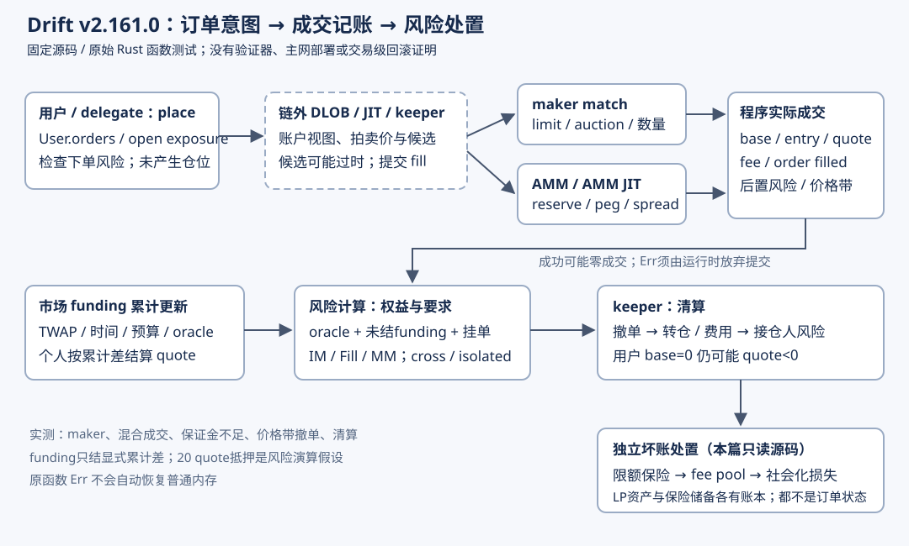

## 1. 问题与结论：订单成功，为什么没有仓位？ {#question}

下单成功只表示订单请求通过了该路径的检查。订单可能仍在拍卖、没有可成交对手价、仅部分成交，或在后续 keeper 调用中被取消。**已成交数量、仓位变化和 fill 记录必须一起核对**；SDK 返回签名、发送成功甚至链上指令成功，都不等于买到目标数量。

本文围绕下单→成交→仓位与费用→资金费→价格变化→清算展开。实际实验执行固定提交的原始 Rust 库测试，包含 maker 成交、maker+AMM 混合成交、保证金不足错误、预言机价格带保护及清算。资金费是在同一成交测试后调用原结算函数，累计费率由夹具显式输入；并未运行定时费率更新。下单入口、签名、账户权限、SBF 执行与交易原子性只读源码，未用验证器执行。下面逐项区分实测与源码推演。

### 版本与适用范围

核查日 **2026-11-19 UTC**，保存官方 API 原始响应与固定源码。以下“最新”只对应这次查询，不保证阅读日仍成立。

| 对象 | 固定版本/日期 | 使用边界 |
| --- | --- | --- |
| 程序 | 最新正式非预发布 [v2.161.0](https://github.com/drift-labs/protocol-v2/releases/tag/v2.161.0)，2026-03-30发布；提交 `d686955cdc0d02ca4647c8fc71dac1dc4ed9c269`，2026-03-27 | 本文原始程序逻辑与测试基线 |
| 较新官方标签 | [v2.162.0](https://github.com/drift-labs/protocol-v2/tree/0d35029d780b5faf8b80fce84053e862802badc1)，2026-04-01，`0d35029d780b5faf8b80fce84053e862802badc1` | 未列为正式 release；其 [lib.rs](https://github.com/drift-labs/protocol-v2/blob/0d35029d780b5faf8b80fce84053e862802badc1/programs/drift/src/lib.rs#L240) 注释下单/成交等指令，故不作为可执行主线；已查而非漏查 |
| SDK 稳定包 | npm `@drift-labs/sdk@2.156.0`，2026-01-27发布；对应官方 tag `bcaf43e605b5cb501906d3e1147d4ddb4010105b`（提交2026-01-27 UTC） | npm 未给 gitHead；包内227个源码文件均与固定 tag逐字节相等，tarball完整性通过；不声称发布流水线证明。包内 VERSION 残留 `2.156.0-beta.6`，不能覆盖 npm 版本身份 |
| SDK latest | 查询为 `2.163.0-beta.13`、gitHead `d778a2be41ca507f128e7f8cf81caef40c17b363` | 测试版，不当稳定 SDK，也不推断程序部署版本 |
| GMX 有限对照 | [gmx-synthetics v2.2](https://github.com/gmx-io/gmx-synthetics/releases/tag/v2.2)，2025-09-09；`ee721b7e2d1891312dde52964d774144208cd1a0` | 仅源码架构对照，无 GMX 执行实验 |

官方 Drift GitHub 地址目前重定向到 `velocity-exchange/protocol-v2`，API 标记 `archived: true`。保留这个观察，不能从旧文档推断仍有持续维护或生产服务可用。完整性与源码核对方法见第7节。

程序 [declare_id 与入口](https://github.com/drift-labs/protocol-v2/blob/d686955cdc0d02ca4647c8fc71dac1dc4ed9c269/programs/drift/src/lib.rs#L60-L80) 和 Anchor.toml localnet 都使用 `dRiftyHA39MWEi3m9aunc5MzRF1JYuBsbn6VPcn33UH`。相同 Program ID 不能证明相同部署字节码。仓库 `.verified-build.json` 还指向另一个提交 `8d2cd726afdc800f89c841ff3cf1968980719df0`，本次没有查升级槽、ProgramData 或链上 ELF，因此结论限**固定源码/本地实现**，不代表当前主网程序及参数。

工具链分两层：[官方 CI](https://github.com/drift-labs/protocol-v2/blob/d686955cdc0d02ca4647c8fc71dac1dc4ed9c269/.github/workflows/main.yml#L13-L18) 写 Rust1.70.0、Solana1.16.27，Anchor CLI安装0.29.0；[Cargo依赖](https://github.com/drift-labs/protocol-v2/blob/d686955cdc0d02ca4647c8fc71dac1dc4ed9c269/programs/drift/Cargo.toml)锁 anchor-lang/spl0.29.0、solana-program1.16.25。本文实际宿主编译为 macOS arm64/Rust1.85.0，使用官方 lock 解析；没有安装或调用 Anchor CLI、Solana CLI/validator，不能说已复现官方 SBF 构建。

## 2. 最小模型：价格发现、风险承担与保险分开 {#model}

前置术语见[永续合约导读](./README.md)，Solana 账户和交易基础见[程序](../../solana/program.md)与[交易](../../solana/transaction.md)。



| 维度 | 固定 Drift 实现 | 不能推出什么 |
| --- | --- | --- |
| 订单簿 | `User.orders` 存链上订单；SDK 的 [DLOB](https://github.com/drift-labs/protocol-v2/blob/bcaf43e605b5cb501906d3e1147d4ddb4010105b/sdk/src/dlob/DLOB.ts) 在链外重建并找候选 | DLOB 的排序/候选不是程序已接受的 fill |
| JIT与拍卖 | 订单带起止拍卖价、duration、slot；即时 maker 提交报价/成交交易，程序验证当前价格与订单条件 | 拍卖不是另一条最终结算账本；外部JIT maker与AMM JIT分支不同 |
| AMM/vAMM | [fulfillment选择](https://github.com/drift-labs/protocol-v2/blob/d686955cdc0d02ca4647c8fc71dac1dc4ed9c269/programs/drift/src/math/fulfillment.rs)组合 maker match 与 AMM；AMM有虚拟储备、peg、spread、库存与oracle保护 | 储备乘积不能单独给出所有实际成交价，也不代表逐笔交换底层 base token |
| LP与库存 | [LPPool/Constituent](https://github.com/drift-labs/protocol-v2/blob/d686955cdc0d02ca4647c8fc71dac1dc4ed9c269/programs/drift/src/state/lp_pool.rs)及[LP管理](https://github.com/drift-labs/protocol-v2/blob/d686955cdc0d02ca4647c8fc71dac1dc4ed9c269/programs/drift/src/instructions/lp_admin.rs)另管资产、目标库存和AUM | “有LP”不能推出所有订单都直接对LP池成交；本实验不运行LP池 |
| 保险与亏损 | perp保险索赔额度、quote spot保险金库和破产结算 | 保险不是撮合对手方，也没有无限偿付承诺 |

这里称“混合”有具体含义：某次 fulfill 可以先后消耗 maker 与 AMM 可用量；不是把几种协议标签并列。实验的混合成交中，taker买1 base，maker卖0.5，另0.5进入 `base_asset_amount_with_amm`；成交与手续费按各段更新。拍卖/价差/AMM可用性会改变分配顺序。原日志解码后实际有三段，不能合并成一个“成交价100”的想象成交：

| 次序 | 分支 | base原始量 | quote原始量 | taker fee | filler奖励 |
| --- | --- | ---: | ---: | ---: | ---: |
| 1 | AMM | 4999000 | 499926 | 250 | 25 |
| 2 | maker match | 500000000 | 50005000 | 25003 | 2500 |
| 3 | AMM | 495001000 | 49751332 | 24876 | 2487 |

各段base合计1e9、quote合计100256258、fee合计50129。taker最终entry=-100256258、quote=-100306387；maker返佣15001。Python独立复算各段fee/返佣、分配和数量总和，AMM曲线本身仍只由原控制器与断言验证。

GMX v2.2 的[ExecuteOrderUtils.executeOrder](https://github.com/gmx-io/gmx-synthetics/blob/ee721b7e2d1891312dde52964d774144208cd1a0/contracts/order/ExecuteOrderUtils.sol)读取 oracle 市场价格、更新 funding/borrowing、调用执行器并校验池余额；[MarketUtils](https://github.com/gmx-io/gmx-synthetics/blob/ee721b7e2d1891312dde52964d774144208cd1a0/contracts/market/MarketUtils.sol)维护 market pool 的资金和风险，[PositionUtils](https://github.com/gmx-io/gmx-synthetics/blob/ee721b7e2d1891312dde52964d774144208cd1a0/contracts/position/PositionUtils.sol)计算仓位与费用。这个入口围绕池、oracle和订单执行，不等同Drift的DLOB maker选择。比较只证明这组入口/资金模型不同，不比较收益、安全性或当前线上流动性，不套用旧GLP介绍。

## 3. 状态与数学：费用和资金费落在哪里？ {#state-math}

### 字段、单位与方向

[constants.rs](https://github.com/drift-labs/protocol-v2/blob/d686955cdc0d02ca4647c8fc71dac1dc4ed9c269/programs/drift/src/math/constants.rs#L10-L42)和[PerpPosition](https://github.com/drift-labs/protocol-v2/blob/d686955cdc0d02ca4647c8fc71dac1dc4ed9c269/programs/drift/src/state/user.rs#L1130-L1245)为准；源码旧注释中个别精度不一致时，按参与计算的常量和算式核对。

| 字段或量 | 精度/含义 |
| --- | --- |
| `base_asset_amount` | `BASE_PRECISION=1e9`；正为long，负为short；表示合约敞口，不是钱包base token余额 |
| price / oracle price | `PRICE_PRECISION=1e6`，每base的quote价格 |
| `quote_asset_amount`、entry、break-even、fee、funding payment | `QUOTE_PRECISION=1e6`；long开仓的quote记账为负，short为正 |
| `quote_entry_amount` | 与当前未平仓数量相关的成交成本；减仓/反转会重新分摊，不是全部历史现金流水 |
| `quote_break_even_amount` | 成交成本加该仓位的费用/资金费等调整；不能仅据字段名将其当实时可成交平仓价 |
| `open_bids / open_asks / open_orders` | 未成交bid数量为正、ask数量为负和订单数；影响最坏情况风险 |
| `cumulative_funding_rate_long/short` | `PRICE_PRECISION×FUNDING_RATE_BUFFER=1e9`，累计每base价格转移量；**不是直接以1e9缩放的无量纲百分比** |
| IM/MM/Fill比率 | `MARGIN_PRECISION=10000`；本夹具1000/500/750，即10%/5%/7.5%，不是主网固定参数 |
| spot `scaled_balance` | 还要结合market累计存借指数、decimals与balance type；不是直接除以1e6 |

仓位估值简式（普通非prediction perp、quote=1、无额外挂单）为：

```text
position_pnl_raw = trunc_toward_zero(base_raw × oracle_price_raw / 1e9) + quote_asset_amount
notional_raw = abs(base_raw) × oracle_price_raw / 1e9
margin_requirement_raw = floor(worst_case_liability_raw × margin_ratio / 10000)
```

完整[风险计算](https://github.com/drift-labs/protocol-v2/blob/d686955cdc0d02ca4647c8fc71dac1dc4ed9c269/programs/drift/src/math/margin.rs#L140-L231)先加未结资金费，再算最坏挂单方向、quote保守估值、正PNL权重与open-order附加要求；[get_margin_ratio](https://github.com/drift-labs/protocol-v2/blob/d686955cdc0d02ca4647c8fc71dac1dc4ed9c269/programs/drift/src/state/perp_market.rs#L461-L525)还涉及size/IMF、自定义和高杠杆规则。Fill 基础比率是 `(IM+MM)/2`，增险 fill 并非一律重新使用10% IM；减险可能允许MM。不能将简式推广到所有账户。

### 实测A：一对maker/taker，费用可独立复算

原测试 `long_taker_order_fulfilled_start_of_auction`：taker long 1 base，maker post-only short 1 base，maker价100；taker拍卖100→200、duration5、order slot0、执行slot1，成交价仍取被接受的maker价100。调用原 `fulfill_perp_order_with_match`，并未执行下单/账户层保证金校验。该小测试没有抵押资产，不能据此说零抵押也能在链上成交。

费率夹具为taker5/10000、maker返佣3/10000，无filler/referrer/builder。依[fees.rs](https://github.com/drift-labs/protocol-v2/blob/d686955cdc0d02ca4647c8fc71dac1dc4ed9c269/programs/drift/src/math/fees.rs#L161-L213)，taker基准fee向上取整，maker基准rebate向下取整：

```text
成交quote = 1e9 × 100e6 / 1e9 = 100000000
taker fee = ceil(100000000 × 5 / 10000) = 50000      (0.05 quote)
maker rebate = floor(100000000 × 3 / 10000) = 30000 (0.03 quote)
市场剩余 = 50000 - 30000 = 20000                     (0.02 quote)
```

| 成交后字段 | taker | maker |
| --- | ---: | ---: |
| base | 1000000000 | -1000000000 |
| quote entry | -100000000 | 100000000 |
| quote asset / break-even | -100050000 | 100030000 |
| open bids/asks、open orders | 0 | 0 |

taker入场价100，含已记fee的break-even为100.05，oracle=100时PNL=-0.05；maker盈亏为+0.03。两方PNL和为-0.02，对应市场已收费用，不能遗漏费用后声称完全零和。

### 同一仓位结算资金费

夹具显式把long累计值从0改为 `10000000`（每base0.01 quote），调用原 `settle_funding_payment`。[原公式](https://github.com/drift-labs/protocol-v2/blob/d686955cdc0d02ca4647c8fc71dac1dc4ed9c269/programs/drift/src/math/funding.rs#L141-L181)先取绝对值作U192乘除，再恢复符号，最后从base精度转quote精度：

```text
magnitude = floor(floor(abs(delta) × abs(base) / 1e6) / 1000)
payment_raw = trunc_toward_zero(sign × magnitude / 1000)
long遇正delta：sign=-1；short遇正delta：sign=+1
本例payment = -10000 = -0.01 quote
```

结算后taker `quote_asset_amount = quote_break_even_amount = -100060000`；entry仍-100000000；last累计值更新到10000000，`cumulative_perp_funding=-10000`，市场 `net_unsettled_funding_pnl` 增10000。同一累计值再结算一次不重复收费。这里没有按“持仓时长×当前费率”重算历史；累计差才是输入。实际费率生成还有第5节的TWAP、偏移、限幅和不平衡预算，本例没有实测这些。

### 价格变化与风险（其中20 quote抵押是独立演算假设）

同一成交+funding后的仓位，调用原 `calculate_perp_position_value_and_pnl` 得到下表position-only结果；另外**假设**一个权重100%的20 quote存款、无借款/其他仓位/挂单，独立Python把它加到PNL上，不声称跑了存款交易或整账户风险计算。

| oracle价格 | position PNL | 假设总抵押权益 | IM10% | Fill7.5% | MM5% | 风险判断 |
| --- | ---: | ---: | ---: | ---: | ---: | --- |
| 100 | -0.06 | 19.94 | 10 | 7.5 | 5 | 三项均足 |
| 90 | -10.06 | 9.94 | 9 | 6.75 | 4.5 | 仍满足IM，亏损已侵蚀缓冲 |
| 84 | -16.06 | 3.94 | 8.4 | 6.3 | 4.2 | 低于MM，具备风险不足条件 |

理想连续边界 `20 + P - 100.06 = 0.05P` 得 `P=80.06/0.95≈84.27368421`。实际协议还取整、计挂单、附加清算buffer、选择cross/isolated风险域及校验oracle，所以它是**所列假设下的边界演算**，不是对账户报出的保证清算价。

## 4. 完整主路径：谁触发，什么状态可观察？ {#path}

| 阶段 | 触发者与权限 | 主要读写 | 可观察结果 |
| --- | --- | --- | --- |
| place | 用户authority或允许的delegate签名；Anchor `PlaceOrder`约束 | 读State、市场、oracle和账户风险；写User订单、next id、open exposure | Place `OrderActionRecord`、`OrderRecord`；仓位base尚未因挂单增加 |
| 链外候选/拍卖 | DLOB/keeper/JIT参与者观察账户并构造交易 | 链外订单视图，slot和报价；未直接提交链上仓位 | 候选/报价只表明愿意执行，可能过时 |
| fill | keeper签署其filler账户；不要求目标user再次签名 | 写User/UserStats、maker及stats、PerpMarket；读spot抵押与oracle，可能写referrer/builder escrow | 实际fill数量、费用、仓位变化及Fill记录；也可能成功返回0 |
| 更新funding | keeper调用更新；受State/市场暂停、时间和oracle约束 | 写AMM长短累计值、TWAP、revenue | `FundingRateRecord`，个人仓位不必同时全量遍历 |
| settle funding | 单独结算入口或fill/清算前调用 | 写User quote/break-even/last累计和market未结funding | `FundingPaymentRecord`；不自动等于quote token提款 |
| liquidate | 清算人签其账户，负担接仓风险；不需要被清算人授权 | 读风险域和oracle；撤挂单，转base/quote、费用，更新user状态与market | `LiquidationRecord`；可能仅撤单就恢复风险，也可能仓位清零后仍有负quote |
| bankruptcy | 独立keeper处理及vault上下文 | 保险额度/金库、fee pool、累计funding、坏账 | 亏损处置记录；不能从“清算成功”推断没有坏账 |

权限入口见 [PlaceOrder](https://github.com/drift-labs/protocol-v2/blob/d686955cdc0d02ca4647c8fc71dac1dc4ed9c269/programs/drift/src/instructions/user.rs#L4865-L4876)、[FillOrder等keeper账户](https://github.com/drift-labs/protocol-v2/blob/d686955cdc0d02ca4647c8fc71dac1dc4ed9c269/programs/drift/src/instructions/keeper.rs#L3755-L3810)及[清算账户](https://github.com/drift-labs/protocol-v2/blob/d686955cdc0d02ca4647c8fc71dac1dc4ed9c269/programs/drift/src/instructions/keeper.rs#L3910-L3950)。只看controller会跳过Anchor signer、账户owner/关联性约束和remaining accounts加载，实际集成必须同时追这些边界。

普通 place 由[handle_place_perp_order](https://github.com/drift-labs/protocol-v2/blob/d686955cdc0d02ca4647c8fc71dac1dc4ed9c269/programs/drift/src/instructions/user.rs#L2320-L2367)加载市场/oracle映射，拒绝普通入口的IOC，转 [place_perp_order](https://github.com/drift-labs/protocol-v2/blob/d686955cdc0d02ca4647c8fc71dac1dc4ed9c269/programs/drift/src/controller/orders.rs#L96-L462)：校验user/market状态、订单槽与唯一user id、规范化step/tick、拍卖/trigger参数，写订单及open exposure，做下单风险与OI约束后发记录。TryPostOnly可在特定不满足条件时直接成功返回；这也说明成功不是实际挂入或成交证明。

fill由[keeper入口](https://github.com/drift-labs/protocol-v2/blob/d686955cdc0d02ca4647c8fc71dac1dc4ed9c269/programs/drift/src/instructions/keeper.rs#L114-L210)加载writable market及maker映射，更新AMM后进入 [fill_perp_order](https://github.com/drift-labs/protocol-v2/blob/d686955cdc0d02ca4647c8fc71dac1dc4ed9c269/programs/drift/src/controller/orders.rs#L990-L1430)。它查目标open order、先结资金费、查暂停/触发/清算状态，筛掉不合格maker、取oracle有效性/AMM可用性；随后内部fulfill选择AMM或match、逐段更新仓位与订单，再做fill后风险与价格带检查。缺少订单的keeper外层分支甚至可返回成功；必须核对结果。

读取状态也有异步边界：订阅断线或slot分叉时，某个DLOB快照与执行时账户可能不同。处理端以链上订单id、User地址、市场、记录id/交易签名及具体日志序号关联，并按确认等级回查；不能用SDK请求参数覆盖实际fill，也不能只用slot去重。交易日志可能包含失败前生成的记录，应结合交易错误和最终账户状态判断是否提交，见[Solana数据路径](../../solana/data-path.md)。

## 5. 源码定位：成交后检查为什么不能省？ {#source}

所有SRC链接均固定v2.161.0提交；复验脚本检查文件和行范围，并确认生产Rust未修改。

| 问题 | 固定入口 | 需要连起来看的逻辑 |
| --- | --- | --- |
| maker与AMM如何分段 | [fulfill_perp_order](https://github.com/drift-labs/protocol-v2/blob/d686955cdc0d02ca4647c8fc71dac1dc4ed9c269/programs/drift/src/controller/orders.rs#L1768-L2130)、[fulfillment.rs](https://github.com/drift-labs/protocol-v2/blob/d686955cdc0d02ca4647c8fc71dac1dc4ed9c269/programs/drift/src/math/fulfillment.rs) | 当前有效maker价、拍卖与AMM可用性决定方法；数量合计与base/quote一致性检查 |
| match到底改什么 | [fulfill_perp_order_with_match](https://github.com/drift-labs/protocol-v2/blob/d686955cdc0d02ca4647c8fc71dac1dc4ed9c269/programs/drift/src/controller/orders.rs#L2604-L3093)、[position.rs](https://github.com/drift-labs/protocol-v2/blob/d686955cdc0d02ca4647c8fc71dac1dc4ed9c269/programs/drift/src/controller/position.rs) | 先可选AMM JIT，再maker/taker方向与限制价校验、资金量/fee分配、仓位成本、order filled和Fill记录 |
| AMM如何给价 | [fulfill_perp_order_with_amm](https://github.com/drift-labs/protocol-v2/blob/d686955cdc0d02ca4647c8fc71dac1dc4ed9c269/programs/drift/src/controller/orders.rs#L2185-L2568) | reserve/peg/spread、step与limit、库存上限、surplus和费用，不能只用oracle现价成交 |
| 成交后还有什么 | [fulfill后风险](https://github.com/drift-labs/protocol-v2/blob/d686955cdc0d02ca4647c8fc71dac1dc4ed9c269/programs/drift/src/controller/orders.rs#L1978-L2126) | 增险taker通常Fill门槛；maker依是否减险选择门槛；stale-for-margin时可能100%要求或限制OI不增加 |
| 风险怎么汇总 | [margin.rs](https://github.com/drift-labs/protocol-v2/blob/d686955cdc0d02ca4647c8fc71dac1dc4ed9c269/programs/drift/src/math/margin.rs#L260-L700)、[MarginCalculation](https://github.com/drift-labs/protocol-v2/blob/d686955cdc0d02ca4647c8fc71dac1dc4ed9c269/programs/drift/src/state/margin_calculation.rs) | spot存借/指数、worst-case订单、perp估值/未结funding、cross与isolated域、正PNL权重；不能直接加所有名义余额 |
| oracle保护 | [oracle_validity](https://github.com/drift-labs/protocol-v2/blob/d686955cdc0d02ca4647c8fc71dac1dc4ed9c269/programs/drift/src/math/oracle.rs#L309-L400)、[is_oracle_valid_for_action](https://github.com/drift-labs/protocol-v2/blob/d686955cdc0d02ca4647c8fc71dac1dc4ed9c269/programs/drift/src/math/oracle.rs#L147-L228) | 非正、过度波动、置信区间、陈旧和样本不足分级；不同action容忍不同，不是统一布尔开关 |
| 更新与个人结算 | [update_funding_rate](https://github.com/drift-labs/protocol-v2/blob/d686955cdc0d02ca4647c8fc71dac1dc4ed9c269/programs/drift/src/controller/funding.rs#L156-L314)、[settle_funding_payment](https://github.com/drift-labs/protocol-v2/blob/d686955cdc0d02ca4647c8fc71dac1dc4ed9c269/programs/drift/src/controller/funding.rs#L31-L89) | 市场累计值更新与个人last累计差结算分开；账面funding与quote资产结算/提款分开 |
| 清算与坏账 | [liquidate_perp](https://github.com/drift-labs/protocol-v2/blob/d686955cdc0d02ca4647c8fc71dac1dc4ed9c269/programs/drift/src/controller/liquidation.rs#L78-L300)、[resolve_perp_bankruptcy](https://github.com/drift-labs/protocol-v2/blob/d686955cdc0d02ca4647c8fc71dac1dc4ed9c269/programs/drift/src/controller/liquidation.rs#L3317-L3543) | 清算域/权限/暂停→结funding→风险→撤单→oracle→转仓→清算人风险；破产另走保险/fee pool/社会损失 |

有代表性的后置检查是：

```rust
// fulfill_perp_order：仓位已经按候选成交发生了内存变化
if !maker_margin_calculation.meets_margin_requirement() {
    // 先记录要求与抵押，再将错误传回指令入口
    return Err(ErrorCode::InsufficientCollateral);
}
```

它必须在知道实际成交量、费用和剩余挂单后再检查。Rust函数返回Err不会自动撤销它已改的普通内存；Solana交易失败的账户提交规则属于运行时层。实验B正是为了观察这个差别。

oracle还有[价格带校验](https://github.com/drift-labs/protocol-v2/blob/d686955cdc0d02ca4647c8fc71dac1dc4ed9c269/programs/drift/src/controller/orders.rs#L1431-L1491)和fill后保护；不能只检查一个 `delay` 字段。AMM即时成交、低风险成交与maker match允许的oracle状态不同；过期oracle并非任何动作必然统一失败。原oracle分类函数中数值转型也可能提前返回算术错误，应把实际错误上下文一并保存，不从枚举名单推断所有非法输入一定落到某个可读错误。

funding更新先检查时钟、暂停与 `block_operation`，更新mark/oracle TWAP；以价格差加入offset、按contract tier限幅，按period折算，再由[calculate_funding_rate_long_short](https://github.com/drift-labs/protocol-v2/blob/d686955cdc0d02ca4647c8fc71dac1dc4ed9c269/programs/drift/src/math/funding.rs#L20-L139)处理长短不平衡。协议补贴受fee pool预算约束，长短累计值可能不同；不能默认所有多头付给所有空头严格对称。TWAP/offset/限幅是此版本规则，不是永续合约定义。个人结算用[update_quote_asset_and_break_even_amount](https://github.com/drift-labs/protocol-v2/blob/d686955cdc0d02ca4647c8fc71dac1dc4ed9c269/programs/drift/src/controller/position.rs)，保留entry成本并更新break-even。

清算也不是固定“跌到阈值、一次全平”。本版本按cross或isolated范围算风险，已在清算状态的账户还要满足buffer才能退出；先撤单可能释放额度，随后才按shortage、时间分批比例、最大接仓量、step、liquidator fee和IF fee选转移量，并校验清算人风险。价格/时间/仓位等输入不同可走不同分支。本实验C只覆盖下述完全转仓例。

## 6. 失败与边界：错误、撤单和坏账分别看 {#failures}

### 实验B：maker保证金不足，函数返回Err但内存已改

运行上游 `maker_insufficient_collateral`：oracle100，taker有100 quote、买1 base；maker有10 quote、以95卖1 base，IM10%/MM5%。原fulfill在match后发现maker风险不满足，返回 `InsufficientCollateral`。实际maker权益 `10 + 95.0285 - 100 = 5.0285`，低于7.5 quote门槛；taker quote中间值为-95.0475，maker为95.0285。完整输出保留程序打印的requirement、total_collateral及前后观察。

这个测试不是Solana交易，错误后的taker/maker仍可持有中间仓位变化；`takerUnchanged/makerUnchanged`用于如实报告，不要求伪造为true。**本次没有交易级回滚证据**。上线交易应由运行时在Err时丢弃账户写入，若要证明它，须另用同版本SBF或program-test执行指令、比较全账户字节与交易元数据。这里仅证明真实控制器检测到保证金不足并把错误返回，不能用调用者手动恢复快照冒充运行时回滚。

### 预言机价格带：成功返回0，maker被取消

上游 `maker_order_canceled_for_breaching_oracle_price_band` 实际走 `fill_perp_order`：oracle100而maker ask50，taker最多买价50；保护分支取消maker，返回base fill0，断言maker订单槽可复用。它的可观察结果是**保护性撤单/零成交**，不是整笔交易返回错误。说明业务状态不能只看Result是否Ok。

本例未覆盖所有stale/confidence或实际oracle喂价签名校验；Pyth账户是原测试内存夹具，不是联网获取的生产价格源。

### 实验C：清算后仍有负quote

原 `successful_liquidation_long_perp` 独立夹具：用户long1 base、quote=-150，无spot抵押，oracle100；清算人存50 quote。初始清算比例设100%，最大接仓1 base，liquidator fee1%，IF fee上限1%，该分支实际IF fee为0。原 `liquidate_perp` 撤掉用户挂单并转移整份base：

```text
user:       base 1 → 0；quote -150 → -51；open_orders 1 → 0
liquidator: base 0 → 1；quote    0 → -99
```

按100估值：清算人接仓带来1 quote优惠；用户损失从-50变-51。剩下的-51没有因为base归零而消失。本例未继续调用保险或破产函数，不宣称保险赔付已执行。

[破产源码](https://github.com/drift-labs/protocol-v2/blob/d686955cdc0d02ca4647c8fc71dac1dc4ed9c269/programs/drift/src/controller/liquidation.rs#L3317-L3543)依次尝试：受 `quote_max_insurance - quote_settled_insurance` 和保险金库余额减1限制的支付；再用可用fee pool覆盖；余损经累计funding差额社会化，并记录 `total_social_loss` 和清除坏账。实际vault转账由keeper指令层完成；原controller返回支付量不等于SPL转账已发生。这个路径不应写成所有协议都采用的ADL，也不代表保险足够覆盖极端事件。

重试时先读回订单与仓位：重复fill可能发现订单不存在，重复funding只应结新增累计差；清算订单可能已被其他keeper消费。账户锁和slot变化仍可能导致竞争，本文没有测吞吐、keeper激励竞争或链上抢跑。

## 7. 复现实验：固定原代码，保留真实输出 {#reproduce}

实验目录保留 [run.py](/examples/drift-position/run.py)、[prepare.py](/examples/drift-position/prepare.py)、[check_math.py](/examples/drift-position/check_math.py) 与 [result.json](/examples/drift-position/result.json)；其余输入与输出未随仓库提供。运行时不依赖站点目录。

```bash
# 在独立临时目录执行；Rust1.85.0，C编译器/链接器由宿主提供
# CARGO_HOME/RUSTUP_HOME可指向专用临时目录，避免改动全局工具链
git clone --branch v2.161.0 --depth 1 https://github.com/drift-labs/protocol-v2.git protocol-v2
cd protocol-v2
git rev-parse HEAD
# 必须为 d686955cdc0d02ca4647c8fc71dac1dc4ed9c269
cd ..
python3 run.py protocol-v2
python3 check_math.py
```

`prepare.py`只在这个独立checkout中重置并修改两份上游test文件及一份test_utils夹具，增加打印与原funding/position-risk函数调用；另对 `test_utils.rs` 的Anchor账户缓冲区作宿主对齐修正，使8字节discriminator后的payload满足 `align_of<T>()`，保持字节、字段和业务参数相同；不改生产controller、风险计算或fees。运行前检查提交，生成patch与所有本地Rust源码哈希；原测试的断言保留。`run.py`每个case用 `--exact --nocapture --test-threads=1`，断言恰好1个test通过，保存命令、输出和观察，防止过滤错了却零测试通过。cargo始终使用 `--locked`。

| 实际执行 | 证据含义 | 不覆盖 |
| --- | --- | --- |
| maker match | 原仓位/费用/order更新，追加funding与risk观察 | 下单、账户权限、整账户保证金 |
| maker+AMM | 原fulfill与内部post-fill风险校验 | 外部DLOB/JIT服务、真实网络交易 |
| maker抵押不足 | 原fulfill返回InsufficientCollateral及中间内存 | 交易原子回滚 |
| oracle价格带 | 原fill取消maker、零成交 | 生产oracle网络与所有guard rail |
| perp清算 | 原清算控制器撤单/转仓/费用 | 保险支付、SPL转账、主网参数 |

Python还以固定IDL子集独立解码12个原始Borsh事件（含费用、funding、保护性撤单和清算），检查完整载荷消费及事件/状态一致。失败控制器也已在Err之前发出Fill记录，故仅见事件不能证明提交成功。Python复算只消费原始日志提取的整数及固定输入，不调用Rust/SDK数学，核对成交fee/返佣、funding符号/取整、不重复结算、三个价格下IM/Fill/MM及清算转仓守恒。混合成交的复杂AMM路径由原断言与状态记录证明，复算器不冒称完整独立重建所有AMM曲线/价差算法。

首次环境检查无rustc/cargo/anchor/solana。实际安装Rust仅在 `/tmp`，完整构建日志、原始官方响应与最终清单另见仓库 `wiki/plans/drift-position-verification.md`。依赖获取或编译出现的实际问题也保留，不以安装成功代替测试成功。

## 8. 工程取舍与证据边界 {#tradeoffs}

工程端至少保存订单标识、实际fill、手续费、仓位成本与quote调整的独立字段；把oracle输入及有效性、margin mode、确认等级和时钟放进同一个诊断快照。预估风险应采用与执行版本一致的整数规则，识别open orders、未结funding、正PNL折扣和quote估值；UI显示的连续清算价只能作提示。

| 结论 | 证据类型/核验情况 | 精确限制 |
| --- | --- | --- |
| 发布、tag、SDK标签不一一对应 | 官方API/npm响应与固定Git文件，已核查 | 未证明链上部署、npm发布流水线或生产可用性 |
| maker/AMM成交与费用 | 固定原Rust控制器与上游断言，实际执行 | 宿主函数，不是SBF或完整指令 |
| funding累计差改变quote/break-even | 原settle函数实测+Python整数复算 | 累计值显式输入，费率生成只读源码 |
| 风险随价格变化 | 原position-risk函数+独立加20抵押假设 | 未存入20 quote；没有整账户端到端清算资格测试 |
| maker保证金不足被拒绝 | 原fulfill错误与内存观察，实际执行 | 未证明交易级回滚；函数中间写入可能保留 |
| 清算与破产不是同一状态 | 原清算测试及破产源码 | 本例没有继续运行坏账/保险支付 |
| GMX池执行模型与Drift有差异 | 固定GMX源码核对 | 无GMX执行、主网、收益或安全性比较 |

没有验证的项目包括：当前链上ELF/升级授权、主网账户参数、SBF可复现构建、生产oracle、实际签名下单/confirmation、权限攻击用例、LP池、builder/referral全部费用、所有isolated/high-leverage分支、资金费生成及保险/社会化损失执行、Linux与线上HTTP。不要把本地函数通过写成这些集成都成立。

继续阅读[共用术语](./README.md)、[Solana数据可见性](../../solana/data-path.md)。这里的指标与状态变化只属于本文固定实现，其他永续协议应重新核查其源码或公开接口边界。
