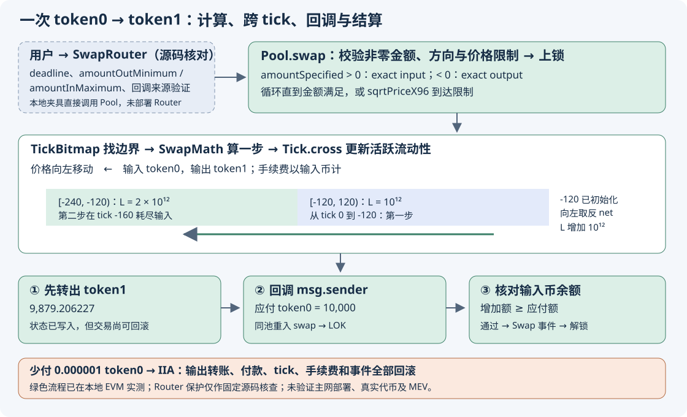

# Uniswap V3：跨 Tick Swap 与回调结算

## 1. 问题与结论 {#question}

为什么投入 10,000 个 token，报价却不能直接用当前价格相乘？价格经过一个 tick 时，流动性、手续费和最终到账怎样改变？输出已经转走，Pool 怎样保证自己收到输入？

V3 在当前活跃流动性不变的区间内计算一段交换，遇到已初始化 tick 就切换流动性，继续计算。金额满足或到达价格限制后，Pool 先给接收者输出，再回调调用者收取输入，最后检查输入币余额；付款不足会使整笔交易回滚。**跨 tick 是分段计算，结算是一次 EVM 原子事务。** 下文正常案例收到 `9,879.206227 token1`；付款少一个最小单位则触发 `IIA`，此前转账与状态修改全部撤销。[Pool.swap 固定源码](https://github.com/Uniswap/v3-core/blob/ed88be38ab2032d82bf10ac6f8d03aa631889d48/contracts/UniswapV3Pool.sol#L596-L788)

### 版本与适用范围 {#versions}

核查日：**2026-11-19**。按官方仓库所声明的 npm 包，读取 `dist-tags.latest` 对应发布、`gitHead` 和版本时间，冻结如下基线。两个仓库的 GitHub `releases/latest` 均返回 404，因此不把 GitHub 标签或教程日期当作最新 npm 发布。这里的“最新”限定为核查日这两个 **V3 包的稳定发布**，不表示整个 Uniswap 产品线停留在 V3。

| 部件 | 最新适用发布及发布时间（UTC） | 固定源码提交 | 本文用途 |
| --- | --- | --- | --- |
| `@uniswap/v3-core` | `1.0.1`，2022-01-26 | `ed88be38ab2032d82bf10ac6f8d03aa631889d48` | Factory/Pool 发布字节码、本地部署及数学库 |
| `@uniswap/v3-periphery` | `1.4.4`，2023-09-27 | `697c2474757ea89fec12a4e6db16a574fe259610` | 经典 `SwapRouter`、付款和来源验证的源码核对；未部署 Router |

来源：[core 包元数据](https://registry.npmjs.org/@uniswap/v3-core/latest)、[periphery 包元数据](https://registry.npmjs.org/@uniswap/v3-periphery/latest)、[core 包声明](https://github.com/Uniswap/v3-core/blob/ed88be38ab2032d82bf10ac6f8d03aa631889d48/package.json)、[periphery 包声明](https://github.com/Uniswap/v3-periphery/blob/697c2474757ea89fec12a4e6db16a574fe259610/package.json)。这些地址中的 `latest` 会变化，复核本篇以保存的 JSON 和固定提交为准。

实验为无外部 RPC 的进程内 EVM，`chainId=1337`、Istanbul 规则、两种自建 6 位精度代币。部署 npm 发布包中的 Factory，由 Factory 创建 Pool；用固定 core 源码和原编译参数重编，**Factory 与 Pool 的 creation bytecode 均逐字节匹配 npm artifact**，见源码对应检查。Pool 创建码哈希为 `0xe34f199b19b2b4f47f68442619d555527d244f78a3297ea89325f843f87b8b54`，也与 periphery 的 [PoolAddress 常量](https://github.com/Uniswap/v3-periphery/blob/697c2474757ea89fec12a4e6db16a574fe259610/contracts/libraries/PoolAddress.sol#L6)一致。这里不声称验证了任何主网地址的运行字节码；本地地址和收据保存在实验结果中。

## 2. 最小心智模型 {#model}



**Router 组织用户意图，Pool 执行一个池的交换。** 本文选定的 `SwapRouter` 负责 deadline、路径、付款人、输出下限或输入上限，并在回调中验证调用者确实是指定 Factory 的池。它可以在 Pool 成功后继续校验；校验失败仍回滚整笔调用。Pool 不知道用户能接受的最终滑点，只接收方向、有符号金额、价格限制和回调数据。[Router 源码](https://github.com/Uniswap/v3-periphery/blob/697c2474757ea89fec12a4e6db16a574fe259610/contracts/SwapRouter.sol#L57-L129)

Pool 回调的是 `msg.sender`，输出接收者是 `recipient`，两者可以不同。回调参数是 **Pool 视角的余额变化**：正数表示调用者应付池子的金额，负数表示池子已付出的金额。真实 Router 通常通过 `transferFrom(payer, pool, value)` 按实际欠款拉取 ERC-20；本地实验用已持币的夹具付款。[付款分支](https://github.com/Uniswap/v3-periphery/blob/697c2474757ea89fec12a4e6db16a574fe259610/contracts/base/PeripheryPayments.sol#L48-L68)

“跨 tick”也有两层：价格经过普通整数 tick 不必更新流动性；命中 **initialized tick** 才调用 `Tick.cross`。初始化表示这里有头寸边界，不能仅凭价格变化超过一个 tick 判断跨越了流动性边界。

## 3. 状态、单位与可复算的一笔交换 {#math}

### 价格与流动性的表示 {#units}

| 字段或量 | 含义与单位 |
| --- | --- |
| `token0` / `token1` | 按合约地址升序排列，与代币名称或报价习惯无关；脚本从 Pool 读取地址后绑定代币 |
| `sqrtPriceX96 = S` | `sqrt(token1原始数量 / token0原始数量) × 2^96` 的整数表示 |
| `P = (S / 2^96)^2` | 最小单位层面的 token1/token0 价格；人类价格还须乘 `10^(decimals0-decimals1)` |
| `tick` | 价格所在离散区间，约为 `floor(log(P)/log(1.0001))`；命中初始化边界后向左会存 `tickNext-1` |
| `liquidity = L` | 当前价格范围内的活跃流动性，不能当作池子实际 token 余额，也不统一除以某个 token 的 decimals |
| `liquidityGross` / `liquidityNet` | 边界处头寸流动性总和 / 从左向右跨过边界的活跃流动性增量 |
| `fee=3000` | 百万分之 3000，即输入手续费 0.3%；此费用档初始 `tickSpacing=60` |
| `feeGrowthGlobal{0,1}X128` | 每单位活跃流动性累计的输入币 LP 手续费，缩放 `2^128` |

依据：[Factory 费用档](https://github.com/Uniswap/v3-core/blob/ed88be38ab2032d82bf10ac6f8d03aa631889d48/contracts/UniswapV3Factory.sol#L22-L31)、[slot0 及状态](https://github.com/Uniswap/v3-core/blob/ed88be38ab2032d82bf10ac6f8d03aa631889d48/contracts/UniswapV3Pool.sol#L56-L99)、[TickMath](https://github.com/Uniswap/v3-core/blob/ed88be38ab2032d82bf10ac6f8d03aa631889d48/contracts/libraries/TickMath.sol)、[Tick.Info](https://github.com/Uniswap/v3-core/blob/ed88be38ab2032d82bf10ac6f8d03aa631889d48/contracts/libraries/Tick.sol#L16-L37)。边界舍入时应使用 `TickMath`，不要用浮点数重建交易输入。

### 初始头寸与跨越方向 {#positions}

两种测试代币均 `decimals=6`，初始 `S=2^96=79228162514264337593543950336`、`tick=0`，人类价格也为 1。创建三份头寸：

| 范围（左闭右开） | 头寸 L | 初始是否活跃 |
| --- | --- | --- |
| `[-240,-120)` | `2,000,000,000,000` | 否 |
| `[-120,120)` | `1,000,000,000,000` | 是 |
| `[120,240)` | `2,000,000,000,000` | 否；供反向案例使用 |

在 `-120`，`liquidityGross=3×10^12`，`liquidityNet=10^12-2×10^12=-10^12`。本例 `zeroForOne=true`，输入 token0、输出 token1，价格下降。向左跨越时对 net 取反，所以新活跃流动性是 `10^12-(-10^12)=2×10^12`；不是把 gross 加到当前 L。边界 `-120` 的价格整数为 `78754240422856966435523493930`。

### 一步里的数学与取整 {#rounding}

令 `Q=2^96`，`a < b` 为一段价格两端的平方根整数。忽略取整的数量关系为：

```text
Δtoken0 = L × Q × (b-a) / (a×b)
Δtoken1 = L × (b-a) / Q
```

价格下降时，前者是输入、后者是输出；价格上升时对调。`SqrtPriceMath` 对**输入数量向上取整、输出数量向下取整**。exact input 先算 `floor(remaining×997000/1000000)` 作为不含费预算：能到目标时收 `ceil(amountIn×3000/997000)`；预算不足、在区间内停止时，`fee=remaining-amountIn`。因此总费可能与对整笔名义金额乘 0.3% 有一个最小单位的差别。[SwapMath 分支](https://github.com/Uniswap/v3-core/blob/ed88be38ab2032d82bf10ac6f8d03aa631889d48/contracts/libraries/SwapMath.sol#L40-L96)、[SqrtPriceMath 数量差](https://github.com/Uniswap/v3-core/blob/ed88be38ab2032d82bf10ac6f8d03aa631889d48/contracts/libraries/SqrtPriceMath.sol#L145-L194)

输入预算为 `10,000,000,000` 最小单位，即 10,000 token0，价格下限取 tick -180。两步非零交换如下，金额均为原始整数：

| 步骤 | 起点 S → 实际终点 S | L | 不含费输入 | 输出 | 输入币手续费 |
| --- | --- | --- | --- | --- | --- |
| 到初始化边界 -120 | `79228162514264337593543950336` → `78754240422856966435523493930` | `10^12` | `6,017,734,269` | `5,981,737,760` | `18,107,526` |
| 跨界后耗尽预算 | `78754240422856966435523493930` → `78599845790278256170299673996` | `2×10^12` | `3,952,265,730` | `3,897,468,467` | `11,892,475` |

第一步总消耗 `6,035,841,795`，余 `3,964,158,205`。第二步不含费预算为 `floor(3,964,158,205×997000/1000000)=3,952,265,730`，手续费为余数 `11,892,475`。两步总输入 `10,000,000,000`、总输出 `9,879,206,227`、总费 `30,000,001`，即 `30.000001 token0`。

第二步向下换价可用整数式重算：

```text
S_end = ceil((L × Q × S_start) / (L × Q + amountIn × S_start))
```

最终 `tick=-160`、L 为 `2×10^12`、边际价格约 `0.9842019483972806 token1/token0`。含费平均成交价是 `0.9879206227`，两者回答不同问题。相对初始边际价 1 的到账缺口包含自身价格影响、手续费和取整；它不等于用户在 Router 中设置的滑点容忍度。全部数值见[原始结果](/examples/uniswap-v3-swap/result.json)和独立有理数复算。

### 手续费落到谁的区间 {#fee-growth}

本例协议费开关 `feeProtocol=0`。每段按当时 L 累加 `floor(feeAmount×2^128/L)`；跨 -120 前的费用属于中央活跃范围，之后属于左侧范围。实测：

```text
feeGrowthGlobal0X128 = 8185071577136476998201403719069094
ticks[-120].feeGrowthOutside0X128 = 6161671806362433171563105751810536
feeGrowthGlobal1X128 = 0
protocolFees = [0,0]
```

`Tick.cross` 将 outside 改成 `global-outside`，使后续能够求区间内增长；它没有当场向 LP 钱包转费。头寸还需通过 inside 增量、头寸 L 和 `2^128` 取整更新 `tokensOwed`，再 collect。本文核对了 global/outside，**未执行头寸费用领取实验**。协议费开启时先从本段 fee 中提取 `floor(feeAmount/feeProtocol)`，余下才计入 LP 增长，不能把 0.3% 一律算成 LP 实得。[Pool 费用处理](https://github.com/Uniswap/v3-core/blob/ed88be38ab2032d82bf10ac6f8d03aa631889d48/contracts/UniswapV3Pool.sol#L681-L692)、[Tick.cross](https://github.com/Uniswap/v3-core/blob/ed88be38ab2032d82bf10ac6f8d03aa631889d48/contracts/libraries/Tick.sol#L159-L184)、[Position.update](https://github.com/Uniswap/v3-core/blob/ed88be38ab2032d82bf10ac6f8d03aa631889d48/contracts/libraries/Position.sol#L39-L87)

## 4. 从入口到结算的完整路径 {#path}

1. **Router 入口。** `exactInputSingle` 检查 deadline，编码 `tokenIn,fee,tokenOut,payer`，以正金额调用池；`exactOutputSingle` 使用负金额，路径编码反过来。方向由地址排序判断。多跳 exact output 在回调中递归获取所欠输入，不是多笔独立交易。
2. **Pool 前置校验和锁。** `amountSpecified!=0`，池当前 unlocked。向下价格限制须严格低于当前 S 且大于 `MIN_SQRT_RATIO`；向上须严格高于当前 S 且小于 `MAX_SQRT_RATIO`。随后置 `unlocked=false`。
3. **寻找下一边界。** `TickBitmap.nextInitializedTickWithinOneWord` 把 tick 除以 spacing 压缩，负非整除值再向负无穷修正。一次只搜一个 256 bit 字；没有初始化位时会返回该字的边缘及 `initialized=false`，循环可以继续搜索。不能把每次返回值都当作头寸边界。
4. **计算一步。** 从“下一边界”和“用户价格限制”取更近者作为目标。`computeSwapStep` 根据剩余金额、L、方向和手续费给出新 S、输入、输出、费用；exact input 减去输入加费，exact output 加回已完成的输出数量。
5. **分配费用并跨 tick。** 先按本段 L 计费；仅在实际 S 等于下一 tick 的 S 且该 tick 已初始化时执行 `Tick.cross`，必要时计算累计预言机观察值，再按方向应用 net。向左抵达 tick 时存 `tickNext-1`，向右存 `tickNext`；若停在区间内部，则重新求所在 tick。
6. **写状态。** 写入价格、tick、必要的 oracle observation、活跃 L 和费用增长。此时还在同一个调用栈内，后续失败仍全部撤销。
7. **先出后收。** 将负 delta 对应的输出转给 recipient；读取输入币余额，回调 `msg.sender.uniswapV3SwapCallback`。Router 验证池地址，并由 payer 或 Router 自身向池付款。
8. **检查和提交。** Pool 要求 `balanceAfter >= balanceBefore + positiveDelta`，否则 `IIA`。通过后 emit `Swap`、解锁，再返回 Router；Router 继续做输出下限或输入上限检查。整个外层交易成功后，收据和状态才成为本次执行的结果。

主案例向下从 tick 0 开始，bitmap 首次会返回未初始化的字边缘 tick 0，产生零金额、零价格变化的一轮，然后将内存 tick 设为 -1 再搜索 -120。数值表省略这一轮；脚本的 `steps` 是对两段非零交换调用官方数学库得到的**重建结果，不是 EVM 内部逐步 trace**。实际跨越证据是 `ticks[-120].initialized=true`、net/outside、最终 L/价格及事件相互对应。

## 5. 固定源码定位与关键分支 {#source}

| 需要回答的问题 | 固定文件与函数 |
| --- | --- |
| 如何循环、换 L、收款和发事件 | [core / UniswapV3Pool.sol，swap，596–788 行](https://github.com/Uniswap/v3-core/blob/ed88be38ab2032d82bf10ac6f8d03aa631889d48/contracts/UniswapV3Pool.sol#L596-L788) |
| 金额不足到边界时怎样换价、怎样计费 | [core / libraries/SwapMath.sol，computeSwapStep](https://github.com/Uniswap/v3-core/blob/ed88be38ab2032d82bf10ac6f8d03aa631889d48/contracts/libraries/SwapMath.sol#L21-L97) |
| 输入输出的取整方向 | [core / libraries/SqrtPriceMath.sol](https://github.com/Uniswap/v3-core/blob/ed88be38ab2032d82bf10ac6f8d03aa631889d48/contracts/libraries/SqrtPriceMath.sol#L106-L194) |
| 负 tick 与字边界怎么查 | [core / libraries/TickBitmap.sol，nextInitializedTickWithinOneWord](https://github.com/Uniswap/v3-core/blob/ed88be38ab2032d82bf10ac6f8d03aa631889d48/contracts/libraries/TickBitmap.sol#L42-L78) |
| outside 和 net 如何跨越 | [core / libraries/Tick.sol，cross](https://github.com/Uniswap/v3-core/blob/ed88be38ab2032d82bf10ac6f8d03aa631889d48/contracts/libraries/Tick.sol#L168-L184) |
| Router 的 input/output 保护 | [periphery / SwapRouter.sol](https://github.com/Uniswap/v3-periphery/blob/697c2474757ea89fec12a4e6db16a574fe259610/contracts/SwapRouter.sol#L87-L241) |
| 谁允许调用付款回调 | [periphery / libraries/CallbackValidation.sol](https://github.com/Uniswap/v3-periphery/blob/697c2474757ea89fec12a4e6db16a574fe259610/contracts/libraries/CallbackValidation.sol#L15-L35) |

以下为保留顺序的必要摘录，省略了无关代码；完整上下文见上表：

```solidity
// UniswapV3Pool.swap：遇到已初始化边界时更新 L
int128 liquidityNet = ticks.cross(/* global fee growth 与 oracle 累计值 */);
if (zeroForOne) liquidityNet = -liquidityNet;
state.liquidity = LiquidityMath.addDelta(state.liquidity, liquidityNet);

// 同函数：token0 -> token1 的结算；状态已经写入，但仍可回滚
if (amount1 < 0) TransferHelper.safeTransfer(token1, recipient, uint256(-amount1));
uint256 balance0Before = balance0();
IUniswapV3SwapCallback(msg.sender).uniswapV3SwapCallback(amount0, amount1, data);
require(balance0Before.add(uint256(amount0)) <= balance0(), 'IIA');
```

这里的 `balance0Before` 在输出转账之后、付款回调之前读取。回调可以利用已收到的输出完成其他动作，但必须在返回前补足欠款。依靠“回调返回了”无法证明付款，余额差才是 Pool 的最终约束；同池锁则限制在这段未结算状态上的再次进入。

## 6. 失败、价格限制与 Router 边界 {#boundaries}

| 模式 | Pool 的金额约束 | 选定 Router 的附加约束 |
| --- | --- | --- |
| exact input，`amountSpecified>0` | 金额含输入手续费；尽量消耗预算，价格限制可使实际消耗更少 | `amountOut >= amountOutMinimum`；不是保证名义输入全部用完 |
| exact output，`amountSpecified<0` | 尽量完成 `-amountSpecified` 输出，价格限制可使输出不足 | `amountIn <= amountInMaximum`；**仅当 `sqrtPriceLimitX96==0` 时**，`exactOutputInternal` 还要求拿满输出 |

Pool 没有 `amountOutMinimum`、`amountInMaximum`、deadline，也不接受 0 代表“不限价”。Router 将参数 0 转成 `MIN_SQRT_RATIO+1` 或 `MAX_SQRT_RATIO-1`。在这个经典 Router 版本中，显式非零价格限制的 exact output 可能部分成交而不触发全额校验；需要业务层另行核对最终数量，不能笼统写成“exact output 永远足额，否则回滚”。这些结论来自[固定 Router 分支](https://github.com/Uniswap/v3-periphery/blob/697c2474757ea89fec12a4e6db16a574fe259610/contracts/SwapRouter.sol#L169-L220)，本实验直接测试的是 Pool 原语。

下列每行从同一初始快照重新执行，金额为最小单位，方向 true 表示 token0→token1：

| 案例 | 方向 / amountSpecified / 限制 tick | Pool 返回 `(amount0,amount1)` | 终点 tick / 剩余指定金额 |
| --- | --- | --- | --- |
| 正常 exact input | true / `10000000000` / -180 | `(10000000000,-9879206227)` | -160 / 0 |
| 限价部分 input | true / `20000000000` / -180 | `(12098897899,-11936612816)` | -180 / `7901102101` |
| 正常 exact output | true / `-9000000000` / -180 | `(9104389914,-9000000000)` | -151 / 0 |
| 限价部分 output | true / `-20000000000` / -180 | `(12098897899,-11936612816)` | -180 / `-8063387184` |
| 反向 exact input | false / `10000000000` / 180 | `(-9879206227,10000000000)` | 159 / 0 |
| 反向 exact output | false / `-9000000000` / 180 | `(-9000000000,9104389914)` | 150 / 0 |

限价 -180 **没有初始化**，所以最终 tick 为 -180；不能把“向左减一”的初始化边界分支机械应用到任意整数价格。反向案例跨 +120，`liquidityNet=+10^12`，L 同样增至 `2×10^12`。两种方向的价格倒数关系与整数舍入见复算结果。

**少付一个最小单位。** 夹具收到回调后仅支付 `amount0-1`，静态调用返回 `Error("IIA")`。为获得实际失败收据，脚本显式指定 gas limit 发送本地交易，结果 `status=0`、日志为空。`sqrtPriceX96=Q`、tick=0、L=`10^12`、费用增长和双方 token 余额均与交易前一致。失败收据不携带 revert reason，reason 来自同输入的 `eth_call`，两类证据分开保存。

**锁。** 另一个成功案例在回调中尝试同池 `swap`，捕获 `LOK`，随后正常付款；外层仍成功。若不捕获，错误会向外传播并回滚。锁不是 callback 身份验证的替代品；自行实现 callback 必须验证 `msg.sender`，否则攻击者可以伪造欠款回调。夹具固定验证一个 Pool，Router 则从 Factory 和池 key 推导地址验证。

本例使用普通测试代币。带转账扣费、重基等行为的代币不能据此认为兼容；输入实到账少于欠款仍会触发余额检查，输出实收也未必等于名义事件量。本篇未测试这些代币、空流动性区间、极值边界、协议费开启或真实交易路由。

## 7. 可复现实验与原始证据 {#experiment}

实测环境：macOS 26.5.2 arm64、Node `v25.2.1`、npm `11.6.2`、Python `3.14.2`；Solidity 编译器 `0.7.6+commit.7338295f`、Ganache `7.9.2`、ethers `6.15.0`。依赖版本在实验时固定，**与站点 package.json/package-lock.json 无关**。Ganache 在 Node 25 上的 µWS 和 bigint 原生绑定未命中，实际回退到 JS 实现；八个案例在此环境执行通过，不据此做性能比较。

重编与复算步骤如下。`mktemp` 与 `pwd -P` 用于隔离安装及避免 macOS `/tmp` 符号链接影响 npm 锁文件路径。脚本仅创建进程内 EVM，不监听服务、不连接真实网络、不读取或保存私钥；本地 signer 由 Ganache 临时生成。

实验目录仅保留 [`result.json`](/examples/uniswap-v3-swap/result.json) 与独立复算脚本 [`recalculate.py`](/examples/uniswap-v3-swap/recalculate.py)；其余源码与依赖需从固定仓库获取。

正常例先 `staticCall` 取得返回 delta，再发真实本地交易保存收据。脚本核对双向池余额变化、Swap 事件与返回值、跨界后的 L、数学库分段总额和费用增长；失败例核对 `IIA`、空日志和完整状态回滚。预期末尾出现 `All eight cases passed`。随机临时账户使地址、交易哈希和嵌入 immutable 的运行字节码哈希每次可变，金额、tick、L 和创建码哈希应一致。

重编发布 core，并独立复算保存的样本：

```bash
git clone https://github.com/Uniswap/v3-core.git "$LAB_DIR/core"
git -C "$LAB_DIR/core" checkout ed88be38ab2032d82bf10ac6f8d03aa631889d48
python3 "$REPO_ROOT/wiki/static/examples/uniswap-v3-swap/recalculate.py"
```

重编使用 solc 0.7.6、optimizer 800、`metadata.bytecodeHash=none`、Istanbul，并要求创建码与安装的 npm artifact 完全相等；夹具本身 optimizer 200，独立于发布池的编译参数。`recalculate.py` 用 Python `Fraction` 重算金额和手续费，用高精度 Decimal 显示价格；它默认读取脚本同目录的已保存 `result.json`，不冒充重新部署的 EVM 结果。

实验产物未随仓库提供；保留 `result.json`（原始结果）与 `recalculate.py`（独立复算）。

实际执行边界：本地单池、普通测试币和固定 Factory/Pool artifact 已验证；Router、LP collect、多跳、ETH/WETH 退款、主网部署、不同 EVM 分叉和 MEV 均未通过本实验验证。本文不是线上交易参数建议。

## 8. 工程取舍与一手来源 {#tradeoffs}

集中流动性使资本在选定范围内参与报价，也要求每次交换按边界切换 L；池内 token 余额不能直接代入一个全局 `x*y=k`。在 L 不变的一段，可以用虚拟储备 `x=L/sqrt(P)`、`y=L*sqrt(P)` 理解局部曲线；跨界后要换一组 L。它提供更精细的流动性分布，也让报价、gas 和价格影响依赖实际经过的初始化 tick。

结算采用先转出、后回调收款，可以组合多跳和其他合约动作；代价是付款身份验证、锁和最终余额校验缺一不可。业务接入时应同时确定金额模式、token 排序与 decimals、方向性价格限制、最终金额保护和收款方，而不能只提交一个“滑点百分比”。离线报价只描述所观察状态，不能保证交易入块前池状态不变。

| 结论 | 证据类型与适用范围 | 核验状态 |
| --- | --- | --- |
| V3 最新包及固定提交 | 官方 npm 元数据、官方仓库包声明；核查日限定 | 已核对官方元数据 |
| 分段计算、bitmap、cross、回调余额检查 | 固定 core 提交，源码可证明 | 已读关键分支；本地正常及失败案例吻合 |
| 本文金额、费用与状态 | chainId 1337 本地部署、原始收据、独立分数运算 | 已实际执行；不代表真实部署 |
| Router deadline、滑点、全额输出条件 | 固定 periphery 的经典 SwapRouter | 源码已核对；未部署实测 |
| 对性能、主网路由、特殊代币的推广 | 本实验未提供相应样本 | 不作已验证结论 |

前置入口：[Uniswap 版本导读](../../ethereum/contract/uniswap.md)。V2 的常数乘积可从[官方 V2 Pair](https://github.com/Uniswap/v2-core/blob/v1.0.1/contracts/UniswapV2Pair.sol)理解基础交换与余额约束，不用于替代 V3 的分段公式。V4 的 singleton、unlock 结算和 Hook 属于另一条执行路径，参阅[官方 V4 概念](https://docs.uniswap.org/contracts/v4/overview)，后续应单独冻结版本和实验。本文也不把经典 SwapRouter 等同于所有 Universal Router 或其他路由器实现。

补充一手材料：[V3 白皮书](https://app.uniswap.org/whitepaper-v3.pdf)、[官方 V3 集中流动性说明](https://docs.uniswap.org/concepts/protocol/concentrated-liquidity)、[V3 部署文档](https://docs.uniswap.org/contracts/v3/reference/deployments/)。文档用于术语和部署入口，具体执行分支以本文固定源码为准；上线前需另查目标链地址与运行代码。
