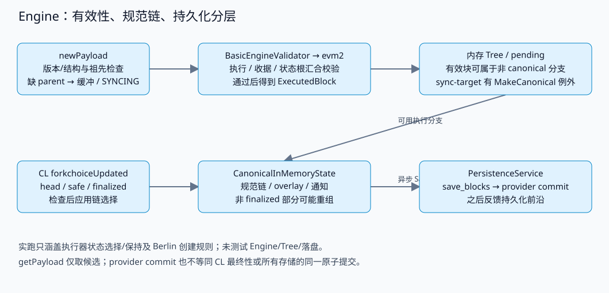

# Reth：Engine 执行与状态持久化

## 1. 一个 VALID 能证明什么 {#question}

收到 `engine_newPayload` 的 VALID 后，为什么不能立即说“已最终确认并落盘”？这一响应首先涉及 payload 的有效性，而 CL 的链选择、节点内存规范链和存储提交各有后续路径。

先读[区块头](../block/header.md)、[状态与 Trie](../state/trie.md)、[EVM](../evm/evm.md)及[执行/共识职责](../consensus/pos.md)。本文追实时链路；历史追赶使用 pipeline/backfill，并不要求每个新 payload 重走完整历史 stages。

## 2. 版本与实验对象 {#version}

核查于 2026-11-20，固定官方最新稳定 v2.11.0 / `b9abbcc1b982755baa9021e6874e2e58936ca65f`。[完整发布和依赖依据](./node-architecture.md#version)随文提供。当前 `EthBlockExecutor` 是 evm2 block executor 的适配层，`BundleState` 等执行类型也来自这一边界，见 [EthBlockExecutor 适配器](https://github.com/paradigmxyz/reth/blob/b9abbcc1b982755baa9021e6874e2e58936ca65f/crates/ethereum/evm/src/executor.rs#L1-L220)。

本篇实跑官方**执行器单元测试**：多段环境切换下的状态保持与选择性提交，以及 Berlin 规则下的创建合约。没有实跑完整 Engine 服务、Tree canonical/reorg、MDBX/RocksDB/static files 持久化或崩溃恢复；后几部分是固定源码分析。

## 3. 消息、状态和存储组件 {#components}



| 构件 | 保存/处理什么 |
| --- | --- |
| `EngineApi` / `ConsensusEngineHandle` | API 版本和字段检查、消息/响应通道；`getPayload` 走构建结果解析 |
| `TreeState` / block buffer | 已执行树、未知祖先的待连接块、当前 canonical tip 等 |
| `BasicEngineValidator` | 获取 parent state、转换/校验、执行和状态根核对，产出 `ValidationOutput` |
| `EthEvmConfig` / `EthBlockExecutor` | 根据块环境和链规则执行交易、收据、状态变化；下层 evm2 负责 Ethereum 执行 |
| `CanonicalInMemoryState` | 尚未全部持久化的规范链、pending、safe/finalized 跟踪与通知 |
| `PersistenceHandle` / `PersistenceService` | 向存储任务提交 SaveBlocks/移除等动作，等待并反馈持久化前沿 |
| `SaveBlocksInput` / provider RW | 区分 state/trie 与其余 block 数据的保存范围，执行实际写入/commit |

## 4. 实时调用链：先验证再进入树 {#source}

Engine 的方法有不同职责，且 V1/V2… 受分叉时间/字段要求约束；不是随意选任意版本都等价。入口见 [EngineApi 的 newPayload / forkchoiceUpdated 各版本入口](https://github.com/paradigmxyz/reth/blob/b9abbcc1b982755baa9021e6874e2e58936ca65f/crates/rpc/rpc-engine-api/src/engine_api.rs#L148-L475) 和 [EngineApi::get_payload_inner](https://github.com/paradigmxyz/reth/blob/b9abbcc1b982755baa9021e6874e2e58936ca65f/crates/rpc/rpc-engine-api/src/engine_api.rs#L524-L556)。

| 方法 | 主要请求 | 不代表什么 |
| --- | --- | --- |
| `newPayload` | 验证/执行给定 payload，报告 VALID、INVALID、SYNCING 等 | 不是 CL 投票，也不普遍令它成为 canonical |
| `forkchoiceUpdated` | CL 给出 head/safe/finalized；EL 检查并应用可接受的链更新；可带 attributes 请求下一个候选 | EL 不自行替 CL 计算 Beacon 选叉/最终性 |
| `getPayload` | 按 payload ID 取构建任务当前可返回结果 | 取回不使候选上链或最终确认 |

从 [on_new_payload / try_insert_payload](https://github.com/paradigmxyz/reth/blob/b9abbcc1b982755baa9021e6874e2e58936ca65f/crates/engine/tree/src/tree/mod.rs#L739-L870) 的 `on_new_payload` 进入：

1. 检查已知无效祖先；backfill 活跃时走缓冲路径，不能用“收到请求”证明已执行。
2. `try_insert_payload → insert_payload → insert_block_or_payload`；[insert_payload / insert_block_or_payload](https://github.com/paradigmxyz/reth/blob/b9abbcc1b982755baa9021e6874e2e58936ca65f/crates/engine/tree/src/tree/mod.rs#L3129-L3311) 先检查内存/已持久化块是否已知，再检查 parent 是否存在。未知 parent 的块放入 buffer，返回 disconnected 状态并在上层映射 SYNCING。
3. parent 可用时，调用 payload validator。[BasicEngineValidator::validate_block_with_state](https://github.com/paradigmxyz/reth/blob/b9abbcc1b982755baa9021e6874e2e58936ca65f/crates/engine/tree/src/tree/payload_validator.rs#L470-L648) 的 `validate_block_with_state` 获取父头/overlay state provider，安排 payload 转换与基础验证，并准备执行和 state-root 工作。预校验、收据/状态处理有并行重叠，不能机械画成所有步骤完全串行。
4. validator 中的 `execute_block`/`execute_transactions` 使用实际 EVM 配置；[EthBlockExecutor 适配器](https://github.com/paradigmxyz/reth/blob/b9abbcc1b982755baa9021e6874e2e58936ca65f/crates/ethereum/evm/src/executor.rs#L1-L220) 的 Reth 适配器把执行、条件提交和结果传给 evm2。执行产出不能直接当共识验证完成。
5. [执行后校验与 state-root 核对](https://github.com/paradigmxyz/reth/blob/b9abbcc1b982755baa9021e6874e2e58936ca65f/crates/engine/tree/src/tree/payload_validator.rs#L800-L924) 等待结果、核对执行后约束与最终 state root。只有通过后返回 `ValidationOutput`。state root 不匹配构造具体的 `BodyStateRootDiff` 验证错误，不插入一个“已经有效”的 ExecutedBlock。
6. [insert_payload / insert_block_or_payload](https://github.com/paradigmxyz/reth/blob/b9abbcc1b982755baa9021e6874e2e58936ca65f/crates/engine/tree/src/tree/mod.rs#L3129-L3311) 将有效 `ExecutedBlock` 放入内存树；若 parent 是当前 canonical tip，可更新 pending block，并发出事件。这里的 `CanonicalBlockAdded` 是按高度分类的事件名，不能单靠名字当作已经完成 FCU 链选择或存储 commit 的证明。

`newPayload` 有一处重要例外：若有效块恰好是先前 CL 已指定的 sync target head，会发出 MakeCanonical 动作，见 [on_new_payload / try_insert_payload](https://github.com/paradigmxyz/reth/blob/b9abbcc1b982755baa9021e6874e2e58936ca65f/crates/engine/tree/src/tree/mod.rs#L739-L870)。因此正确说法是“VALID **不普遍等价于** canonical”，而不是声称该入口永远不能推动规范链更新。

## 5. 规范链、持久化与回滚边界 {#state}

[on_forkchoice_updated / apply_chain_update](https://github.com/paradigmxyz/reth/blob/b9abbcc1b982755baa9021e6874e2e58936ca65f/crates/engine/tree/src/tree/mod.rs#L1154-L1388) 的 `on_forkchoice_updated` 依次检查状态、同 head、可应用链更新，否则走缺块同步。[on_canonical_chain_update](https://github.com/paradigmxyz/reth/blob/b9abbcc1b982755baa9021e6874e2e58936ca65f/crates/engine/tree/src/tree/mod.rs#L2904-L2943) 的 `on_canonical_chain_update` 更新 tree canonical head、内存规范链、provider 可见的 head，并通知监听者。重组会处理新旧分支；safe/finalized 仍要过一致性检查，不是把 CL 传来的任意 hash 无条件写入。

| 阶段 | 状态变化 | 回退/失败边界 |
| --- | --- | --- |
| 执行中的交易结果 | 可以先得到未提交的 changed state | 条件提交可放弃本次变化；不是数据库事务回滚的证明 |
| payload 验证通过 | 有 ExecutedBlock，可存内存树/pending | 仍可能非 canonical，后续 FCU 可选择别的分支 |
| FCU 规范化 | 内存规范链和通知改变 | 非 finalized 部分仍可能重组；EL 按规则拒绝不一致/过深请求 |
| 发起 persistence | SaveBlocksInput 入后台任务 | 请求已发不等于写入成功；接收结果后才推进持久化记录 |
| provider commit 成功 | 本批被存储层提交 | 不等同 Beacon finality；跨存储格式与崩溃一致性不能仅凭函数名下结论 |

[持久化启动与完成处理](https://github.com/paradigmxyz/reth/blob/b9abbcc1b982755baa9021e6874e2e58936ca65f/crates/engine/tree/src/tree/mod.rs#L1438-L1577) 的 `advance_persistence` 只在需要且没有当前任务时启动持久化；完成后再更新前沿。实时树有 persistence gap/backpressure 路径，可能暂停消费更多 Engine 请求以限制落后积累，见 [persistence gap 与背压](https://github.com/paradigmxyz/reth/blob/b9abbcc1b982755baa9021e6874e2e58936ca65f/crates/engine/tree/src/tree/mod.rs#L490-L605)；不要把内存保留数量和区块最终性混为一谈。

实际存储入口在 [PersistenceService::on_save_blocks](https://github.com/paradigmxyz/reth/blob/b9abbcc1b982755baa9021e6874e2e58936ca65f/crates/engine/tree/src/persistence.rs#L160-L225) 的 `PersistenceService::on_save_blocks`：打开 provider RW，调用 `save_blocks`，按已保存高度夹取 safe/finalized 的待写编号，再 `commit`；BAL store 位于主数据库之外，并在其后 flush，失败单独记录。`SaveBlocksInput` 还区分 state/trie 前沿和其余数据前沿，不能简化成“所有数据一次原子落入一个数据库”。静态文件/数据库组织、sync policy 与故障恢复需另做崩溃注入测试，本篇没有执行。

重组内存链与重组已持久化分支的路径也不能互换。树中有 canonical unwind 处理，persistence 另有 remove-blocks-above 动作；本篇只确认实现存在这些层次，不用一个执行器 CommitChanges::No 夹具来证明整节点重组正确或磁盘回滚原子性。

## 6. 本地实验：未提交结果与执行状态 {#experiment}

运行 [官方分段执行与条件提交测试](https://github.com/paradigmxyz/reth/blob/b9abbcc1b982755baa9021e6874e2e58936ca65f/crates/ethereum/evm/src/executor.rs#L785-L851) 的官方 `executor::tests::big_block_executor_preserves_state_across_segment_switch`。使用 `TestDatabase` 和实际 `EthBigBlockExecutorFactory`；第一段 London、第二段 Shanghai，base fee 1，gas price 1，初始发送者余额 1,000,000，两个普通收款地址分别收 1。chain spec 为测试显式构造，不代表主网按此组合运行。

1. 第一次试执行 nonce 0：回调看见候选 sender nonce 1，返回 `CommitChanges::No`；原断言结果 None。
2. 仍以 nonce 0 执行并选择提交，再执行 nonce 1；证明前次放弃没有消费 sender nonce。
3. finish 后原断言两收据、gas 42,000、两收款余额各 1、beneficiary 收益 0。

新增的观察值：

```text
RETH_OBS execution discarded_candidate_nonce=1
RETH_OBS execution receipts=2 gas_used=42000 sender_nonce=2 sender_balance=957998 first_balance=1 second_balance=1
```

独立整数核对：`1,000,000 − 2 × (21,000 × 1 + 1) = 957,998`；tip 为 `1 − baseFee 1 = 0`，所以 beneficiary 无 tip。没有第三次费用扣除，这与第一轮 `CommitChanges::No` 的边界一致。独立复算只校验观测，不替代实际执行器。

另运行 [官方 Berlin 合约创建测试](https://github.com/paradigmxyz/reth/blob/b9abbcc1b982755baa9021e6874e2e58936ca65f/crates/ethereum/evm/src/executor.rs#L875-L910) 的 `pre_london_creation_preserves_legacy_ef01_code`。测试通过真实 `EthBlockExecutorFactory`，用 Berlin 环境执行 initcode `61ef016000526002601ef3`，原断言得到 legacy runtime code `EF01`。它保护的是指定旧分叉规则，不证明该代码在后续分叉同样可创建。签名使用测试签名，发送者通过 `Recovered::new_unchecked` 注入，不验证签名恢复。

上述均是**官方原测试及原断言 + 仅 stdout 观察补丁**，生产源码不动。BigBlock 分段测试不是普通区块的完整 Engine 测试；创建案例补充了常规执行器路径。没有测试 EVM REVERT、无效 state root、Tree 重组或持久化，不能把放弃未提交状态称作链上交易失败回滚证据。

## 7. 工程取舍 {#tradeoffs}

执行、状态根计算和 payload 转换重叠可以减少串行等待，但必须在返回有效结果前汇合并校验；拿到中间收据或状态不是允许绕过 state-root 检查的理由。内存规范链让最近区块能在后台存储完成前被查询/继续执行，代价是要处理持久化延迟、重组与 provider overlay 的一致性。

把执行器边界收敛到 evm2 使 Reth 更专注链、任务和存储编排，也让跨版本 SDK 调用者需要同步适配类型。以上是从代码结构得出的取舍；没有性能基准、掉电或重组压力实验，不据此宣称性能增益或所有故障原子恢复。

## 8. 可确认到哪一步 {#limits}

官方源码可以回答职责和调用边界；三个精确测试可以回答限定夹具中的 nonce 排序、状态选择性提交/保持和 Berlin code 规则。它们不能证明真实 Engine 网络交互、CL 决策、主网当前部署、所有分叉、数据库 durability 或最终性。

返回 [Reth](./README.md)，或回看[节点装配](./node-architecture.md)与[交易池/候选构块](./transaction-pool-payload.md)。
