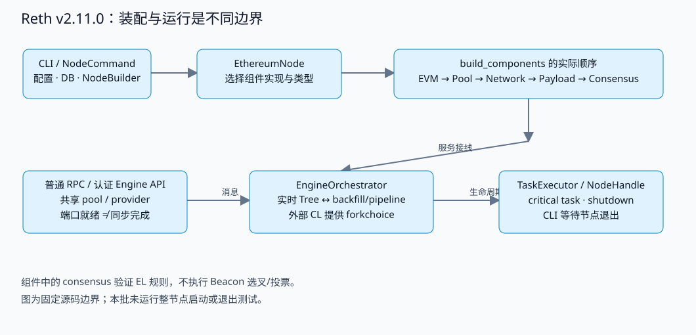

# Reth：节点启动与组件边界

## 1. 从哪个问题开始 {#question}

启动 `reth node` 后，端口可连接能否说明链头已追平？更换 EVM 实现是否只需换一个 RPC handler？这两问需要分开看**构造依赖、服务生命周期、链同步状态**。

[执行层/共识层](../consensus/pos.md)介绍职责分工，[JSON-RPC](../rpc/rpc.md)介绍外部接口。这里顺着实际类型和任务追 Reth 如何把这些职责装成节点；下一篇继续追[一笔交易](./transaction-pool-payload.md)，最后一篇追[执行结果和状态](./execution-state.md)。

## 2. 固定版本与一手依据 {#version}

2026-11-20 查询 [GitHub 官方 latest release](https://github.com/paradigmxyz/reth/releases/tag/v2.11.0)：v2.11.0 发布于 **2026-11-11 10:47:00 UTC**，`draft=false`、`prerelease=false`。API 的 `target_commitish=main` 不能作为源码 pin；本地 `git rev-parse v2.11.0^{commit}` 与 HEAD 均为 **`b9abbcc1b982755baa9021e6874e2e58936ca65f`**。原始响应和对象证明可复核。

| 固定项 | 实际值及含义 |
| --- | --- |
| Reth workspace | 2.11.0，edition 2024，`rust-version = 1.96` |
| 工具链文件 | 该提交无 rust-toolchain 文件；MSRV 不等于自动锁定编译器，实验显式使用 rustc 1.96.0 |
| 锁文件 | Cargo.lock（未随仓库提供），SHA256 `5cc28d67d3dbfc6a831591c7a44007d3440d05c51a4d6f0714f102d4ecd861f8` |
| Ethereum 执行 | evm2 0.1.0，Git `66687c18b34d3bdbb899f5eb7605070615c03475` |
| 交易/Engine 类型 | alloy-consensus、alloy-eips、alloy-rpc-types-engine 2.5.0；alloy-primitives 1.7.3 |
| 部分基础类型 | reth-core Git `275ce4cf5befeb9f1e8acd935ff2882d2d25fc61`，如 reth-primitives-traits 0.8.2 |

以上是实际 lock 解析结果。当前 `EthBlockExecutor` 包装 `evm2::block::ethereum::EthBlockExecutor`；不能因旧文章写 revm 就画成当前调用链。官方发布说明也明确此次 block execution 迁移。版本不等于公共节点部署证明，源码中具备某分叉能力也不等于某时刻主网已激活该分叉。

## 3. 组件怎样互相依赖 {#components}

| 类型/构件 | 负责什么 | 不应从中推断什么 |
| --- | --- | --- |
| `NodeBuilder` / `NodeTypes` | 逐步补齐数据库、节点类型、组件与 add-ons；`EthereumNode` 定义 primitives/chainspec/storage/payload 关联类型 | Builder 链书写顺序不是运行时所有任务的启动顺序 |
| `ComponentsBuilder` | 构造 EVM、pool、network、payload service、consensus validator | 其中 consensus 是 EL 区块规则验证，不是 Beacon 投票/选叉算法 |
| `BlockchainProvider` / `OverlayManager` | 把存储与内存执行层状态接给消费者；overlay 在 provider/engine 间共享 | 内存可读不代表写入磁盘已完成 |
| `EngineOrchestrator` | 组合实时树、backfill 与消息流；处理追赶/实时切换 | 不替代外部 CL 的 forkchoice 决策 |
| RPC add-ons | 启动普通 RPC 与认证 Engine API，持有 pool/provider/engine handle | 端口可用不证明同步完成 |
| `TaskExecutor` / `NodeHandle` | 运行关键任务，联动 shutdown；CLI 等待节点退出 | 一次普通请求错误不等于整个节点退出 |

## 4. 从入口顺源码走 {#source}

下面引用全部固定到本篇提交，行号指原始源码，实验的测试观察语句不影响这些生产函数。

1. **进程入口**：[main](https://github.com/paradigmxyz/reth/blob/b9abbcc1b982755baa9021e6874e2e58936ca65f/bin/reth/src/main.rs#L20-L60) 的 `main` 安装信号处理、解析 `Cli<EthereumChainSpecParser>`，创建 `EthereumBackfill`，调用 `.node(EthereumNode::default()).launch_with_debug_capabilities_and_backfill(backfill)`，最后 `handle.wait_for_node_exit().await`。入口还拒绝误启用 `account-ext` 的 Ethereum binary；不是所有编译成功组合都能启动。
2. **CLI 到节点配置**：[NodeCommand::execute](https://github.com/paradigmxyz/reth/blob/b9abbcc1b982755baa9021e6874e2e58936ca65f/crates/cli/commands/src/node.rs#L158-L285) 的 `NodeCommand::execute` 把 CLI 配置、数据库环境和运行上下文交给 launcher。CLI 参数解析失败、数据库打开失败属于启动阶段错误，不是区块验证返回的 INVALID。
3. **选择组件类型**：[EthereumNode::components](https://github.com/paradigmxyz/reth/blob/b9abbcc1b982755baa9021e6874e2e58936ca65f/crates/ethereum/node/src/node.rs#L82-L112) 的 `EthereumNode::components` 指定 `EthereumPoolBuilder`、`BasicPayloadServiceBuilder<EthereumPayloadBuilder>`、`EthereumNetworkBuilder`、`EthereumExecutorBuilder`、`EthereumConsensusBuilder`。
4. **真正构造顺序**：[ComponentsBuilder::build_components](https://github.com/paradigmxyz/reth/blob/b9abbcc1b982755baa9021e6874e2e58936ca65f/crates/node/builder/src/components/builder.rs#L375-L402) 的 `build_components` 实际先 `build_evm`，再 `build_pool`、`build_network`、`spawn_payload_builder_service`、`build_consensus`。pool 和 builder 均拿到 EVM 配置；network 与 builder 共享 pool handle。替换 EVM 涉及这些类型边界，不只 RPC。
5. **打开状态并接线**：[EngineNodeLauncher::launch_node（准备）](https://github.com/paradigmxyz/reth/blob/b9abbcc1b982755baa9021e6874e2e58936ca65f/crates/node/builder/src/launch/engine.rs#L84-L185) 的 `EngineNodeLauncher::launch_node` 创建共享 `OverlayManager`，加载 TOML/peers，附加 DB，执行 provider recovery/一致性相关准备、genesis 和组件初始化，然后建立 pipeline、pruner、Engine 通道。
6. **让服务运行**：[EngineNodeLauncher::launch_node（服务与退出）](https://github.com/paradigmxyz/reth/blob/b9abbcc1b982755baa9021e6874e2e58936ca65f/crates/node/builder/src/launch/engine.rs#L190-L475) 装配 `EngineOrchestratorBuilder`，通过 add-ons 启动 RPC，把 orchestrator 作为关键任务运行，并同时接收本地 built payload 和 shutdown。`BackfillSyncStarted/Finished`、实时 canonical 事件会更新 network sync/status；初始化时先设 `Syncing`。

“先把类型拼好”与“任务开始接受消息”是两件事。launch 中还存在可选 ExEx、debug/reorg/replay 包装与 JIT 路径，本批不逐项实验，也不把它们画成每个节点必经的同一条线。

## 5. 运行状态和退出边界 {#state}

| 观察点 | 已发生 | 仍可能发生的后续动作/失败 |
| --- | --- | --- |
| 配置解析完成 | 参数能组成配置 | 旧版已删除 flag 会启动失败；provider recovery、genesis、端口仍可失败 |
| RPC 已启动 | 可通过接口提交请求 | Engine 仍可能追赶；需要数据的请求可能缺状态 |
| backfill 运行 | 历史追赶在推进 | 实时 payload 可被缓冲，不能把 pipeline 的历史阶段当作每个新 payload 的处理链 |
| 实时树收到 FCU | CL 提供 head/safe/finalized | 仍需检查已知区块和一致性；缺块可能进入同步 |
| critical engine 任务结束 | engine loop 给出退出结果 | graceful shutdown 需要收尾；这不等同“一笔坏交易把节点杀掉” |

启动代码以 `?` 传播打开数据库、构造组件、启动 RPC 等错误；engine loop 对 `FatalError` 产生错误并结束。正常 shutdown 与 Engine 请求的错误状态分属不同层级。跨文件生命周期的关键处在 [EngineNodeLauncher::launch_node（服务与退出）](https://github.com/paradigmxyz/reth/blob/b9abbcc1b982755baa9021e6874e2e58936ca65f/crates/node/builder/src/launch/engine.rs#L190-L475)，CLI 等待边界在 [main](https://github.com/paradigmxyz/reth/blob/b9abbcc1b982755baa9021e6874e2e58936ca65f/bin/reth/src/main.rs#L20-L60)。

## 6. 本地证据怎样复核 {#experiment}

本篇**未运行完整节点启动、端口连接、恢复或 shutdown 测试**。节点装配顺序来自上述生产源码；可执行证据是相同提交的两组底层官方测试，入口见[交易池实验](./transaction-pool-payload.md#experiment)与[执行器实验](./execution-state.md#experiment)。这些测试能核对实际 pool/executor 函数，不能替代启动集成测试。

复现步骤包含隔离 clone、显式工具链、原 lock 与精确测试过滤器。没有给正式 Wiki 工程加 Rust 依赖；实验的 CARGO_HOME/target 单独设置。工具链安装器曾在下载完成后因 CARGO_HOME 中没有 rustup 自身报错，最终直接验证并使用已安装的 `rustc/cargo` 二进制，未把安装器退出码说成成功。

## 7. 工程取舍 {#tradeoffs}

类型化 builder 把定制边界暴露给库使用者，能让很多不匹配在编译期出现，代价是泛型和关联类型较多；阅读时先找 `EthereumNode` 选了哪些实现，再进入 trait。共享 pool/provider handle 使不同服务能看到状态变化，也意味着“某服务已启动”不能作为其他异步任务已经完成的屏障。

历史追赶 pipeline 与实时树各自适应不同工作负载，orchestrator 负责切换。通过事件更新同步状态和通过任务传播退出，可以把运行状态与进程生命周期分开观察；监控时至少同时看链头、同步状态、Engine 请求延迟和持久化差距，不能只看端口存活。

## 8. 证据边界与后续阅读 {#limits}

**官方事实**是发布元数据、依赖与类型/函数；**代码推导**是依据具体装配和等待点解释边界；**实际实验**只涵盖后两篇列出的精确测试。未测整节点、P2P、认证 Engine API、主网、JIT、崩溃恢复与性能，不把设计目的当吞吐基准。

返回 [Reth](./README.md)，继续[交易池到 payload](./transaction-pool-payload.md)或[Engine 执行与持久化](./execution-state.md)。
