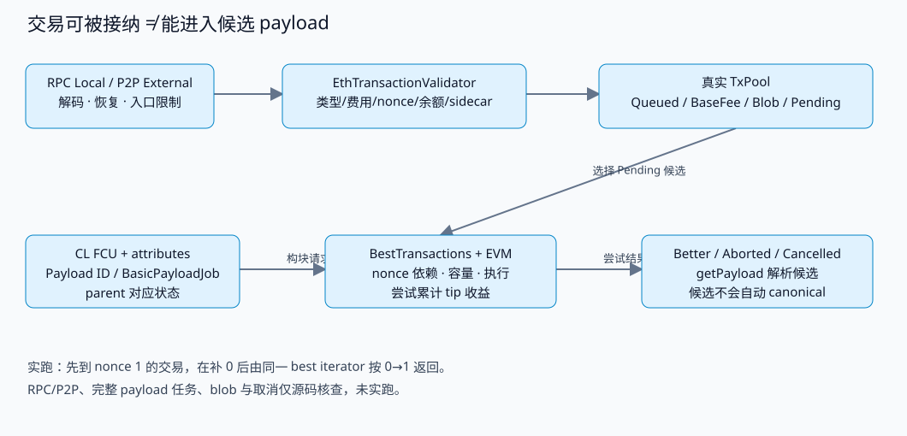

# Reth：交易池到 payload 构建

## 1. 交易哈希之后还差哪些步骤 {#question}

`eth_sendRawTransaction` 返回哈希，为什么 `getPayload` 可能仍不带这笔交易？同一发送者的 nonce 1 先到，补齐 nonce 0 后，正在消费的最佳交易迭代器能否按顺序看到两笔？

前一问跨越池接纳、当前可执行性与构块取舍，后一问可以用实际 `TxPool` 函数测试。先读[交易类型](../transaction/types.md)、[费用模型](../transaction/eip1559.md)和[Blob](../transaction/eip4844.md)。这里讨论节点本地策略；并不存在由所有节点共同维护的一份全局 mempool。

## 2. 版本和验证范围 {#version}

核查于 2026-11-20，固定当日官方最新稳定 v2.11.0 / `b9abbcc1b982755baa9021e6874e2e58936ca65f`。[版本依据、依赖和工具链](./node-architecture.md#version)与本篇相同，源码链接均固定提交。当前 pool 与 payload builder 使用 Ethereum 的实际 EVM 配置，执行器下层为 evm2；不能用旧版示意链代替。

**实跑**仅覆盖官方 pool nonce 缺口补齐测试。RPC/P2P 输入校验、替换、余额/费用变化、blob、完整 payload job/取消只读源码，下面逐项标明。没有向公共网络发送交易。

## 3. 数据结构和两种入口 {#components}



| 结构 | 关键内容/职责 |
| --- | --- |
| `TransactionOrigin` | 区分 Local/External 等来源；来源会影响本地策略，不保证一定传播或纳入区块 |
| `TransactionValidationOutcome::Valid` | 带已读取 balance/state_nonce、transaction、propagate 等；“通过静态/状态验证”不代表能立即进入 pending |
| `ValidPoolTransaction` / `TransactionId` | 记录 sender ID + nonce、来源与时间；关联发送者依赖链 |
| `TxState` / `SubPool` | 状态位驱动 Queued、BaseFee、Blob、Pending 四类；Blob 子池存放非 pending 的 blob 交易 |
| `BestTransactions` | 从可执行候选中按 ordering 和发送者 nonce 依赖逐步选取；不是对全部交易做一次无约束 tip 排序 |
| `BuildArguments` / `BasicPayloadJob` | 持有 parent/attributes、cached reads、best payload、取消/截止相关状态；一次任务可反复尝试更优候选 |

RPC 的 [EthTransactions::send_raw_transaction](https://github.com/paradigmxyz/reth/blob/b9abbcc1b982755baa9021e6874e2e58936ca65f/crates/rpc/rpc-eth-api/src/helpers/transaction.rs#L80-L132) 解码和恢复 raw pool transaction，再调用 `send_pool_transaction(Local, ...)`。Ethereum 的具体 [EthApi::send_pool_transaction](https://github.com/paradigmxyz/reth/blob/b9abbcc1b982755baa9021e6874e2e58936ca65f/crates/rpc/rpc/src/eth/helpers/transaction.rs#L32-L125) 在默认无 forwarder 路径等待本地 pool 接纳，并有可选 blob sidecar 转换路径。配置 raw transaction forwarder 时，先取远端返回的 hash，再尝试保留本地交易，后一步错误被忽略；因此该配置下成功返回甚至不能作为本地 pool 接纳成功的证明。这里不能把 `sendRawTransactionSync` 的等待收据行为与普通返回哈希的接口混为一谈。

P2P 入口在 [TransactionsManager::import_transactions](https://github.com/paradigmxyz/reth/blob/b9abbcc1b982755baa9021e6874e2e58936ca65f/crates/net/network/src/transactions/mod.rs#L1326-L1485) 的 `import_transactions`：初始同步或关闭 gossip 时直接返回，对 broadcast 还按可用导入容量截断，随后恢复/导入交易。两类入口共享 pool，但前置传输约束和 origin 不同；池接纳不证明其他节点已收到。

## 4. 顺着校验、排序和构块函数走 {#source}

1. **校验**：[EthTransactionValidator：静态和状态校验](https://github.com/paradigmxyz/reth/blob/b9abbcc1b982755baa9021e6874e2e58936ca65f/crates/transaction-pool/src/validate/eth.rs#L373-L735) 的 `EthTransactionValidator` 从 state provider 取得状态，并校验交易类型/分叉、gas、费用字段、nonce、余额和相应 blob 条件等，返回带状态的 validation outcome。这里不逐项声称所有分支都已实测。
2. **接纳与重分类**：[PoolInner::add_transaction](https://github.com/paradigmxyz/reth/blob/b9abbcc1b982755baa9021e6874e2e58936ca65f/crates/transaction-pool/src/pool/mod.rs#L588-L650) 将 outcome 转为 `ValidPoolTransaction`，调用 [TxPool::add_transaction](https://github.com/paradigmxyz/reth/blob/b9abbcc1b982755baa9021e6874e2e58936ca65f/crates/transaction-pool/src/pool/txpool.rs#L787-L965) 的 `TxPool::add_transaction`。验证时读取的状态和当前池跟踪状态可能不同，池还要维护 nonce 链、余额约束与替换规则。
3. **子池状态**：[SubPool / TxState](https://github.com/paradigmxyz/reth/blob/b9abbcc1b982755baa9021e6874e2e58936ca65f/crates/transaction-pool/src/pool/state.rs#L146-L214) 定义四类 `SubPool`；[TxPool::best_transactions](https://github.com/paradigmxyz/reth/blob/b9abbcc1b982755baa9021e6874e2e58936ca65f/crates/transaction-pool/src/pool/txpool.rs#L420-L453) 提供最佳交易迭代入口。非 pending 交易仍可在池里，外部查到哈希不等于当前能打包。
4. **任务由谁请求**：CL 的有效 `forkchoiceUpdated` 携带 attributes 时，经 [process_payload_attributes](https://github.com/paradigmxyz/reth/blob/b9abbcc1b982755baa9021e6874e2e58936ca65f/crates/engine/tree/src/tree/mod.rs#L3576-L3640) 的 `process_payload_attributes`，向 payload service 发 `BuildNewPayload`，获得异步 payload ID。不是每次 RPC 接纳都创建一个 Engine payload job。
5. **从池到执行**：[EthereumPayloadBuilder / default_ethereum_payload](https://github.com/paradigmxyz/reth/blob/b9abbcc1b982755baa9021e6874e2e58936ca65f/crates/ethereum/payload/src/lib.rs#L91-L480) 的 `EthereumPayloadBuilder::try_build` 调 `default_ethereum_payload`。函数以 parent 对应状态与 attributes 创建 next-block builder，应用 pre-execution changes，按新块 base fee/blob fee 获取 best transactions，逐笔执行和计费。
6. **尝试结果**：同函数在气量、blob 数量/sidecar、块大小等不合适时跳过候选或其依赖；只有累积费用更好才返回更优 payload。[BasicPayloadJob 的 spawn / poll / resolve](https://github.com/paradigmxyz/reth/blob/b9abbcc1b982755baa9021e6874e2e58936ca65f/crates/payload/basic/src/lib.rs#L413-L593) 的 `BasicPayloadJob::poll` 更新 best/cached reads，失败尝试可等下一轮；[EngineApi::get_payload_inner](https://github.com/paradigmxyz/reth/blob/b9abbcc1b982755baa9021e6874e2e58936ca65f/crates/rpc/rpc-engine-api/src/engine_api.rs#L524-L556) 的 `get_payload_inner` 校验 API 版本/时间戳后解析当前构建结果。取回 payload 不会因此把它变成 canonical。

## 5. 池状态、失败和取消不是一个层次 {#state}

| 条件/动作 | 当前实现中的含义 | 本篇证据 |
| --- | --- | --- |
| nonce 1 先到而 state nonce 为 0 | 缺祖先，交易被 queued；补 0 后可晋升并按 0→1 迭代 | 原测试实际运行 |
| 余额不足、base fee 变化 | 可影响池接纳/子池状态；取决于具体错误和状态位 | 源码阅读，未实跑这些组合 |
| 同 sender/nonce 替换 | 池内有独立替换条件；不是“后到就覆盖” | 源码阅读，未实跑 |
| 交易超过剩余 block gas | builder 对本次 best iterator `mark_invalid`，跳过后续依赖 | 源码阅读，未实跑 |
| 执行报 nonce too low | builder 可跳过这一笔；其他某些无效交易会连依赖一起跳过 | 源码阅读，未实跑 |
| blob 数量/格式/sidecar 不合适 | 按分叉和本地上限检查，不能套成普通交易的单一费用队列 | 源码阅读，未实跑 |
| 候选费用未优于已有 best | `BuildOutcome::Aborted` 保留缓存；不代表所有池交易无效 | 源码阅读，未实跑 |
| build cancel 被观察到 | 交易循环可返回 `BuildOutcome::Cancelled` | 源码阅读，未实跑 |

`best_txs.mark_invalid` 操作的是**本次选择迭代**的交易/依赖，不能据此宣称已从共享交易池永久驱逐。取消也是协作检查，不是对运行线程任意抢占：`default_ethereum_payload` 在取出交易后的循环内检查 token，不能据这一处推断空池、每个执行步骤或所有退出点都即时响应取消。任务层还处理截止时间、resolve 和 best 状态；[BasicPayloadJob 的 spawn / poll / resolve](https://github.com/paradigmxyz/reth/blob/b9abbcc1b982755baa9021e6874e2e58936ca65f/crates/payload/basic/src/lib.rs#L413-L593) 中收到 `Cancelled` 的特定轮询分支甚至标为 unreachable，必须结合调用者生命周期理解，不能把所有层的返回值混成一张通用状态表。

费用累计使用 `effective_tip_per_gas(base_fee) × tx_gas_used`；这不是将用户 `maxFeePerGas` 全部当收益，也不是证明本地 builder 搜索到了全局最大收益组合。Blob fee 与执行 tip 的计算边界不同。

## 6. 本地实验：填补 nonce 缺口 {#experiment}

运行原函数 [官方 gap-fill 测试](https://github.com/paradigmxyz/reth/blob/b9abbcc1b982755baa9021e6874e2e58936ca65f/crates/transaction-pool/src/pool/txpool.rs#L5548-L5580)：`pool::txpool::tests::best_transactions_nonce_order_on_gap_fill`，来自官方测试。测试使用 `MockTransactionFactory`、`MockOrdering`、无限余额和模拟验证后的交易，**调用真实 TxPool 和 BestTransactions 实现**；没有走签名恢复/真实账户 provider/网络入口。

| 步骤 | 输入 | 原有断言/观测 |
| --- | --- | --- |
| 建池并先加 tx1 | 同一发送者，state nonce 0，交易 nonce 1，gas price 100 | 创建 best iterator 后 `next()` 为 None |
| 补 tx0 | nonce 0，余额足够 | 已创建的同一个 best iterator 得到两笔 |
| 核对依赖顺序 | 获取 t0/t1 | 原断言 nonce 分别为 0、1；不能先消费 nonce 1 |

pool 输出包含：

```text
RETH_OBS pool before_gap_best_empty=true
RETH_OBS pool yielded_nonces=0,1
```

原测试原断言全部保留，仅加入 stdout 观察语句。测试使用 `--exact` 且检查恰好 running 1 test/1 passed，避免零测试误报。

这证明该夹具中的实时迭代器能在 gap-fill 后遵守 nonce 顺序；**没有实际运行完整 payload builder、取消、替换、余额不足或 blob 案例**。`MockOrdering` 也不证明生产 ordering 在任意多发送者场景的收益表现。

## 7. 工程取舍 {#tradeoffs}

将接纳验证与 pool 分类分开，允许存放暂不可执行但未来可晋升的交易；代价是状态更新、重组、费用变化后要维护多个索引和依赖。best iterator 的动态更新避免每次构块只用固定快照，但需要严格维持发送者链顺序；实验保护的正是这条不变量。

构块时再做真实执行，能过滤池验证后状态已变的候选，并按目标块环境取舍；这并不保证所有合法池交易都能被选中。重复尝试和 cached reads 减少重复读取，但目标 parent 和 attributes 必须对应正确状态。并发收益和最优性需另做负载测试，本批不报告性能数字。

## 8. 从候选转向规范链 {#limits}

返回交易哈希 → pending 候选 → built payload → `getPayload` 返回 → CL 选叉 → canonical → 持久化，是不同观察点。前几步不承诺后几步发生。接下来读[Engine 执行与状态持久化](./execution-state.md)，尤其注意 `newPayload` 的 VALID 与 canonical 更新不是同义词。

返回 [Reth](./README.md)；装配关系见[节点架构](./node-architecture.md)。
