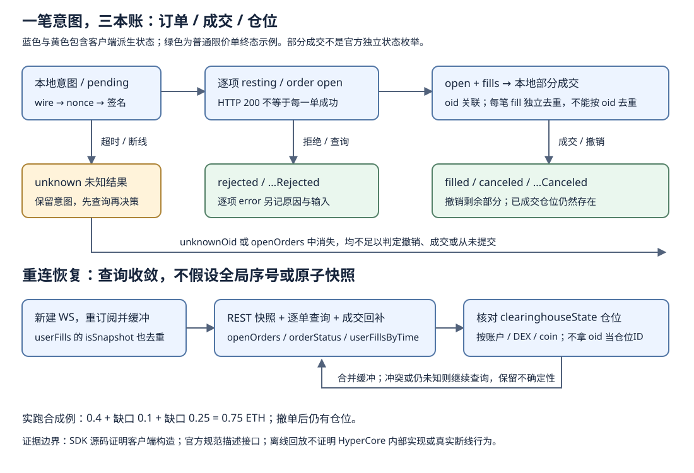

### 下单与撤单

## 1. 问题与结论：签了什么，确认到哪一步 {#question}

客户端调用 `order()` 后超时，可以重新下单吗？收到 HTTP 200，仓位就建立了吗？断线重连后，订单不在挂单列表里，是否表示撤单成功？这三个问题都需要把**本地意图、服务端订单、成交记录和账户仓位**分开保存。

本文采用北京时间 **2026-11-20** 核查的官方 Python SDK **0.24.0**，固定提交 [`2fdb18f9517675ea03695a0962bd19eece9c83f0`](https://github.com/hyperliquid-dex/hyperliquid-python-sdk/tree/2fdb18f9517675ea03695a0962bd19eece9c83f0)。GitHub 最新正式、非预发布 release 与 PyPI 最新版均为 0.24.0；Git tag 实际检出到该提交，安装 wheel 的 10 份 Python 源文件与 tag 逐字节一致。这个版本是本次核查的客户端基线，**不证明当前主网、测试网服务端部署了某个版本**。项目包元数据仍含 Alpha classifier，正式 release 不等于生产保障。发布原始响应、时间、包哈希和依赖见版本证据。

结论先列在这里：

- 普通订单走 **L1 action** 签名：有序 msgpack、nonce、vault 与有效期先组成 action hash，再签 `Agent` typed-data。资金转移等 **user-signed action** 使用另一套 domain 和字段，不能混用。
- `float_to_wire` 是序列化辅助，不是完整市场精度、最小名义金额或风控校验器。SDK 能构造请求，不证明交易所会接受。
- HTTP、外层 `status`、逐项 `resting/filled/error`、订单状态、fills、仓位各回答不同问题。超时进入本地 `unknown`，不能自动解释为失败。
- SDK 的 WS 管理器没有实现完整的重连、重订阅和缺口对账。调用者需要保存意图、去重并交叉查询；nonce 与 cloid 均不能在本文证据范围内当作通用幂等保证。

**公开范围。** 本次实际核查的是官方 SDK、官方接口规范和官方 [node 运行说明](https://github.com/hyperliquid-dex/node/blob/405cc08b17a727ee51b0f9128918955a84439915/README.md)。运行说明指向下载签名二进制；本次没有取得可用于审计 HyperCore 撮合、共识、风险计算的对应实现源码。因此下文“源码”只指客户端。官方 [HyperCore 说明](https://hyperliquid.gitbook.io/hyperliquid-docs/hypercore)、接口结果、离线实验分别标明来源，不从 SDK 推导内部撮合或链上原子性，也不声称已穷尽所有公开仓库。

## 2. 最小模型：意图、订单、成交与仓位 {#model}



| 对象 | 保存什么 | 能确认什么 |
| --- | --- | --- |
| 本地意图 | 内部 ID、账户/网络/DEX、cloid、原始 decimal 输入、wire、nonce、expiry、签名、发送结果 | 计划做什么、实际签了什么；不能确认已被接收 |
| 订单 | 服务端 oid、cloid 映射、原始/剩余数量、官方 status 与 statusTimestamp | 该订单某次可见状态；不能替代所有成交和仓位 |
| fill | coin、time、tid、oid、side、sz、px、fee、hash 等 | 某笔成交及费用；同一 oid 可以有多笔 fill |
| 仓位 | 实际账户、perp DEX、coin、szi、entryPx、marginUsed 等快照字段 | 当前账户风险视图；不是某个订单的“状态字段” |

签名者是持有私钥的用户或已获授权的 API wallet（agent）。**查询地址应是实际主账户、子账户或 vault 的地址**，不是代签 agent；`account_address` 不会自动写入订单 action hash。子账户、vault 没有各自用于此流程的私钥，目标通过 `vaultAddress` 表达；能否代签仍需有效权限，不能只凭恢复地址认定授权。参见官方 [API wallets / nonce](https://hyperliquid.gitbook.io/hyperliquid-docs/for-developers/api/nonces-and-api-wallets) 与 [exchange 的账户说明](https://hyperliquid.gitbook.io/hyperliquid-docs/for-developers/api/exchange-endpoint)。

资金费、保证金与清算的共用术语见[永续合约导读](./../../defi/perps/README.md)。这里不套用 Drift 的账户精度、预言机保护或清算阈值；本篇实验也不计算 Hyperliquid 真实强平价。

## 3. 状态、单位与可复算数值 {#state-math}

### 字段和精度约束

原始金额在业务边界保留十进制字符串，用 `Decimal` 检查有限、正数、步进和范围，再按 SDK 所需类型转换并核对最终 wire。价格单位为 quote/base，数量为 base；时间戳、nonce 与 `expiresAfter` 使用毫秒。不要把 asset 整数编号和 coin 字符串混成一种标识。

官方 [Tick and lot size](https://hyperliquid.gitbook.io/hyperliquid-docs/for-developers/api/tick-and-lot-size) 在本次捕获时规定：数量小数位最多 `szDecimals`；价格最多 5 位有效数字，且小数位最多 `MAX_DECIMALS - szDecimals`，perps 的 `MAX_DECIMALS=6`，spot 为 8。整数价格不受 5 位有效数字限制。`szDecimals` 来自当前网络和市场的 metadata，不能永久硬编码。

本篇**合成 metadata** 将 ETH 放在原生 perp universe 的索引 1，`szDecimals=3`；这不是当前市场数据。于是数量步长为 `0.001 ETH`，价格最多 3 位小数且受有效数字约束。每行均实际经过 SDK `order_request_to_order_wire`：

| 输入 price / size | SDK 序列化 | 按上述精度规则 |
| --- | --- | --- |
| `2000.5 / 0.125` | 接受 | 两者通过 |
| `2000.55 / 0.125` | 接受 | 价格 6 位有效数字，不通过 |
| `2000.5 / 0.1251` | 接受 | 数量 4 位小数，不通过 |
| `123456 / 0.125` | 接受 | 整数价格例外，通过精度规则 |
| `0.001234 / 0.125` | 接受 | 价格超过 3 位小数，不通过 |

“通过精度规则”没有验证最小名义金额、余额、价格范围、资产可交易性或保证金。实验的 Decimal 检查器只表达这两个文档精度条件，不充当交易所完整校验。

SDK [`float_to_wire`](https://github.com/hyperliquid-dex/hyperliquid-python-sdk/blob/2fdb18f9517675ea03695a0962bd19eece9c83f0/hyperliquid/utils/signing.py#L475) 先格式化为 8 位小数，若与原 float 的差达到 `1e-12` 则抛 `ValueError`，随后去尾零。实际边界：`0.1+0.2 → "0.3"`，`1.234567891` 与 `1e-9` 抛错，`1e-13 → "0"`；此版本 `-0.0 → "-0"`。所以既不能依赖二进制 float 表达业务步进，也不能靠这个函数检查正数和非零。普通 `order` 不会自动向有利或不利方向取整；市场单辅助路径的 `_slippage_price` 才另做有效数字及小数位处理，不能把它推广到普通限价单。

### 部分成交与仓位的数值推演

以下是**已执行的合成回放**，价格、费用、时间和状态均为夹具；不是账户实测，也不是 Hyperliquid 风险公式。初始仓位为零，没有资金费、转账、其他市场或清算：

| 阶段 | 订单与成交 | 本地累计净数量 |
| --- | --- | --- |
| 101 挂买单 1 ETH | 官方 `open`，尚无 fill | 0 |
| 第一笔成交 | 101 买入 0.4，费用 0.04 USDC；剩余 0.6，客户端显示部分成交 | 0.4 |
| 断线缺口 | 101 又成交 0.1，费用 0.01；随后剩余 0.5 被撤销 | 0.5 |
| 另一未知意图被查询确认 | 103 买入 0.25，费用 0.025，订单 `filled` | 0.75 |
| 重连对账 | 补回两笔遗漏 fill，消除重复；101 为 `canceled`，104 仍挂 0.2 | 0.75 |

所有 fill 的买入价为 100，故成交名义金额 `0.75×100=75 USDC`，合成费用合计 `0.075 USDC`。重复推送不能重复增加仓位或费用。夹具的 REST 仓位 `szi="0.75"` 与从零开始的 fills 净和相符；真实系统应以账户快照为核对基准，不能只靠有限历史成交重建完整余额、资金费、成本或保证金。

### 状态名与去重键

官方 [`orderStatus`](https://hyperliquid.gitbook.io/hyperliquid-docs/for-developers/api/info-endpoint#query-order-status-by-oid-or-cloid) 列有 `open`、`filled`、`canceled`、`triggered`、`rejected`，以及 `marginCanceled`、`selfTradeCanceled`、`reduceOnlyCanceled`、`scheduledCancel`、`tickRejected`、`badAloPxRejected`、`iocCancelRejected` 等具体原因。原始字符串要完整保留，不宜只按后缀分类；例如 `scheduledCancel` 不以 `Canceled` 结尾。条件单 `triggered` 也不能直接等同于已经成交，本文回放限定普通限价单。

`pending`、`unknown`、`partial` 是本地视图，**不是本文捕获规范中的三个官方订单 status**。部分成交由仍处于 `open` 的订单和已核对 fills 派生；订单 `canceled` 不会抹去此前已成交的仓位。

- 订单表以 `(network, actualAccount, dex, oid)` 为作用域；cloid 是可选 128-bit 十六进制客户端关联标识，持久保存与意图、oid 的映射。不要假定重新使用 cloid 具有任意请求幂等语义。
- 回放的非聚合 fills 按 `(network, actualAccount, time, coin, tid)` 去重。官方 WS 类型给出 trade 的全局区分元组 `(block_time, coin, tid)`，fill 同时提供 `time/coin/tid/oid/hash`。账户作用域避免把交易双方的账混在一起；同键不同内容标为冲突并查询，不能覆盖。保存原始字段，实际接入时核对 trade 的 block_time 与当前 fill 时间口径。
- 不按 oid 去重 fill：那会丢掉同一订单的后续成交；也不只按 hash 去重，因为它描述 L1 交易而非单笔 fill。REST 与 WS 应保持相同聚合设置，本篇使用 `aggregateByTime=false` 语义。
- `statusTimestamp` 不是全局序号。回放忽略同一订单更旧的状态，同时间冲突或终态后重开则交给查询。仓位按账户/DEX/coin 查询覆盖并核对，不以 oid 做仓位 ID。

字段依据来自捕获的 [WS 类型定义](https://hyperliquid.gitbook.io/hyperliquid-docs/for-developers/api/websocket/subscriptions)。

## 4. 完整主路径：从参数到逐项响应 {#path}

下面沿固定 SDK 版本的实际调用追踪：

1. `Exchange.order(name, is_buy, sz, limit_px, order_type, ...)` 构造 `OrderRequest`，转入 `bulk_orders`；传入的 Python 参数名是 `name`，内部请求字段是 `coin`。
2. `Info.name_to_asset` 先把别名映射到 coin，再取整数 asset。原生 perps 是 universe 索引；spot 为 `10000 + spotMeta.universe[index].index`，不是 token 索引。此 SDK 的 builder-deployed perp 路径另以 `110000 + dexIndex×10000` 为偏移，再加市场索引；跨 DEX 时必须加载匹配 metadata，不能套用原生索引。
3. `order_request_to_order_wire` 按顺序写入 `a,b,p,s,r,t`，有 cloid 时再写 `c`。`p/s` 是去尾零的十进制字符串，`t` 如 `{"limit":{"tif":"Gtc"}}`；action 为 `type/orders/grouping`，本例 grouping 为 `na`。
4. `bulk_orders` 取 `get_timestamp_ms()`，调用 `sign_l1_action`。SDK 的这个时钟函数没有跨线程/进程原子 nonce 分配器；高并发同毫秒可能碰撞，需要调用者统一分配。
5. `_post_action` 加上 nonce、signature、vaultAddress、expiresAfter；`API.post` 使用 `requests.Session.post(..., json=payload, timeout=...)` 请求 `/exchange`。HTTP 网络边界之后的处理不是客户端源码能证明的内部执行流程。
6. `API.post` 处理 HTTP 错误并尝试解 JSON；`order()` 返回原始解码对象。它没有替调用者遍历批量 `statuses` 并把每一项 error 转成业务失败，也没有实现超时后的账户恢复。

固定调用入口见 [`exchange.py`](https://github.com/hyperliquid-dex/hyperliquid-python-sdk/blob/2fdb18f9517675ea03695a0962bd19eece9c83f0/hyperliquid/exchange.py#L140)、[`Info` metadata](https://github.com/hyperliquid-dex/hyperliquid-python-sdk/blob/2fdb18f9517675ea03695a0962bd19eece9c83f0/hyperliquid/info.py#L15)、[`wire` 转换](https://github.com/hyperliquid-dex/hyperliquid-python-sdk/blob/2fdb18f9517675ea03695a0962bd19eece9c83f0/hyperliquid/utils/signing.py#L505) 和 [`API.post`](https://github.com/hyperliquid-dex/hyperliquid-python-sdk/blob/2fdb18f9517675ea03695a0962bd19eece9c83f0/hyperliquid/api.py#L23)。

官方 [exchange 规范](https://hyperliquid.gitbook.io/hyperliquid-docs/for-developers/api/exchange-endpoint) 中，限价单时间条件为 `Alo`（post only）、`Ioc`、`Gtc`。旧入口中的通用 FOK 建议不适用于此 SDK 的 `Tif` 定义。`Alo` 不能立即吃单；`Ioc` 未成交部分取消；具体拒绝原因仍要读逐项结果。

```json
{
  "status": "ok",
  "response": {
    "type": "order",
    "data": {
      "statuses": [
        {"resting": {"oid": 101}},
        {"filled": {"totalSz": "0.25", "avgPx": "100", "oid": 103}},
        {"error": "synthetic rejection; not a server error observation"}
      ]
    }
  }
}
```

这是按官方三类响应形状合成的批量夹具，不是真实订单响应。应按输入顺序逐项关联，并检查数量、类型和未知字段；外层 `ok` 不能覆盖第三项失败。`resting` 说明该项挂单响应，不能保证后来仍未成交；`filled` 中的数量与均价是该响应摘要，不能替代去重的 fills 账本。撤单的逐项 `success` 与 error 也要单独处理，撤单与成交竞争后的实际结果用 `orderStatus` 和 fills 核对。

## 5. 源码：两套签名及完整中间值 {#source}

### L1 action：有序序列化后签 phantom agent

本篇实际执行的输入为合成 ETH 买单 `0.125 @ 2000.5 Gtc`，asset=1、reduceOnly=false、cloid=`0x00000000000000000000000000000001`；使用公开 SDK 单元测试密钥，在内存中离线签名，**该公开密钥绝不能存放资金**。nonce=`1700000000000`，expiry=`1700000060000`，均为过期固定向量；网络选择 testnet，vault=None。完整真实 SDK 截获的 HTTP envelope 见签名结果，未发往服务端。

```json
{
  "type": "order",
  "orders": [{
    "a": 1, "b": true, "p": "2000.5", "s": "0.125", "r": false,
    "t": {"limit": {"tif": "Gtc"}},
    "c": "0x00000000000000000000000000000001"
  }],
  "grouping": "na"
}
```

[`action_hash`](https://github.com/hyperliquid-dex/hyperliquid-python-sdk/blob/2fdb18f9517675ea03695a0962bd19eece9c83f0/hyperliquid/utils/signing.py#L174) 的实际前像：

```text
msgpack.packb(action)
|| nonce.to_bytes(8, "big")
|| (0x00 if vault is None else 0x01 || 20-byte vault)
|| (empty if expiresAfter is None else 0x00 || expiresAfter.to_bytes(8, "big"))
```

对其做 Keccak-256。字段顺序影响 msgpack 字节；不能先按键排序 JSON 再假设 hash 不变。expiry 存在与不存在也不同。随后 [`construct_phantom_agent` / `l1_payload`](https://github.com/hyperliquid-dex/hyperliquid-python-sdk/blob/2fdb18f9517675ea03695a0962bd19eece9c83f0/hyperliquid/utils/signing.py#L188) 构造：

| 字段 | 本例值 |
| --- | --- |
| domain | name=`Exchange`，version=`1`，chainId=`1337`，verifyingContract=零地址 |
| primaryType | `Agent` |
| message.source | testnet=`b`；mainnet=`a` |
| message.connectionId | 上述 action hash（bytes32） |

这里的 phantom agent 是签名结构，和“获授权 API wallet”不是一个概念。L1 的 chainId=1337 也不是要求把钱包 RPC 切到 1337；此路径用 `source` 区分环境。`Exchange` 实现以 `self.base_url == MAINNET_API_URL` 判断 mainnet，自定义代理 URL 即使路由到主网也可能选错域，接入前要显式核查该分支。

实跑输出：

```text
actionHash = 0x4b8fecb53e71e38ce1665488e7887c4a2455063250f1911295f48ca25d30ac0c
r = 0x63af9c2fabf172d5df73fe7d332a83232479c08718ca6c0b097bd5730ba4686e
s = 0x27bea9369b6f7cad457ac8cd9b8a023f7a11553f2da61b86470e45c35edbbb0d
v = 28
recovered = 0x14791697260E4c9A71f18484C9f997B308e59325
```

输出文件保留完整 msgpack、hashPreimage、typedData、domainSeparator、structHash 和最终 `keccak(0x1901 || domainSeparator || structHash)`。实验另拼接一次前像核对 hash，并通过 `eth_keys` 从最终 digest 恢复公钥，不只调用 SDK recover helper；EIP-712 编码仍复用 `eth_account`，不是一套全新密码学实现。也核对了官方测试的固定 action hash 向量。

### User-signed action：另一套 domain 和显式网络字段

[`sign_user_signed_action`](https://github.com/hyperliquid-dex/hyperliquid-python-sdk/blob/2fdb18f9517675ea03695a0962bd19eece9c83f0/hyperliquid/utils/signing.py#L217) 会写入 `signatureChainId="0x66eee"`（十进制 421614）及 `hyperliquidChain="Mainnet"/"Testnet"`。domain name 为 `HyperliquidSignTransaction`、version=`1`、chainId 从 `signatureChainId` 解析、verifyingContract 为零地址；primaryType 和签入字段按具体动作定义。

实验只离线调用 `sign_usd_transfer_action`，primaryType=`HyperliquidTransaction:UsdSend`，字段依次为 `hyperliquidChain/destination/amount/time`，保存两种网络恢复结果。动作中的 `type` 和 `signatureChainId` 不会因此自动成为 message 的签入字段；签什么由 typed-data schema 与 domain 决定。没有调用发送转账的方法。其他 user-signed 动作的字段不能照搬 UsdSend。

官方规范与 SDK 注释说明 user-signed 动作不支持 `expiresAfter`；有效期不是所有动作通用能力。离线样本只能证明构造、签名和恢复一致，不证明某签名者在真实账户上获授权、余额充足或请求会被接收。官方 [Signing](https://hyperliquid.gitbook.io/hyperliquid-docs/for-developers/api/signing) 也特别提醒：本地恢复成功不能独自证明服务端会构造出相同 payload。

### Nonce 与有效期的范围

捕获的官方 [nonce 规范](https://hyperliquid.gitbook.io/hyperliquid-docs/for-developers/api/nonces-and-api-wallets) 描述：按**签名者**保存最高 100 个 nonce，新 nonce 必须未使用且大于集合最小值，并落在区块时间 `T` 的 `(T−2天, T+1天)` 毫秒窗口；这不是 Ethereum 的严格 `n+1`。同一 API wallet 代签多个子账户、vault 会共享 nonce 跟踪，不能仅按交易账户各自分配。

推荐用签名者级原子计数器，并根据当前时间推进；SDK `int(time.time()*1000)` 本身不提供这项并发保证。API wallet 注销、到期等条件下 nonce 状态可能被清除，官方建议不要重用旧 agent 地址，以免旧签名在状态清除后重放。不要把“同 nonce 会被限制”解释为永久 exactly-once，更不能把换 nonce 自动重试理解为同一意图的安全重试。

`expiresAfter` 限制动作被接受的时间，**不是挂单 GTC 的存活期限**；需要自动撤单须另外设计。官方还说明过期动作消耗 5 倍通常的地址限额。本文只核查规范与 hash 绑定，没有实测服务端过期、nonce 冲突或 replay 拒绝。

## 6. 失败、未知结果与重连边界 {#failures}

### 超时和重试

序列化异常发生在发送前，可以修正参数重新构造。连接中断或 HTTP 超时可能发生在服务端已经接收之后，应把对应意图标为 unknown，保留原 nonce、cloid、wire 与发送时间，先通过实际账户查询。用新 nonce 重签并重发可能创建第二笔订单；相同 nonce 重传也没有本文实测支持的“返回原响应”保证。cloid 是关联与查询工具，不替代持久化意图账和重试决策。

签名实验逐一改动 action、nonce、network、expiry、删除 expiry、vault、字段顺序，保留原签名；7 项均恢复出不同地址。这个结果是**离线不匹配**，没有发送签名错误订单，不得写成“服务器逐项返回拒绝”。

### WS 默认行为的源码边界

固定 [`WebsocketManager`](https://github.com/hyperliquid-dex/hyperliquid-python-sdk/blob/2fdb18f9517675ea03695a0962bd19eece9c83f0/hyperliquid/websocket_manager.py#L77) 的 `run()` 启动 ping 线程后只调用 `self.ws.run_forever()`；构造器设置 `on_message/on_open`，没有账户缺口对账逻辑。锁定的 `websocket-client 1.9.2` 默认 `RECONNECT=0`。实际以 mock transport 执行 `run`，确认没有传 reconnect 参数，记录见WS 源码与调用证据。

`on_open` 处理排队订阅，不等于实现活跃订阅恢复；`ws_ready`、active/queued subscriptions 和线程生命周期都不能当作跨连接可复用保证。应用应管理新连接和重订阅。SDK 对 `orderUpdates` 与 `userEvents` 的同类多订阅还有显式限制；不能把同一个 manager 当作任意多账户路由器。即便外部设置 websocket-client 的重连参数，也不会自动补齐账户状态。

SDK 每 50 秒发送应用层 ping；官方 [heartbeat 规范](https://hyperliquid.gitbook.io/hyperliquid-docs/for-developers/api/websocket/timeouts-and-heartbeats) 说服务端连续 60 秒未向连接发送消息会关闭，可用 `{"method":"ping"}` / `{"channel":"pong"}` 保活。保活和重连都不证明没有遗漏事件。本篇未进行真实 WS 断线实测。

### 可执行的对账顺序

以下是本文合成回放采用的调用者策略，不是交易所承诺的原子恢复协议：

1. 暂停依赖本地旧视图的增险决策，保留所有未知意图；新建 WS、重订阅，缓冲到达的消息。
2. 请求 `openOrders`，对本地已知订单及 unknown 意图按 oid/cloid 请求 `orderStatus`。订单在挂单快照中消失，并不足以区分成交、撤销、拒绝或未到达；`unknownOid` 仍保留未知。
3. 从上次持久化时间之前留重叠窗口，用 `userFillsByTime` 回补，并与 WS `userFills`（含 `isSnapshot=true`）按同一非聚合口径去重；不能无条件丢弃订阅快照。
4. 查询 `clearinghouseState` 核对账户/DEX/coin 的仓位。fills 不全或起点未知时，不用简单求和覆盖仓位快照。
5. 合并缓冲，检查订单剩余量、状态与仓位矛盾；同时间冲突、同 fill 键不同内容、终态后重开等必须继续查询。重复一轮，保留尚未解决的差异，不能靠等几秒就宣布最终一致。

REST 多次请求没有本文可用的统一原子切点，orderUpdates 也没有全局可回放序号。`statusTimestamp` 只能作为单订单的检查线索，不能做整个账户的 checkpoint。合成夹具在静止状态下连续两轮收敛，不能证明真实持续交易中已覆盖某个最终区块。

官方 info 规范对 `userFills` 标出最近最多 2000，`userFillsByTime` 每次最多 2000、仅最近 10000 笔可用；通用分页说明另有元素/区块限制，应按具体端点和实际响应核对。时间范围端点的边界为 inclusive，分页使用重叠时间加去重，并检测“满页且最大时间不推进”。不要把下一页简单设为最大时间加一，否则同毫秒更多成交可能遗漏；超出可查保留窗口或同时间截断无法消除时，应明确历史不完整，使用自有持久化档案或另行核实的数据源，不能宣称 REST 无限补洞。

## 7. 可复现实验：命令、原始记录与核对 {#reproduce}

实验实际环境：macOS arm64、CPython **3.14.2**。站点依赖未变。实验目录保留以下脚本与输入：

- [真实 SDK 签名实验](/examples/hyperliquid-orders/signing_lab.py)
- [事件回放器](/examples/hyperliquid-orders/replay_lab.py) 与 [合成事件/REST 输入](/examples/hyperliquid-orders/replay-input.json)
- [WS 调用核查](/examples/hyperliquid-orders/ws_audit.py)

```bash
python3.14 -m venv /tmp/hyperliquid-orders-repro
# 依赖需自行安装并固定版本
/tmp/hyperliquid-orders-repro/bin/python signing_lab.py /tmp/signing-reproduced.json
/tmp/hyperliquid-orders-repro/bin/python replay_lab.py replay-input.json /tmp/replay-reproduced.json
/tmp/hyperliquid-orders-repro/bin/python ws_audit.py
```

锁针对实际验证的平台，其他 Python/操作系统的 wheel 哈希不在此锁覆盖范围；跨平台需另行固定并验证。签名脚本在构造 SDK 之前禁止 socket connect，HTTP 使用内存夹具，真实执行了 `Exchange.order → bulk_orders → sign → API.post → session.post`；传入 metadata 避免初始化拉取网络，未读取已有钱包文件。输出中的 URL 只表示被截获的目标，不表示请求发出。

预期三条 `PASS` 分别对应：SDK HTTP 截获/hash/恢复/7项篡改与精度；部分成交/撤单/拒绝/未知/重复乱序/缺口恢复及冲突；WS 默认参数核查。回放最终断言：3 笔唯一 fills、净 0.75 ETH、费用 0.075，101=canceled、102=rejected、103=filled、104=open，另一个查得 unknownOid 的意图仍未知。两轮 REST digest 相同；同时间冲突、同 fill 键不同 payload 的独立案例保持待查，未自定顺序。

只读采样在 UTC 2026-11-19（北京时间 11-20）调用主网公共 `/info` 的 `meta`、零地址 `openOrders`、零地址 `orderStatus(oid=1)`，均 HTTP 200；后两者为 `[]` 与 `{"status":"unknownOid"}`。它们只证明捕获时的公共读取形状，不是有效交易账户的订单/仓位实测。网页 `.md` 入口与部分额外页面返回 403，失败也保存在捕获记录；正文所用 signing/nonce/precision/exchange/info/WS规范普通 HTML 均成功获取。

## 8. 工程取舍、证据与后续阅读 {#tradeoffs}

| 主张 | 证据类型与范围 |
| --- | --- |
| order 构造、metadata 映射、msgpack/hash/domain、HTTP封装 | 固定 SDK commit + 安装包源码逐字节核对 + 离线真实执行 |
| nonce 窗口、精度、官方状态与响应、有效期、历史窗口 | 官方动态规范，保存 UTC 捕获时间；不是服务端源码审计 |
| 签名恢复、篡改后地址变化、float边界 | 真实 SDK 离线实验；不是服务端拒绝实验 |
| 重复/乱序/断线缺口、REST 查询收敛及未知保留 | 已执行合成夹具；不是交易所或网络真实故障注入 |
| 公共 `/info` 三类结构 | 主网公共只读实际采样；零地址查询，不含真实交易 |
| HyperCore 撮合/共识/风险、当前部署、nonce冲突响应、真实签名错误、真实 WS 重连 | 本次未验证，不作源码或端到端结论 |

PyPI wheel SHA256 为 `f472dd4f6d8ef0e66182c7627276400462c86fbc0929eb5b63feda3ae45605f6`，sdist 为 `b3fba7c53f4faee41578df4ee19471393866a4a188e38d1fd05a0217b7a74868`。SDK 中间值、元数据与输出可供逐项复算；

生产客户端的核心成本在持久化意图、分离订单/成交/仓位账、解决冲突和暴露不完整历史。可以用更丰富的存储与独立观察减少不确定性，但不能用一个“连接成功”指示灯替代对账。升级 SDK、切换网络/DEX 或改变聚合方式时，应重跑向量并重建相应 metadata 与核对条件。

继续阅读：[REST 请求与响应](../api/rest.md)、[WS 订阅](../api/ws.md)、[账户与持仓查询](./query.md)、[保证金与风险](../concepts/margins.md)、[网络与链](../network/networks.md)、[Hyperliquid 首页](../README.md)。
