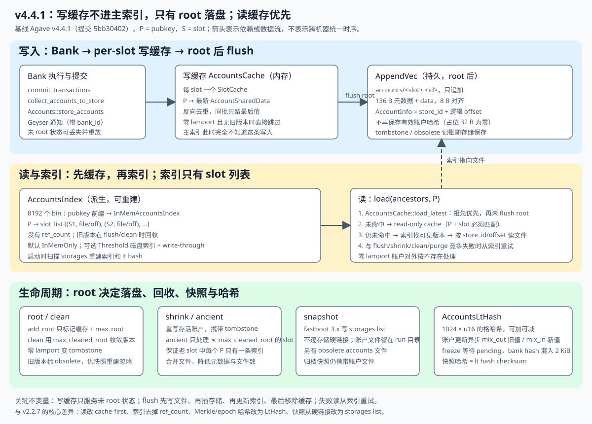

## 1. 具体问题与结论 {#question}

一笔交易修改了账户之后，节点到底把什么写到哪里？为什么重启还能恢复？为什么 RPC 能查到账户，磁盘却会不断膨胀？快照又凭什么证明“这台机器的账户状态是对的”？

AccountsDB 的答案不是“把新余额覆盖到一棵全局 Merkle 树的叶子上”。更准确的模型是：

> **按 pubkey 索引、按 slot 保存版本、以追加文件为事实来源、以可重建索引回答位置；最新状态先住在写缓存里，只有 root 才落盘。**

本文固定 **Agave `v4.4.1`**——截至 2026-11-19 的最新稳定 release，提交 [`5bb30402`](https://github.com/anza-xyz/agave/commit/5bb304027fe1a166b02cb26dc8c161593f416fca)，2026-11-05 发布。它与现有[数据路径文章](./data-path.md)使用的 `v2.2.7` 不是同一实现基线；两文只复用“Bank → AccountsDB”的边界概念，不把旧文行号套到本篇。

### 结论先行 {#conclusions}

1. **AccountsDB 是版本化 KV，不是账户表的原地更新。** 键是 `Pubkey`，版本维度是 `Slot`，可见性由 `Ancestors` 和 root 决定。同一个 pubkey 可以同时存在多个 slot 版本，分叉也可以各自持有版本。[索引结构][A-entry]、[读路径][A-doload]
2. **未 root 的写入只进写缓存，不进主索引。** Bank 提交后先写 per-slot `SlotCache`；主索引里没有 `Cached` 哨兵，也没有对应的 slot 条目。只有 root 才 flush 到 AppendVec。[写缓存][A-writecache]、[flush][A-flush]
3. **读路径是 cache-first。** 先查写缓存（祖先优先、再未 flush root），未命中才查 read-only cache 和主索引；索引只负责“文件 + 偏移”，不负责保存最新值。[`do_load`][A-doload]、[缓存查找][A-cache-load]
4. **AppendVec 只追加、不原地改。** 每个账户版本都带 136 B 固定元数据重新写一遍；文件名为 `<slot>.<id>`。`AccountInfo` 固定 8 字节，保存 `store_id + 逻辑 offset + zero-lamport 位`，不再有 `Cached` 变体。[AppendVec][A-append]、[AccountInfo][A-info]
5. **索引项只有 slot 列表，没有 `ref_count`。** 每个 pubkey 的 `AccountMapEntry` 是 `slot_list + meta`；旧版本在 flush 的 `ReclaimOldSlots` 或 clean 中回收。索引默认 InMemOnly，可选阈值磁盘索引与 write-through。[条目结构][A-entry]、[upsert][A-upsert]、[索引配置][A-indexcfg]
6. **clean 的核心是 `max_cleaned_root`。** 它把 root 以下的版本收敛到“每个 pubkey 至多一条”，并用 tombstone 保留零 lamport 的删除语义、用 obsolete accounts 记录重建时应忽略的旧字节。零 lamport 的彻底清除受最近一次 full snapshot 约束。[clean][A-clean]、[墓碑][A-tombstone]、[obsolete][A-obsolete]
7. **全量状态哈希改为增量格哈希。** `AccountsLtHash` 是 1024 个 `u16` 的格哈希，支持 `mix_in` / `mix_out`；账户更新异步计算“旧值减、新值加”，freeze 时等待完成，bank hash 直接混入 2 KiB 的 lt hash。Merkle 账户哈希、accounts delta hash 和 epoch accounts hash 在这一版都已不存在。[`lt_hash_account`][A-hash]、[`hash_internal_state`][A-bankhash]、[`freeze`][A-freeze]
8. **快照 fastboot 格式改为 storages list。** v4.4.1 的 3.x 快照不再把每个账户文件硬链接到 bank snapshot，而是在快照目录写 `(slot, id)` 列表和 obsolete accounts 文件；启动时按列表裁剪账户目录、重建存储、扫描生成索引和 lt hash，再做校验。[快照序列化][A-snapshot]、[storages list][A-storages]、[启动重建][A-startup]

### 版本与证据边界 {#versions}

| 对象 | 固定基线 | 本文能证明什么 |
| --- | --- | --- |
| Agave 主路径 | `v4.4.1`，提交 [`5bb304027fe1a166b02cb26dc8c161593f416fca`](https://github.com/anza-xyz/agave/commit/5bb304027fe1a166b02cb26dc8c161593f416fca)，2026-11-05 | 最新稳定 release 的写缓存、flush、索引、clean/tombstone、shrink、storages list 快照与 LtHash 路径 |
| Agave 历史对照 | `v2.2.7`，提交 [`7c7f93bc52c4fe2ee40f364f4d9f17c258219158`](https://github.com/anza-xyz/agave/commit/7c7f93bc52c4fe2ee40f364f4d9f17c258219158)，2025-04-04 | 仅用于第 8 节的结构对照；不与 v4.4.1 的函数逐行拼接 |
| 实验 E1 | 2026-11-19，本地 sparse checkout | 34 项 v4.4.1 源码常量、结构和更新顺序断言；不是运行期账户测试 |
| 实验 E2 | 未执行 | 需要本地 validator / ledger；文中标为待验证 |

**为什么这次以 v4.4.1 为主路径？** 因为最近几个版本的 AccountsDB 已经不是“给旧实现加优化”，而是换了几个关键机制：

- 读从“索引优先”改为“缓存优先”，主索引不再保存未 flush 账户；
- 索引项去掉 `ref_count`，clean 依赖 `max_cleaned_root` 与 tombstone/obsolete 记账；
- 全量账户哈希从 Merkle 改为 LtHash，bank hash 不再包含 accounts delta hash / epoch accounts hash；
- 快照 fastboot 从逐存储硬链接改为 storages list。

把这些变化塞进一条“原理”主线，读者会分不清哪些是稳定设计、哪些是版本实现。本文先讲清 v4.4.1 的完整闭环，再在第 8 节用一张表对照 v2.2.7。

## 2. 最小心智模型 {#model}



把 AccountsDB 想成五个平面：

| 平面 | 主要对象 | 作用 | 不能由它单独推出的结论 |
| --- | --- | --- | --- |
| 执行平面 | `Bank`、`Ancestors`、root | 决定哪个 slot 的状态对当前查询可见 | Bank 已提交或已 freeze，不等于网络已 finalized |
| 易失写平面 | `AccountsCache`、`SlotCache`、`AccountsCacheIndex` | 保存未 flush 的最新账户值；主索引此时没有这条写入 | 进程崩溃后这些状态可以丢失并从账本重放 |
| 持久数据平面 | `AccountStorageEntry`、`AccountsFile`、`AppendVec` | 以 slot 为单位保存账户版本的完整字节 | 文件里有旧版本，不代表它仍对当前 fork 可见 |
| 派生索引平面 | `AccountsIndex`、`AccountMapEntry`、`InMemAccountsIndex` | 回答 `pubkey` 在哪些 slot、哪个文件、哪个偏移 | 索引可以重建，不能替代账户文件 |
| 哈希平面 | `AccountsLtHash`、`Bank::accounts_lt_hash` | 增量维护全量账户状态哈希 | lt hash 相同不代表某个中间 slot 的可见状态相同 |

另外有一条生命周期线：`add_root → flush → clean → shrink/ancient → snapshot`。这条线上的操作大多在 `AccountsBackgroundService` 中推进；读路径通过“缓存 → 索引 → 文件 → 失败重试”与它们协作。

| 对象 | v4.4.1 关键字段或约束 | 说明 |
| --- | --- | --- |
| `AccountSharedData` | lamports、data、owner、executable、rent_epoch | 执行层看到的账户值；不是磁盘布局本身 |
| `AccountInfo` | `store_id: u32`、31 位逻辑 offset、zero-lamport 位 | 8 字节的运行期位置引用；**没有 Cached 变体** |
| `SlotCache` | `DashMap<Pubkey, Arc<CachedAccount>>` + 大小/计数 | 每个未 flush 的 slot 一个；同槽重复写覆盖 |
| `AccountsCacheIndex` | `Pubkey → (max_slot, ref_count)` | 缓存内部索引，加速 `load_latest`；不是主索引的 ref_count |
| `AccountStorageEntry` | slot、id、alive accounts/bytes、tombstone offsets、obsolete accounts | 一个 slot 的正常存储单元；shrink 时短暂出现新旧两个 |
| `AppendVec` | 文件、append 锁、当前长度、8 B 对齐 | 只追加；16 GiB 上限；不保存有效账户哈希 |
| `AccountsIndex` | 8192 个 bin、`slot_list`、meta | 读版本选择的核心；默认 InMemOnly，可选 Threshold 磁盘索引 |
| `AccountsLtHash` | 1024 × `u16`，可加可减 | 全量状态哈希；异步更新，freeze 等待 |

## 3. 状态、磁盘布局与数值推演 {#state}

### 3.1 一个账户版本在索引里有多小 {#account-info}

`AccountInfo` 只保存“去哪儿找”，不保存账户内容：

```rust
pub struct AccountInfo {
    store_id: AccountsFileId,                 // u32
    account_offset_and_flags: PackedOffsetAndFlags,
}

#[bitfield(bits = 32)]
pub struct PackedOffsetAndFlags {
    offset: B31,             // 逻辑 offset（文件 offset / 8）
    is_zero_lamport: bool,   // 最高位
}
```

源码对 `size_of::<AccountInfo>() == 8` 做了编译期断言；`StorageLocation` 只有 `AccountsFile(store_id, offset)`，没有 `Cached`。[`AccountInfo`][A-info] 这意味着 v4.4.1 的读路径必须先查写缓存，否则未 flush 的账户在主索引里根本不存在。

| 字段 | 作用 | 注意 |
| --- | --- | --- |
| `store_id` | 指向某个 `AccountStorageEntry` / 文件 | 本地运行期标识，不能跨节点比较，也不能当账户版本号 |
| offset | 文件内账户元数据起点，按 8 字节对齐压缩 | 最大 16 GiB 文件对应 31 位逻辑 offset |
| zero-lamport 位 | 让 clean/shrink 不必先读文件就知道账户已归零 | 它是提示，不是账户余额本身 |

### 3.2 AppendVec 的字节布局 {#appendvec}

每个账户版本在文件中按以下顺序排列：

| 段 | 大小（v4.4.1） | 内容 |
| --- | --- | --- |
| `StoredMeta` | 48 B | `write_version_obsolete: u64`、`data_len: u64`、`pubkey: [u8; 32]` |
| `AccountMeta` | 56 B | lamports、rent_epoch、owner、executable 及对齐填充 |
| `ObsoleteAccountHash` | 32 B | 全零占位；不再保存有效账户哈希 |
| data | `data_len` | 账户数据 |
| padding | 0–7 B | 对齐到下一个 8 字节边界 |

固定开销仍是 `STORE_META_OVERHEAD = 136` 字节，实际占用为 `u64_align(136 + data_len)`；文件名是 `<slot>.<id>`，文件上限 16 GiB，账户偏移按 8 字节对齐。[布局常量][A-append]、[文件命名][A-file]

三个容易误读的点：

- **`write_version_obsolete` 不承担排序职责。** 追加路径明确写入 `0`，字段注释也说明它将被淘汰；版本顺序由 slot 和写入顺序表达。[追加路径][A-append-write]
- **32 B 哈希槽不是有效缓存。** 追加时写 `ObsoleteAccountHash::ZEROED`；全量哈希改由 `AccountsLtHash` 在账户写入时增量维护，不依赖文件里的哈希。[追加路径][A-append-write]、[lt hash][A-hash]
- **`AccountsFile` 目前只有 `AppendVec`。** v4.4.1 的 `AccountsFileProvider` 只有一个 `AppendVec` 变体；`split_file` 等模块存在，但不是本文主路径的默认存储格式。[`AccountsFile`][A-file]

### 3.3 写缓存：一个独立的小索引 {#cache}

`AccountsCache` 有两层：

```text
AccountsCache
  ├─ cache: Slot → Arc<SlotCache>        // 每个未 flush 的 slot 一个 DashMap
  └─ index: Pubkey → (max_slot, ref_count) // 加速 load_latest 的缓存内部索引
```

- `store(slot, pubkey, account)`：插入或覆盖该 slot 的值；只有 pubkey 首次进入该 slot 时才更新缓存索引。[`store`][A-cache-store]
- `load_latest(pubkey, ancestors)`：先按祖先链从高到低找；若祖先没有，再在 `unflushed_roots` 中从高到低找；缓存索引的 `max_slot` 可能因移除而变旧，因此查找按范围向下扫描，而不是只查一个 slot。[`load_latest`][A-cache-load]
- `add_root(slot)`：把 slot 放进 `unflushed_roots`，等待 flush；`remove_slot` 时移除。[`add_root`][A-cache]

这里的 `ref_count` 是“这个 pubkey 当前在多少个 slot 的缓存里”，只用于缓存索引维护，**不是** v2.2.7 主索引里的 alive-slot 引用计数。

### 3.4 主索引：只有 slot 列表，没有 ref_count {#index}

`AccountsIndex` 默认按 pubkey 前缀分成 8192 个 bin（`BINS_DEFAULT`）。每个 bin 是一个 `InMemAccountsIndex`，每个 pubkey 对应一个 `AccountMapEntry`：

```text
P → AccountMapEntry {
      slot_list: [(S1, AccountInfo), (S2, AccountInfo), ...],
      meta: dirty / age
    }
```

[`AccountMapEntry`][A-entry]

- `slot_list` 记录该 pubkey 在不同 slot 的已 flush 版本；`latest_slot()` 先看 `Ancestors`，再在 root 中找不超过上限的最高 slot，而不是简单取列表最后一个。[版本选择][A-latest]
- 没有 `ref_count`。旧版本在 flush 的 `UpsertReclaim::ReclaimOldSlots` 中直接从 slot list 移除并返回 reclaims；若选择 `IgnoreReclaims`（例如有 scan 或 slot 高于 clean 上限），旧版本保留给后续 clean。[`UpsertReclaim`][A-upsert]
- 索引默认 `IndexLimit::InMemOnly`；配置成 `Threshold` 时才启用磁盘 bucket map，并开启 write-through：`slot_list.len() == 1` 的脏条目可以写到磁盘后被驱逐。[索引配置][A-indexcfg]、[write-through][A-write-through]
- 阈值模式按条目数/字节数计算高/低水位，超过高水位后驱逐；`InMemOnly` 没有磁盘后端。[阈值与驱逐][A-bucket]、[驱逐扫描][A-evict]
- 启动时索引不是从磁盘“恢复”出来的，而是扫描账户文件重新生成；`AccountInfo` 是运行期状态。[索引生成][A-genindex]

### 3.5 存储单元：tombstone 与 obsolete {#storage}

`AccountStorageEntry` 除了文件和 alive 计数，还保存两类“已死但还有用”的信息：

- **`tombstone_offsets`**：已经从索引完全删除的零 lamport 账户偏移。字节仍留在文件里，供“最近 full snapshot 之后”的增量快照观察删除事实；shrink 会把这些 tombstone 一并搬到新文件。[墓碑字段][A-tombstone]
- **`obsolete_accounts`**：仍在文件里、但重建索引时应忽略的账户；记录“从哪个 slot 起不再需要”。两种来源：账户被更新到新 slot；账户归零且早于最近 full snapshot。[obsolete 字段][A-obsolete-field]、[obsolete 模块][A-obsolete]

`AccountStorage` 仍然是 `Slot → Arc<AccountStorageEntry>` 的映射；shrink 期间用 `shrink_in_progress_map` 暂时容纳新旧两个存储，`get_account_storage_entry(slot, store_id)` 会在两张表之间查找，保证读者仍能找到旧位置。[存储映射][A-storage-map]

### 3.6 一组数值推演 {#example}

取一个 165 字节的 SPL Token 账户 `P`，忽略索引开销：

| 事件 | 写缓存 | AppendVec | 主索引 | 说明 |
| --- | --- | --- | --- | --- |
| slot 100 执行后 | `(100, P) → v1` | 无 | 无 | 未 root；主索引完全不知道这条写入 |
| slot 100 成为 root，flush | 移除 | 文件 `100.1`，304 B（136 + 165 对齐） | `P: [(100, file 1, off)]` | 先写文件、插入存储、更新索引，最后移除缓存 |
| slot 101 再次修改 | `(101, P) → v2` | 仍保留 v1 | 仍是 `[(100, f1)]` | 读 101 会先命中缓存 |
| slot 101 flush（允许 clean） | 移除 | 文件 `101.2`，304 B | `P: [(101, f2)]`；若受 scan/快照限制则暂时保留 `(100, f1)` | flush 的 `ReclaimOldSlots` 可直接回收旧 slot；否则留给 clean |
| root 推进并 clean | — | v1 被标 obsolete | `P: [(101, f2)]` | 若 flush 已回收，此步主要处理其他候选；字节等 shrink 回收 |
| slot 102 写入 0 lamport | `(102, P) → zero` | 无 | 仍指向 101 | 有旧非零版本，所以缓存要保留 zero 以遮蔽它 |
| slot 102 flush | 移除 | 文件 `102.3`，写入 zero 版本 | 索引删除 `P`，102 文件记录 tombstone | zero-lamport 是删除语义，但字节留给增量快照 |
| full snapshot 覆盖 102 后 | — | shrink 可清掉 tombstone 与旧字节 | `P` 不存在 | `can_purge_zero_lamport_accounts` 才允许整槽/墓碑清理 |

[`can_purge_zero_lamport_accounts`][A-can-purge]

如果 flush 时选择 `IgnoreReclaims`（例如有 scan 正在进行，或 root 高于 `max_clean_root`），索引会暂时保留两个版本，由后续 clean 删除旧版本。单版本写入增加约 304 B；如果每个 slot 都重写一遍且没有 clean/shrink，空间按版本线性增长。clean 只更新索引、alive 计数和 obsolete/tombstone 记账；真正的空间回收发生在 shrink 重写存活账户，或整个 slot 存储死亡后删除文件。

## 4. 完整主路径 {#path}

### 4.1 从交易提交到写缓存 {#write-cache}

Bank 执行完一批交易后，`commit_transactions` 收集写集，`collect_accounts_to_store` 区分成功交易的 writable 账户与失败交易的回滚账户，然后调用 `Accounts::store_accounts`。[提交与收集][A-commit]、[账户收集][A-saver]

`Accounts::store_accounts` 做两件事：

1. 如果有 Geyser notifier，按账户分配 `write_version` 并调用 `notify_account_at_accounts_update`，通知里带 `bank_id`；同一 slot 的多次写会分别通知。
2. 调用 `AccountsDb::store_accounts_unfrozen(accounts, ancestors)`。

[`Accounts::store_accounts`][A-accounts]

`store_accounts_unfrozen` 只写缓存：

```text
AccountsDb::store_accounts_unfrozen
  → write_accounts_to_cache
      → 反向遍历，按 pubkey 去重，只保留最后一份
      → 零 lamport 且没有旧版本 / 旧版本已为零：直接跳过
      → accounts_cache.store(slot, pubkey, account)
      → 更新 secondary index
```

[`store_accounts_unfrozen`][A-unfrozen]、[`write_accounts_to_cache`][A-writecache]

零 lamport 的处理值得单独说明：

- `is_ancestor_zero_lamport(pubkey, ancestors)` 返回 `None` 表示该账户在缓存和索引里都不存在；返回 `Some(true)` 表示可见旧版本已经是零；返回 `Some(false)` 表示存在非零旧版本。
- `None` 或 `Some(true)` 时，零 lamport 写入可以跳过：既没有旧值需要遮蔽，也不会改变 lt hash。
- `Some(false)` 时必须写入缓存里的零值，否则读路径仍会看到旧的非零版本。

[`is_ancestor_zero_lamport`][A-zero]

**主索引此时没有更新。** 这是 v4.4.1 和 v2.2.7 最大的结构差异之一：未 root 的写入只存在于缓存，读路径必须先查缓存。

### 4.2 flush：只把 root 变成文件 {#flush}

v4.4.1 的 flush **只处理 rooted slots**：

- `AccountsCache::roots_to_flush(max_root)` 返回所有已标记 root 且尚未 flush 的 slot；
- `flush_accounts_cache(force_flush, requested_flush_root)` 总是 flush `<= requested_flush_root` 的 root；
- 缓存超过阈值时，也只额外 flush 其他 root（`flush_rooted_accounts_cache_without_clean`），不会把未 root 的 slot 落盘；
- 未 root 的状态留在缓存里，等 root 或 `Bank::drop` 时从缓存清除。

[`flush_accounts_cache`][A-flush]

flush 一个 root 时，v4.4.1 还有一个重要优化：**如果允许 clean，一次 flush 多个 root 只写每个账户的最新版本。** `select_pubkeys_to_store` 从新 root 到旧 root 遍历，用 `written_accounts` 去重；旧 root 只写“更新 root 没写过”的 pubkey。对高于 `max_clean_root` 的 root 则写 `All`，保留所有版本；scan 会把 `max_clean_root` 压低，从而扩大保留范围。[`select_pubkeys_to_store`][A-select]

`store_accounts_for_flush` 的顺序是不变量：

```text
1. 创建与数据量匹配的 AccountStorageEntry / AppendVec
2. write_accounts_to_storage：把账户追加进文件
3. storage.insert(...)：把存储挂到 slot → storage 映射
4. update_index_for_flush：
     - 普通版本：upsert(target_slot, old_slot, ...)，按 reclaim 策略回收旧 slot
     - 零 lamport 且 ReclaimOldSlots：delete(pubkey)，并把本 slot 记为 tombstone
5. 移除被覆盖 pubkey 的 read-only cache 条目
6. handle_reclaims：删除旧版本字节、标记 obsolete、处理死槽、排队 shrink
7. reopen storage as readonly（如果 slot 没死）
```

[`store_accounts_for_flush`][A-store-flush]、[`update_index_for_flush`][A-update-index]

然后 `do_flush_slot_cache` 才移除缓存：

```text
accounts_cache.remove_slot(slot)
  → 返回该 slot 的所有 pubkey
  → 对跳过的零 lamport 清理 secondary index
  → write_through_pubkeys：让单版本索引项可以写到磁盘并被驱逐
```

[`do_flush_slot_cache`][A-flush-body]

不变量是：**文件先写完，存储映射再挂上，索引再切过去，reclaims 再处理，缓存最后移除。** 读者如果在缓存/旧存储上失败，可以回到索引重新读取；此时索引已经指向新文件。源码中的 R1–R4 读步骤和 F1–F4 flush 步骤注释，正是为这条不变量服务的。[读/写竞争注释][A-retry]

### 4.3 读：缓存优先，索引兜底 {#load}

`AccountsDb::load(ancestors, pubkey, ...)` 的流程：

1. `AccountsCache::load_latest`：在缓存中找祖先链上最高可见 slot；祖先没有，再找未 flush root；
2. 命中缓存直接返回（并做 `load_filter` 过滤）；
3. 未命中，读索引 `slot_list`，用 `latest_slot(ancestors, ...)` 选可见版本；
4. 先查 read-only accounts cache（键是 pubkey，值带 slot，命中要求 slot 一致）；
5. 否则按 `store_id + offset` 从 AppendVec 读取；
6. 如果缓存/存储失败（flush、shrink、clean、purge 竞争），回到索引重试；固定 root 的存储缺失路径继续重试，非固定路径累计失败到上限后回退慢路径。

[`do_load`][A-doload]、[`load`][A-load]、[`retry`][A-retry]

这里有两个常见误解：

- **“读最新文件”是错的。** 文件按 slot 命名，索引里可能有多个版本；可见性由 `Ancestors` 和 root 决定。一个较新的 slot 如果在另一条分叉上，不能被当前 Bank 读到。
- **“索引就是账户状态”也是错的。** 索引只给位置；真正的账户字节在缓存或 AppendVec 里，最终还要过 `AccountSharedData` 和 zero-lamport 过滤。

### 4.4 root、clean 与死槽 {#root-clean}

`add_root(slot)` 在 v4.4.1 很轻：把 slot 加入 `AccountsCache` 的 `unflushed_roots`，并推进 `max_root`；主索引没有 root 集合，也没有 `dirty_stores`。[`add_root`][A-addroot]

`AccountsBackgroundService` 周期性地执行：

```text
flush_accounts_cache(force_flush, max_clean_slot)
clean_accounts(max_clean_slot, ...)
shrink_ancient_slots
shrink_candidate_slots
```

[后台服务循环][A-abs]

`max_clean_slot_inclusive` 通常取 `min(next_snapshot_request_slot, max_flush_slot) - 1`：不能 clean 到下一个快照请求之上，否则零 lamport 删除会破坏快照。clean 自己还会用 `max_clean_root = min(scan_tracker.min_ongoing_scan_root, proposed)` 限制，避免边扫描边删除。[`max_clean_root`][A-maxclean]

clean 开始时先处理 `pubkeys_removed_from_cache` 的 secondary index / write-through 收尾；真正的版本回收候选不是全表扫描，而是：

- `uncleaned_pubkeys`：flush 时写入、但尚未被 clean 检查过的 pubkey；
- full snapshot 推进后，额外 sweep 只含 tombstone 的存储，并补充 shrink 候选。

[`construct_candidate_clean_keys`][A-candidates]、[`handle_pubkeys_removed_from_cache`][A-clean]

对每个候选 pubkey，clean 找到不超过 `max_clean_root` 的最高 rooted slot：

- 如果最新 rooted 版本是零 lamport，收集 reclaims 并从索引删除该 key；
- 如果存在多个 rooted 版本，保留最新 root 版本，删除更老的索引项并收集 reclaims；
- 如果没有 rooted 版本（只在分叉上），也可以清理；
- `clean_rooted_entries` 在 slot list 只剩一个零 lamport 条目时，直接 reclaim 并清空 key。

[`clean_rooted_entries`][A-clean-entry]

回收时：

1. `remove_dead_accounts` 按 offset 集合更新存储的 alive 计数/字节；
2. 如果 reclaim 落在“目标 slot 本身”，它不是 obsolete，而是 tombstone：只记录 offset，不减少 alive；字节保留给增量快照；
3. 否则把被删账户标记为 obsolete，记录“从哪个 slot 起不再需要”；
4. 如果所有账户都被删除，或只剩 tombstone 且该 slot `<= latest_full_snapshot_slot`，整槽进入 dead slots，删除存储文件；
5. clean 结束后推进 `max_cleaned_root`；在不超过它的 slot 中，每个 pubkey 至多一条索引。

[`remove_dead_accounts`][A-remove-dead]、[`can_purge_zero_lamport_accounts`][A-can-purge]

**clean 不等于 shrink。** 如果存储里还有存活账户，clean 只更新索引、alive 计数和 obsolete/tombstone；真正把洞收掉需要 shrink 重写。这个区别直接决定磁盘占用曲线：clean 后逻辑上可回收的空间可能仍占着文件。

死分叉的清理很简单：v4.4.1 只 flush root，所以未 root 的 slot 只在缓存里；`Bank::drop` 调用 `purge_slot(slot, bank_id)`，`purge_slots_from_cache` 移除缓存并把 pubkey 交给 clean 做 secondary/write-through 收尾，不会碰已落盘的 root 存储。同一 slot 可能有多个 Bank 实例，因此仍用 `bank_id` 而不是只用 slot 识别。[`purge_slot`][A-purge]

### 4.5 shrink 与 ancient：空间回收的两种粒度 {#shrink}

**shrink** 针对单个 slot 存储：

- 候选来自 clean/flush 的 reclaims、启动时的全量扫描、以及 ancient 候选；
- 按 alive ratio 或总空间策略选择；
- 读取存活账户，写入新的更小存储；索引用 `replace` 指向新 `store_id`；
- 把 `tombstone_offsets` 一并搬到新存储；
- 新索引生效后删除旧存储。

[`shrink_candidate_slots`][A-shrink]、[`shrink_storage`][A-shrink-storage]

**ancient append vec** 针对“老 slot 数量太多”的问题：

- 只考虑 `<= max_cleaned_root` 且超过一个 epoch 的 slot；
- 因为 clean 已经把每个 pubkey 收敛到最多一条索引，合并时不必再处理同一 pubkey 在多个 old slot 的重复；
- 把多个 slot 的存活账户打包进新的 ancient 存储，更新索引到目标 slot；
- 降低文件数、元数据开销和索引版本数。

[`shrink_ancient_slots`][A-ancient]、[ancient 模块][A-ancient-mod]

v4.4.1 的相关默认值包括：`ancient_append_vec_offset = 100_000`、最小 ancient 存储目标 100 KB、最多 100_000 个 ancient 存储。这些是节点参数默认值，不是协议常量，部署时应以实际 CLI/配置为准。[默认参数][A-defaults]

### 4.6 快照与启动：storages list、obsolete accounts、lt hash {#snapshot}

v4.4.1 的 fastboot 快照（3.x 格式）不再逐存储硬链接：

1. 序列化 bank 字段（含 `accounts_lt_hash`）、status cache、版本文件；
2. 对快照涉及的存储执行 `flush`，并禁用“drop 时删除文件”；
3. 写 obsolete accounts 文件：只保留 `slot <= snapshot_slot` 的 obsolete 记录；
4. 写 storages list：`(slot, id)` 列表，指向账户 run 目录中的文件；
5. 写 startup hints（可选），最后标记 loadable。

[`serialize_snapshot`][A-snapshot]、[storages list][A-storages]、[obsolete 文件][A-obsolete-file]

归档快照仍然携带账户文件：full snapshot 包含截至快照 slot 的存储；incremental snapshot 只保留 `slot > base_slot` 的存储。storages list 是本地 fastboot 用的，不进入归档；从归档恢复时走另一条重建路径。

启动时：

```text
读 storages list
  → 删除账户目录中不属于该快照的旧/新文件
  → 从文件重建 AccountStorageMap
  → 读 obsolete accounts，重建时忽略这些条目
  → generate_index
       → 扫描每个存储中的账户
       → 重建 pubkey → slot → AccountInfo
       → 计算 accounts_data_len、capitalization、AccountsLtHash
  → verify_snapshot_bank(calculated_lt_hash)
```

[`rebuild_storages_from_snapshot_dir`][A-startup]、[`generate_index`][A-genindex]、[`verify_snapshot_bank`][A-verify]

旧版 2.0 快照的逐存储硬链接会在启动时迁移回 run 目录，再按 3.x 格式加载；这是兼容路径，不是新格式。[启动重建][A-startup]

### 4.7 AccountsLtHash 与 bank hash {#hash}

v4.4.1 用 `AccountsLtHash` 取代了 Merkle 账户哈希：

- `LtHash` 是 **1024 个 `u16`** 的格哈希，支持 `mix_in`（加）和 `mix_out`（减），加法可交换，顺序无关；`checksum()` 是 32 字节 BLAKE3。[`LtHash`][A-lthash]
- `lt_hash_account(account, pubkey)`：零 lamport 返回 identity；否则对 `lamports || data || executable || owner || pubkey` 做 BLAKE3 XOF，得到一个 2 KiB 向量。注意它**不包含 `rent_epoch`**。[`lt_hash_account`][A-hash]、[输入布局][A-hash-input]
- Bank 创建时从父 Bank 克隆 `accounts_lt_hash`；本 slot 的账户更新通过 `enqueue_on_chain_accounts_lt_hash_updates` 异步排队：对每个 pubkey 找到旧值，计算 `mix_out(old)` 和 `mix_in(new)`，由 hasher 线程累加。[克隆][A-bank-clone]、[异步更新][A-lt-enqueue]
- `freeze()` 调用 `finish_accounts_lt_hash_updates`，等待所有 pending job，把线程累加器 mix 进 bank 的 lt hash，然后才计算 bank hash。[`freeze`][A-freeze]、[`finish`][A-lt-finish]
- `hash_internal_state`：`H(parent_hash, signature_count, last_blockhash, lt_hash_bytes)`；不再有 accounts delta hash 或 epoch accounts hash。[`hash_internal_state`][A-bankhash]
- 快照哈希是 lt hash 的 checksum；启动时用扫描得到的 lt hash 校验快照。[`get_snapshot_hash`][A-snap-hash]、[`verify_snapshot_bank`][A-verify]

这套设计的关键取舍是：**用可加可减的格哈希维护全量状态，替代“每 slot 增量哈希 + 周期性全量 Merkle”的组合。** 好处是不用排序、不用建树、不用周期性全量重扫；代价是每次账户更新都要知道旧值（通常从写缓存/索引读），并且 lt hash 更新是异步的，freeze 必须等待。

## 5. 源码定位 {#source}

以下链接全部固定到 `v4.4.1` 提交；行号以该提交的文件为准。

| 主题 | 文件与入口 | 作用 |
| --- | --- | --- |
| 写缓存 | [`accounts_cache.rs`][A-cache] `AccountsCache` / `load_latest` | per-slot 值、缓存内部索引、祖先优先查找 |
| Bank 写入 | [`accounts.rs`][A-accounts] `store_accounts` | Geyser 通知 + 转入 AccountsDB 写缓存 |
| 写缓存实现 | [`accounts_db.rs`][A-writecache] `write_accounts_to_cache` | 反向去重、零 lamport 跳过、插入缓存 |
| 落盘 | [`accounts_db.rs`][A-flush-body] `do_flush_slot_cache` | 选择 pubkey → 写文件 → 更新索引 → 移除缓存 |
| 追加格式 | [`append_vec.rs`][A-append] `STORE_META_OVERHEAD` | 136 B 元数据、8 B 对齐、只追加、零哈希占位 |
| 位置引用 | [`account_info.rs`][A-info] `AccountInfo` | store_id、31 位逻辑 offset、zero-lamport 位 |
| 索引条目 | [`account_map_entry.rs`][A-entry] `AccountMapEntry` | slot list + meta，无 ref_count |
| 索引更新 | [`accounts_index.rs`][A-upsert] `upsert` | `ReclaimOldSlots` / `IgnoreReclaims` |
| 版本选择 | [`accounts_index.rs`][A-latest] `latest_slot` | ancestors 优先、root 兜底 |
| 读路径 | [`accounts_db.rs`][A-doload] `do_load` | 缓存优先 → read cache → 索引/文件 → 重试 |
| 清理 | [`accounts_db.rs`][A-clean] `clean_accounts` | `max_cleaned_root`、候选 pubkey、tombstone/obsolete |
| 存储元数据 | [`account_storage_entry.rs`][A-storage] | alive 计数、tombstone offsets、obsolete accounts |
| 收缩 | [`accounts_db.rs`][A-shrink-storage] `shrink_storage` | 重写存活账户、携带 tombstone、切换 store id |
| Ancient | [`accounts_db.rs`][A-ancient] / [`ancient_append_vecs.rs`][A-ancient-mod] | 合并老 slot，受 `max_cleaned_root` 约束 |
| 快照 | [`snapshot_utils.rs`][A-snapshot] `serialize_snapshot` | storages list、obsolete accounts、startup hints |
| 启动 | [`snapshot_utils.rs`][A-startup] / [`serde_snapshot.rs`][A-serde] | 裁剪存储、重建、生成索引与 lt hash |
| 哈希 | [`accounts_db.rs`][A-hash] / [`bank.rs`][A-bankhash] | 账户 lt hash、增量更新、bank hash |
| 格哈希 | [`lattice-hash/src/lt_hash.rs`][A-lthash] | 1024 × u16、mix_in/mix_out、checksum |

### 5.1 `AccountInfo` 片段 {#snippet-info}

```rust
// accounts-db/src/account_info.rs (v4.4.1)
pub struct AccountInfo {
    store_id: AccountsFileId,
    account_offset_and_flags: PackedOffsetAndFlags,
}

#[bitfield(bits = 32)]
pub struct PackedOffsetAndFlags {
    offset: B31,
    is_zero_lamport: bool,
}

const _: () = assert!(size_of::<AccountInfo>() == 8);
```

没有 `Cached` 变体；未 flush 的账户由写缓存负责。

### 5.2 写缓存中的零 lamport 片段 {#snippet-cache}

```rust
// accounts-db/src/accounts_db.rs (v4.4.1)
if account.is_zero_lamport() {
    match self.is_ancestor_zero_lamport(pubkey, ancestors) {
        None => {
            stats.num_ephemeral_accounts_skipped += 1;
            return;
        }
        Some(true) => {
            stats.num_ancestors_zero_lamport_skipped += 1;
            return;
        }
        Some(false) => {}
    }
}
self.accounts_cache.store(slot, pubkey, account_shared_data);
```

没有旧版本或旧版本已经为零时，零 lamport 写入不会进入缓存；有非零旧版本时，才需要写零来遮蔽。

### 5.3 flush 顺序片段 {#snippet-flush}

```rust
// accounts-db/src/accounts_db.rs (v4.4.1)
let infos = self.write_accounts_to_storage(slot, &storage, &accounts);
self.storage.insert(Arc::new(storage));
let reclaims = self.update_index_for_flush(&infos, &accounts, reclaim_handling);
self.read_only_accounts_cache.remove_assume_not_present(/* ... */);
if !reclaims.is_empty() {
    let dead_slots = self.handle_reclaims(
        reclaims.iter(),
        &purge_stats,
        MarkAccountsObsolete::Yes(slot),
    );
    // ...
}
```

### 5.4 LtHash 更新片段 {#snippet-lt}

```rust
// runtime/src/bank/accounts_lt_hash.rs (v4.4.1)
if let Some(prev_account) = prev_account {
    let prev_lt_hash = AccountsDb::lt_hash_account(&prev_account, &address);
    accum_lt_hash.mix_out(&prev_lt_hash.0);
}
if let Some(curr_account) = curr_account {
    let curr_lt_hash = AccountsDb::lt_hash_account(&curr_account, &address);
    accum_lt_hash.mix_in(&curr_lt_hash.0);
}
```

### 5.5 bank hash 片段 {#snippet-bankhash}

```rust
// runtime/src/bank.rs (v4.4.1)
let mut hash = hashv(&[
    self.parent_hash.as_ref(),
    &self.signature_count().to_le_bytes(),
    self.last_blockhash().as_ref(),
]);
let accounts_lt_hash = &*self.accounts_lt_hash.lock().unwrap();
let lt_hash_bytes = bytemuck::must_cast_slice(&accounts_lt_hash.0.0);
hash = hashv(&[hash.as_ref(), lt_hash_bytes]);
```

## 6. 失败与边界 {#failures}

### 6.1 崩溃：未 root 的缓存丢失，索引重建 {#failure-crash}

- 未 flush 的写缓存只存在于内存；进程崩溃后，这部分状态可以丢失，节点从账本重放或从快照恢复。
- 索引不是持久真相；正常启动路径本来就会扫描账户文件重建主索引和 lt hash。真正需要担心的是账户文件本身损坏或被错误删除。
- flush 过程中崩溃可能留下部分写入的 AppendVec；加载路径会校验布局和长度，再决定哪些账户可读。不要把“文件存在”当成“文件完整”。

### 6.2 读与后台操作的竞争 {#failure-race}

flush、shrink、clean、purge 都可能让读者刚拿到的 `store_id/offset` 失效。源码用“失败后回到索引重试”解决，而不是给整个 AccountsDB 加一把全局读锁。v4.4.1 的缓存优先路径还要处理另一种竞争：读缓存时命中，随后 flush 删除了该 slot；此时 `load_latest` 会回退到索引/存储，而不是把缓存当成永久真相。

### 6.3 零 lamport、tombstone 与增量快照 {#failure-zero}

零 lamport 是“删除”的语义，但删除时机受 full snapshot 约束：

- 如果账户在 full snapshot 之后归零，而 incremental snapshot 只包含增量存储，提前删掉所有字节会让恢复方看不到“归零”这件事；
- v4.4.1 用 tombstone 保留零 lamport 的字节，用 obsolete accounts 标记“重建时忽略”的旧版本；
- 只有当 `slot <= latest_full_snapshot_slot` 时，`can_purge_zero_lamport_accounts` 才允许整槽/墓碑清理；full snapshot 推进后，`sweep_slots_after_snapshot` 再清理只含 tombstone 的存储。

[`can_purge_zero_lamport_accounts`][A-can-purge]、[`sweep_slots_after_snapshot`][A-sweep]

### 6.4 异步 lt hash 与 freeze {#failure-lt}

LtHash 更新是异步的：账户写入只把 `prev/curr` 对放入队列，hasher 线程累加；`freeze()` 必须等待 pending job 完成，才能保证 bank hash 看到本 slot 的全部账户变化。调试 bank hash 不一致时，要区分：

- 账户写入是否被零 lamport 跳过；
- 旧值是否读到了错误版本（缓存/索引/fork）；
- hasher 队列是否在 freeze 前完成；
- 账户输入是否包含/排除了 `rent_epoch` 等字段。

### 6.5 同槽多次写与 Geyser {#failure-geyser}

写缓存对同一 slot 的同一 pubkey 只保留最后一版，但 Geyser 的账户通知发生在 `Accounts::store_accounts`，每次写都会通知。因此消费账户流时：

- 不能假设“每个账户通知都对应一个最终持久化版本”；
- 同一 slot 内同一 pubkey 可能有多次通知；
- 需要按 slot、`bank_id`、写入版本/来源以及最终快照对账，不能只按“最后收到的消息”判断状态。

### 6.6 `write_version` 不是全局序号 {#failure-version}

v4.4.1 的 AppendVec 追加路径把 `write_version_obsolete` 写成 0；Geyser 的 `write_version` 只在需要通知时分配，且不保证跨节点可比。把它当成数据库自增 ID 或跨节点排序键，会得到错误结论。

### 6.7 死分叉与同 slot 多 Bank {#failure-fork}

v4.4.1 只 flush root，所以未 root 的 fork 状态只在缓存里；`purge_slot(slot, bank_id)` 移除缓存，并用 `bank_id` 区分同一 slot 的不同 Bank 实例。已落盘的 slot 是 root，不会被当作死分叉删除；如果调试时看到“存储还在但缓存没了”，先确认该 slot 是否已经 root。

### 6.8 AccountsDB 不提供跨账户事务 {#failure-atomicity}

AccountsDB 提供的是版本化存储和索引，不是“多账户 ACID 事务”。交易执行期间的账户锁、Bank 的提交顺序、冻结与 ancestors 可见性共同决定原子性；AccountsDB 负责把这些结果按 slot 存下来。读账户时如果需要一个一致视图，应选择已冻结的 Bank 和明确的 commitment，而不是在写入过程中直接读底层文件。

## 7. 复现实验 {#experiments}

### E1：v4.4.1 固定源码断言（已执行） {#e1}

目的：验证本文引用的常量、结构和更新顺序确实存在于 `v4.4.1` 提交，而不是凭记忆描述。

环境：macOS，本地 sparse checkout；只读取源码，不运行 validator。

```bash
git clone --depth 1 --branch v4.4.1 --filter=blob:none --sparse \
  https://github.com/anza-xyz/agave.git /tmp/agave-v4.4.1
cd /tmp/agave-v4.4.1
git sparse-checkout set accounts-db runtime/src lattice-hash/src

```


| 检查项 | 结果 |
| --- | --- |
| 提交是否为 `5bb30402...` | PASS |
| AccountInfo 8 字节、无 `Cached`、31 位 offset + zero 位 | PASS |
| 136 B 元数据、16 GiB 上限、8 B 对齐、零哈希占位 | PASS |
| `<slot>.<id>` 文件名、`write_version_obsolete = 0` | PASS |
| 缓存内部索引、祖先/未 flush root 查找、cache-first | PASS |
| `add_root` 只标记缓存 + `max_root` | PASS |
| 索引无 `ref_count`、`ReclaimOldSlots` / `IgnoreReclaims` | PASS |
| 默认 InMemOnly、Threshold write-through | PASS |
| `store_accounts_unfrozen` 只写缓存、零 lamport 跳过 | PASS |
| flush 选择 pubkey、写文件 → 插存储 → 更新索引 → reclaims | PASS |
| 只 flush root、`max_cleaned_root`、tombstone/obsolete | PASS |
| ancient 受 `max_cleaned_root` 约束 | PASS |
| storages list、obsolete accounts、启动生成索引 + lt hash | PASS |
| LtHash 1024 × u16、输入不含 rent_epoch | PASS |
| bank hash 混入 lt hash、无 accounts delta hash、freeze 等待 | PASS |
| **总计** | **34 PASS / 0 FAIL** |

这次检查能证明“源码里有这些结构和顺序”，不能证明“某个具体 validator 在某个 slot 的实际账户状态”。后者需要运行期实验。

### E2：本地 validator 观察（未执行） {#e2}

以下实验需要本地 Solana 工具链和可写的 ledger 目录；本次环境没有 `solana-test-validator`，因此未执行，也不把预期结果写成实测结果。

建议步骤：

1. 用固定版本 `v4.4.1` 的 `solana-test-validator` 启动本地链，显式指定 ledger 和 accounts 路径；
2. 发送若干笔会反复修改同一账户的交易，记录 slot 和 `bank_id`；
3. 在 root 推进前后分别观察：
   - `accounts/` 下 `<slot>.<id>` 文件的数量、大小与 alive 计数；
   - 若配置 `IndexLimit::Threshold`，观察 `accounts_index/` 的文件变化与 write-through；
   - 快照目录中的 `storages list`、obsolete accounts、startup hints 和 loadable 标记；
4. 停止节点后删除索引目录、保留账户文件，再启动，观察 `generate_index` + lt hash 校验是否能恢复；
5. 对同一账户在多个 slot 的版本做 `getAccountInfo`，确认返回的是所选 Bank 的可见版本，而不是“文件最新版本”；
6. 让账户归零，观察 tombstone/obsolete 在 full snapshot 前后和 shrink 前后的变化。

预期现象（待验证，不作为结论）：写入先落缓存；root 后出现新文件；clean 后旧版本从索引消失但字节可能还在；shrink 后旧文件被更小文件替换并携带 tombstone；full snapshot 推进后只含 tombstone 的存储才被清理；删除索引后启动变慢但账户仍可读。

## 8. 工程取舍与版本差异 {#tradeoffs}

### 8.1 为什么这样设计 {#why}

| 选择 | 收益 | 代价 |
| --- | --- | --- |
| 未 root 只写缓存，不进主索引 | 写入快；主索引小；未 root 分叉状态不污染索引 | 读必须先查缓存；缓存崩溃丢失；缓存查找要扫 slot |
| 账户按 slot 追加、不原地更新 | 写路径简单；旧版本天然支持分叉和快照；无需页级事务 | 写放大：每次写都复制完整 data + 136 B 元数据 |
| clean 用 `max_cleaned_root` + tombstone/obsolete | 索引收敛；零 lamport 删除可跨增量快照保留 | 生命周期复杂；tombstone/obsolete 需要 shrink 携带与快照过滤 |
| 索引无 `ref_count` | 结构更小；旧版本可在 flush 时直接回收 | 需要 `max_cleaned_root` 和 flush 的 reclaim 策略保证正确性 |
| 周期性全量哈希改为增量 LtHash | 不排序、不建树、不周期全量扫描；bank hash 直接反映全量状态 | 每次更新要知道旧值；异步更新增加 freeze 等待与调试复杂度 |
| fastboot storages list（v4.4.1） | 不复制、不硬链接；账户文件留在 run 目录，启动按列表裁剪 | 快照与账户目录生命周期耦合；旧文件清理必须严格按列表 |
| 默认 InMemOnly 索引 | 读快、无磁盘 IO | 内存占用随账户数增长；大节点需要配置 Threshold |

### 8.2 与 v2.2.7 的对照 {#v227}

| 主题 | v2.2.7 | v4.4.1 |
| --- | --- | --- |
| 读路径 | 先读索引；索引项可指向 `Cached` | 先查写缓存；缓存未命中再读索引 [`do_load`][A-doload] |
| `AccountInfo` | `Cached` 哨兵 + 压缩 offset | 只有 `AccountsFile(store_id, offset)`；8 字节断言 [`AccountInfo`][A-info] |
| 主索引条目 | `AccountMapEntryInner` 含 `ref_count` + slot list | `AccountMapEntry` 只有 slot list + meta [`entry`][A-entry] |
| 未 root 写入 | 写缓存 + 主索引中的 `Cached` 条目 | 只写缓存，主索引无条目 [`store_accounts_unfrozen`][A-unfrozen] |
| flush | 可 flush 已冻结的未 root slot | 只 flush root；未 root 留给 `Bank::drop` [`flush`][A-flush] |
| clean | ref count、dirty stores、零 lamport 过滤 | `max_cleaned_root`、候选 pubkey、tombstone/obsolete [`clean`][A-clean] |
| 零 lamport | 删除索引项与字节；增量快照保护 | tombstone 保留删除字节；full snapshot 后才允许整槽清理 [`can_purge`][A-can-purge] |
| 快照 | 逐存储硬链接到 bank snapshot | fastboot 3.x 写 storages list + obsolete accounts [`snapshot`][A-snapshot] |
| 账户哈希 | BLAKE3 + fanout 16 Merkle；accounts delta hash；epoch accounts hash | `AccountsLtHash` 1024 × u16；bank hash 混入 lt hash；无 delta/epoch [`hash`][A-bankhash] |
| 索引默认 | `IndexLimitMb::Unlimited` 默认启用磁盘索引 | `IndexLimit::InMemOnly` 默认；可选 Threshold [`config`][A-indexcfg] |
| 死分叉清理 | 可能已 flush 未 root，需同时清缓存与存储 | 只 flush root，死分叉只在缓存，purge 缓存即可 [`purge`][A-purge] |

这些变化说明：**“追加文件 + 版本 + root + 快照”仍是稳定骨架；“缓存是否进入主索引、索引如何回收、全量哈希用什么结构”是实现层的演进。** 写新文章或做节点对比时，先固定版本，再谈函数名和行号。

### 8.3 哪些是源码证明，哪些是推断 {#evidence}

- **源码直接证明**：字段布局、常量、调用顺序、错误分支、root/clean 条件、tombstone/obsolete 字段、快照序列化步骤、LtHash 结构与 freeze 等待。
- **源码 + 运行语义推断**：缓存丢失后从账本重放、clean 后空间占用曲线、shrink 的实际 IO 成本、Geyser 中间写的可见性、Threshold 索引的实际内存/磁盘平衡。这些需要运行期实验或运维数据确认。
- **不应从本文推出**：某个 RPC 提供商的历史账户保留能力、某个快照服务的热备延迟、某个版本在特定集群上的实际内存占用。AccountsDB 的结构解释不了这些部署差异。

## 9. 相关阅读与资料 {#sources}

- 前置：[Solana 交易与数据路径](./data-path.md)、[交易](./transaction.md)、[账户地址](./address.md)、[程序](./program.md)、[PDA](./pda.md)、[Token](./token.md)。
- RPC 账户查询：[getAccountInfo 与 getProgramAccounts 源码路径](./rpc-account-queries.md)。
- 交易执行：[Solana SVM 源码路径](./svm.md)。
- Agave 仓库：[anza-xyz/agave](https://github.com/anza-xyz/agave)。
- 最新稳定 release：[`v4.4.1`](https://github.com/anza-xyz/agave/releases/tag/v4.4.1)，2026-11-05。
- 本文主路径固定提交：[`5bb30402`](https://github.com/anza-xyz/agave/commit/5bb304027fe1a166b02cb26dc8c161593f416fca)。
- 历史对照固定提交：[`7c7f93bc`](https://github.com/anza-xyz/agave/commit/7c7f93bc52c4fe2ee40f364f4d9f17c258219158)。

[A-info]: https://github.com/anza-xyz/agave/blob/5bb304027fe1a166b02cb26dc8c161593f416fca/accounts-db/src/account_info.rs#L53
[A-append]: https://github.com/anza-xyz/agave/blob/5bb304027fe1a166b02cb26dc8c161593f416fca/accounts-db/src/append_vec.rs#L55
[A-append-write]: https://github.com/anza-xyz/agave/blob/5bb304027fe1a166b02cb26dc8c161593f416fca/accounts-db/src/append_vec.rs#L945
[A-file]: https://github.com/anza-xyz/agave/blob/5bb304027fe1a166b02cb26dc8c161593f416fca/accounts-db/src/accounts_file.rs#L49
[A-cache]: https://github.com/anza-xyz/agave/blob/5bb304027fe1a166b02cb26dc8c161593f416fca/accounts-db/src/accounts_cache.rs#L236
[A-cache-store]: https://github.com/anza-xyz/agave/blob/5bb304027fe1a166b02cb26dc8c161593f416fca/accounts-db/src/accounts_cache.rs#L287
[A-cache-load]: https://github.com/anza-xyz/agave/blob/5bb304027fe1a166b02cb26dc8c161593f416fca/accounts-db/src/accounts_cache.rs#L335
[A-entry]: https://github.com/anza-xyz/agave/blob/5bb304027fe1a166b02cb26dc8c161593f416fca/accounts-db/src/accounts_index/account_map_entry.rs#L21
[A-upsert]: https://github.com/anza-xyz/agave/blob/5bb304027fe1a166b02cb26dc8c161593f416fca/accounts-db/src/accounts_index.rs#L800
[A-latest]: https://github.com/anza-xyz/agave/blob/5bb304027fe1a166b02cb26dc8c161593f416fca/accounts-db/src/accounts_index.rs#L417
[A-clean-entry]: https://github.com/anza-xyz/agave/blob/5bb304027fe1a166b02cb26dc8c161593f416fca/accounts-db/src/accounts_index.rs#L915
[A-indexcfg]: https://github.com/anza-xyz/agave/blob/5bb304027fe1a166b02cb26dc8c161593f416fca/accounts-db/src/accounts_index.rs#L158
[A-write-through]: https://github.com/anza-xyz/agave/blob/5bb304027fe1a166b02cb26dc8c161593f416fca/accounts-db/src/accounts_index/in_mem_accounts_index.rs#L438
[A-bucket]: https://github.com/anza-xyz/agave/blob/5bb304027fe1a166b02cb26dc8c161593f416fca/accounts-db/src/accounts_index/bucket_map_holder.rs#L273
[A-evict]: https://github.com/anza-xyz/agave/blob/5bb304027fe1a166b02cb26dc8c161593f416fca/accounts-db/src/accounts_index/in_mem_accounts_index.rs#L995
[A-storage]: https://github.com/anza-xyz/agave/blob/5bb304027fe1a166b02cb26dc8c161593f416fca/accounts-db/src/account_storage_entry.rs#L23
[A-storage-map]: https://github.com/anza-xyz/agave/blob/5bb304027fe1a166b02cb26dc8c161593f416fca/accounts-db/src/account_storage.rs#L25
[A-tombstone]: https://github.com/anza-xyz/agave/blob/5bb304027fe1a166b02cb26dc8c161593f416fca/accounts-db/src/account_storage_entry.rs#L41
[A-obsolete-field]: https://github.com/anza-xyz/agave/blob/5bb304027fe1a166b02cb26dc8c161593f416fca/accounts-db/src/account_storage_entry.rs#L51
[A-obsolete]: https://github.com/anza-xyz/agave/blob/5bb304027fe1a166b02cb26dc8c161593f416fca/accounts-db/src/obsolete_accounts.rs#L1
[A-accounts]: https://github.com/anza-xyz/agave/blob/5bb304027fe1a166b02cb26dc8c161593f416fca/accounts-db/src/accounts.rs#L509
[A-unfrozen]: https://github.com/anza-xyz/agave/blob/5bb304027fe1a166b02cb26dc8c161593f416fca/accounts-db/src/accounts_db.rs#L4343
[A-writecache]: https://github.com/anza-xyz/agave/blob/5bb304027fe1a166b02cb26dc8c161593f416fca/accounts-db/src/accounts_db.rs#L4584
[A-zero]: https://github.com/anza-xyz/agave/blob/5bb304027fe1a166b02cb26dc8c161593f416fca/accounts-db/src/accounts_db.rs#L4564
[A-flush]: https://github.com/anza-xyz/agave/blob/5bb304027fe1a166b02cb26dc8c161593f416fca/accounts-db/src/accounts_db.rs#L3489
[A-select]: https://github.com/anza-xyz/agave/blob/5bb304027fe1a166b02cb26dc8c161593f416fca/accounts-db/src/accounts_db.rs#L3677
[A-flush-body]: https://github.com/anza-xyz/agave/blob/5bb304027fe1a166b02cb26dc8c161593f416fca/accounts-db/src/accounts_db.rs#L3715
[A-store-flush]: https://github.com/anza-xyz/agave/blob/5bb304027fe1a166b02cb26dc8c161593f416fca/accounts-db/src/accounts_db.rs#L4481
[A-update-index]: https://github.com/anza-xyz/agave/blob/5bb304027fe1a166b02cb26dc8c161593f416fca/accounts-db/src/accounts_db.rs#L4116
[A-load]: https://github.com/anza-xyz/agave/blob/5bb304027fe1a166b02cb26dc8c161593f416fca/accounts-db/src/accounts_db.rs#L2736
[A-doload]: https://github.com/anza-xyz/agave/blob/5bb304027fe1a166b02cb26dc8c161593f416fca/accounts-db/src/accounts_db.rs#L3006
[A-retry]: https://github.com/anza-xyz/agave/blob/5bb304027fe1a166b02cb26dc8c161593f416fca/accounts-db/src/accounts_db.rs#L2769
[A-addroot]: https://github.com/anza-xyz/agave/blob/5bb304027fe1a166b02cb26dc8c161593f416fca/accounts-db/src/accounts_db.rs#L4769
[A-clean]: https://github.com/anza-xyz/agave/blob/5bb304027fe1a166b02cb26dc8c161593f416fca/accounts-db/src/accounts_db.rs#L1511
[A-candidates]: https://github.com/anza-xyz/agave/blob/5bb304027fe1a166b02cb26dc8c161593f416fca/accounts-db/src/accounts_db.rs#L1344
[A-remove-dead]: https://github.com/anza-xyz/agave/blob/5bb304027fe1a166b02cb26dc8c161593f416fca/accounts-db/src/accounts_db.rs#L4237
[A-can-purge]: https://github.com/anza-xyz/agave/blob/5bb304027fe1a166b02cb26dc8c161593f416fca/accounts-db/src/accounts_db.rs#L4186
[A-sweep]: https://github.com/anza-xyz/agave/blob/5bb304027fe1a166b02cb26dc8c161593f416fca/accounts-db/src/accounts_db.rs#L1392
[A-maxclean]: https://github.com/anza-xyz/agave/blob/5bb304027fe1a166b02cb26dc8c161593f416fca/accounts-db/src/accounts_db.rs#L1251
[A-shrink]: https://github.com/anza-xyz/agave/blob/5bb304027fe1a166b02cb26dc8c161593f416fca/accounts-db/src/accounts_db.rs#L2388
[A-shrink-storage]: https://github.com/anza-xyz/agave/blob/5bb304027fe1a166b02cb26dc8c161593f416fca/accounts-db/src/accounts_db.rs#L2092
[A-ancient]: https://github.com/anza-xyz/agave/blob/5bb304027fe1a166b02cb26dc8c161593f416fca/accounts-db/src/accounts_db.rs#L2374
[A-ancient-mod]: https://github.com/anza-xyz/agave/blob/5bb304027fe1a166b02cb26dc8c161593f416fca/accounts-db/src/ancient_append_vecs.rs#L1
[A-purge]: https://github.com/anza-xyz/agave/blob/5bb304027fe1a166b02cb26dc8c161593f416fca/accounts-db/src/accounts_db.rs#L3138
[A-genindex]: https://github.com/anza-xyz/agave/blob/5bb304027fe1a166b02cb26dc8c161593f416fca/accounts-db/src/accounts_db.rs#L4979
[A-hash]: https://github.com/anza-xyz/agave/blob/5bb304027fe1a166b02cb26dc8c161593f416fca/accounts-db/src/accounts_db.rs#L3429
[A-hash-input]: https://github.com/anza-xyz/agave/blob/5bb304027fe1a166b02cb26dc8c161593f416fca/accounts-db/src/accounts_db.rs#L3456
[A-bankhash]: https://github.com/anza-xyz/agave/blob/5bb304027fe1a166b02cb26dc8c161593f416fca/runtime/src/bank.rs#L5609
[A-snap-hash]: https://github.com/anza-xyz/agave/blob/5bb304027fe1a166b02cb26dc8c161593f416fca/runtime/src/bank.rs#L5884
[A-lt-enqueue]: https://github.com/anza-xyz/agave/blob/5bb304027fe1a166b02cb26dc8c161593f416fca/runtime/src/bank/accounts_lt_hash.rs#L45
[A-lt-finish]: https://github.com/anza-xyz/agave/blob/5bb304027fe1a166b02cb26dc8c161593f416fca/runtime/src/bank/accounts_lt_hash.rs#L215
[A-freeze]: https://github.com/anza-xyz/agave/blob/5bb304027fe1a166b02cb26dc8c161593f416fca/runtime/src/bank.rs#L3240
[A-bank-clone]: https://github.com/anza-xyz/agave/blob/5bb304027fe1a166b02cb26dc8c161593f416fca/runtime/src/bank.rs#L1604
[A-commit]: https://github.com/anza-xyz/agave/blob/5bb304027fe1a166b02cb26dc8c161593f416fca/runtime/src/bank.rs#L4548
[A-saver]: https://github.com/anza-xyz/agave/blob/5bb304027fe1a166b02cb26dc8c161593f416fca/runtime/src/account_saver.rs#L49
[A-snapshot]: https://github.com/anza-xyz/agave/blob/5bb304027fe1a166b02cb26dc8c161593f416fca/runtime/src/snapshot_utils.rs#L488
[A-storages]: https://github.com/anza-xyz/agave/blob/5bb304027fe1a166b02cb26dc8c161593f416fca/runtime/src/snapshot_utils.rs#L771
[A-obsolete-file]: https://github.com/anza-xyz/agave/blob/5bb304027fe1a166b02cb26dc8c161593f416fca/runtime/src/snapshot_utils.rs#L702
[A-startup]: https://github.com/anza-xyz/agave/blob/5bb304027fe1a166b02cb26dc8c161593f416fca/runtime/src/snapshot_utils.rs#L1534
[A-serde]: https://github.com/anza-xyz/agave/blob/5bb304027fe1a166b02cb26dc8c161593f416fca/runtime/src/serde_snapshot.rs#L1008
[A-verify]: https://github.com/anza-xyz/agave/blob/5bb304027fe1a166b02cb26dc8c161593f416fca/runtime/src/bank.rs#L5890
[A-abs]: https://github.com/anza-xyz/agave/blob/5bb304027fe1a166b02cb26dc8c161593f416fca/runtime/src/accounts_background_service.rs#L548
[A-defaults]: https://github.com/anza-xyz/agave/blob/5bb304027fe1a166b02cb26dc8c161593f416fca/accounts-db/src/accounts_db.rs#L104
[A-lthash]: https://github.com/anza-xyz/agave/blob/5bb304027fe1a166b02cb26dc8c161593f416fca/lattice-hash/src/lt_hash.rs#L1
