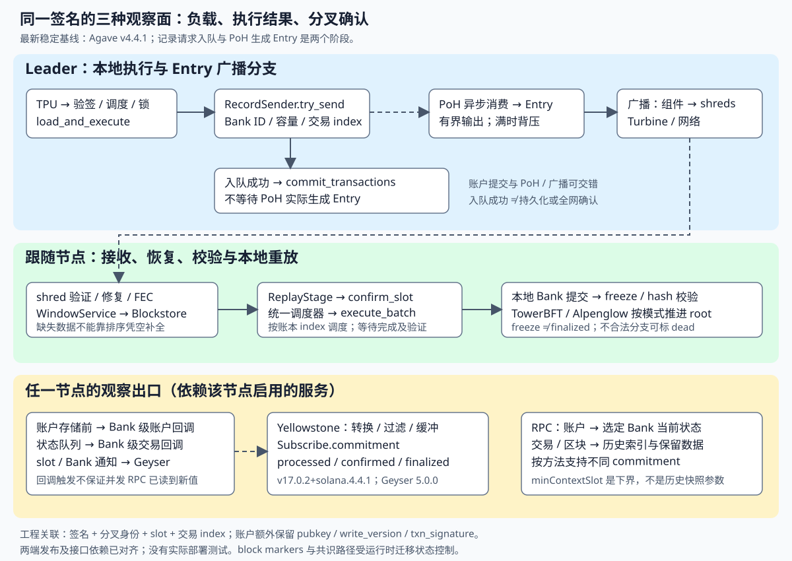

## 1. 具体问题与结论 {#question}

同一笔交易先出现在 shred、随后出现在 Yellowstone、最后能用 RPC 查到时，业务究竟可以确认什么？答案取决于**观察节点、消息类型、所在分叉和确认等级**，不能只比较接口名字。

- **shred 是账本数据的传输单元。** 在本文最新稳定 Agave 的 Leader 路径中，交易先本地执行，再将记录请求入队；PoH 异步生成 Entry，广播端再编码为 shreds。接收方可以在自己重放之前拿到交易负载，但不能因此知道执行是否成功，更不能判定最终性。[Leader 实现][A-consumer]、[记录队列][A-record-channel]、[广播实现][A-broadcast]分别证明这些阶段。
- **Geyser 是节点内部通知接口；Yellowstone 是其上的一个服务实现。** 账户、交易执行元数据和 slot 状态经过不同路径产生。Yellowstone 的 `SubscribeRequest.commitment` 明确支持 `PROCESSED / CONFIRMED / FINALIZED`，确认等级并非 RPC 独有。[Geyser 接口][A-interface]、[Yellowstone 协议][Y-proto]。
- **RPC 要按方法理解。** 账户查询从选定 Bank 读状态；交易查询依赖历史索引和保留数据。`getAccountInfo` 的 `minContextSlot` 是响应上下文的最低 slot 要求，不是“返回该 slot 的历史账户快照”。[账户查询][A-rpc-account]、[交易查询][A-rpc-tx]。

本文面向索引器、余额监听和交易状态服务。基础概念见[交易](./transaction.md)、[地址](./address.md)、[程序](./program.md)、[PDA](./pda.md)和 [Token](./token.md)。本篇不提供交易策略或接口延迟排名。

### 版本与证据边界 {#versions}

| 对象 | 固定基线 | 本文能证明什么 |
| --- | --- | --- |
| Agave | 最新稳定发布 [`v4.4.1`](https://github.com/anza-xyz/agave/releases/tag/v4.4.1)，提交 [`5bb304027fe1a166b02cb26dc8c161593f416fca`](https://github.com/anza-xyz/agave/commit/5bb304027fe1a166b02cb26dc8c161593f416fca)，2026-11-05 | 此版本的 Leader、PoH、广播、统一调度重放、Bank 提交、Geyser 和 RPC；共识按运行时迁移状态区分 |
| Yellowstone | 最新稳定发布 [`v17.0.2+solana.4.4.1`](https://github.com/rpcpool/yellowstone-grpc/releases/tag/v17.0.2%2Bsolana.4.4.1)，提交 [`3c66a659b947e6df09136fc7570bf9918588e2fb`](https://github.com/rpcpool/yellowstone-grpc/commit/3c66a659b947e6df09136fc7570bf9918588e2fb)，2026-11-18 | 发布标注配套 Agave 4.4.1；协议、按 Bank 区分的通知、commitment 通道和有限回放实现 |
| Geyser 接口 | `agave-geyser-plugin-interface 5.0.0`；Agave SDK 提交 [`549c41429dc8705e9c4eb5f540db66463ec45bd6`](https://github.com/anza-xyz/agave-sdk/commit/549c41429dc8705e9c4eb5f540db66463ec45bd6) | 接口已迁到 SDK 仓库；提交来自 crates.io 发布包的 `.cargo_vcs_info.json`，两端依赖一致 |
| 实验 E1 | 2026-11-19，公共 Devnet，RPC 报告 `solana-core: 4.5.0-beta.0` | 这一个端点、这一个签名的只读查询结果；没有验证它运行上述 Agave 提交 |

版本选择核对日期为 **2026-11-19**。Agave 发布说明将 v4.4.1 标为推荐普遍采用的稳定版；更晚的 [`v4.5.0-beta.0`](https://github.com/anza-xyz/agave/releases/tag/v4.5.0-beta.0) 是预发布版。本文以最新稳定发布为主线，不将随时变化的默认分支当作固定证据。

Agave [依赖][A-cargo]和 Yellowstone [依赖][Y-cargo]均使用 Geyser 接口 `5.0.0`，后者还将核心 Agave 依赖精确固定为 `=4.4.1`。这是一组上游发布标注配套、依赖对齐的源码基线；本篇仍**没有实际运行配套节点和插件**，不能据此声称已验证二进制加载。部署须核对构建工具链、动态库接口及运行时启用特性。E1 的端点自报 4.5.0-beta.0，只实际观察 RPC；shred 与 Geyser 的对应过程是稳定版源码解释，没有伪称抓取到这些流，也没有由版本号推断该网络已启用 Alpenglow。

## 2. 最小心智模型 {#model}



| 对象 | 内容和约束 | 不能由它单独推导的结论 |
| --- | --- | --- |
| transaction | 签名和消息；第一签名通常作为交易 ID。消息包含最近区块哈希、账户、指令；v0 还可能通过 ALT 加载账户 | 被接收或被模拟过，不等于已被链上处理 |
| Entry | `num_hashes`、`hash`、`transactions`；PoH 序列中的一个记录，tick Entry 可以没有交易 | 一个 Entry 不是一个 slot，也不是交易执行元数据 |
| shred | Entry 序列编码后的数据分片，以及用于纠删恢复的 coding 分片；slot、类型、index 等标识其位置 | 一片 shred 不一定包含完整交易，也不含完整 `TransactionStatusMeta` |
| slot | 调度和账本组织单位；可能跳过，存在父子分叉关系 | 不是交易唯一标识，也不保证该编号有完整区块 |
| Bank | 某条父链上、某个 slot 的节点本地执行状态视图，持有账户可见祖先、状态缓存等 | 本地 Bank 已提交或已冻结，不等于网络已最终确认 |
| root | 本地认定的已扎根分叉边界；推进时保留其祖先路径并处理其他分支 | 一个数值较小的 slot 不因此自动属于该 root 的祖先链 |

Entry 的实际构造见 [PohRecorder::record][A-poh]；v4.4.1 的广播端按 `BlockComponent` 编码，入口为 [StandardBroadcastRun::component_to_shreds][A-broadcast]。除 Entry 外，运行时允许 block markers 时还可包含 header、footer、parent 更新等组件，不能把所有 shred 都解释为交易 Entry。Bank 的创建、冻结、扎根分别见 [Bank::new_from_parent、freeze、squash][A-bank]，root 推进还涉及 [Votor root 工具][A-root]。

接口仍暴露 `processed / confirmed / finalized`，但 v4.4.1 包含 TowerBFT 与 Alpenglow 的迁移分支，不能统一用旧 Tower 锁定规则解释所有运行模式：[commitment service][A-commitment]、[Votor root 路径][A-root]。

| 运行模式 | 此版本源码中的 commitment 更新 |
| --- | --- |
| TowerBFT 路径 | 根据投票锁定和权益聚合更新 confirmed、super-majority root 等缓存；processed 仍不是最终性保证 |
| Alpenglow 路径 | `Notarize` 事件更新 processed 对应的 slot；Votor 选择最终化 Bank 为 root 后，`Rooted` 分支同时更新 highest-confirmed、root 和 highest-super-majority-root；root 工具还发出兼容 RPC 的 optimistically-confirmed 通知 |

[RPC 按 commitment 选 Bank][A-rpc-bank]、[Yellowstone 按 commitment 分发][Y-grpc]说明接口怎样使用这些状态，但协议字段本身不能证明某网络启用了哪种共识模式。不要把固定等待毫秒数当作承诺，也不要再写成“所有版本都固定等 31 个区块”。交易失败也可以 finalized：确认的是包含该执行结果的账本，不代表 `err == null`。

## 3. 状态、字段与数值推演 {#state}

E1 的交易签名是：

```text
3pePAiDRXjEhE85sZxzu6ydr3V3RxfgqvwkYr2bPxFYoZj2jbuKCY2wpV3yF9E6tbL59GzR5SwPsQXtxXzzQjEZE
```

它是 Devnet 上一笔已有的 legacy 交易，包含两条 Compute Budget 指令和一条 System Program 转账；本实验没有创建或发送它。转账金额是 `1,000,000 lamports = 0.001 SOL`，`1 SOL = 10^9 lamports`。源地址 `HUT3JXAZWq8XtPuyv8bbx5zduvvLyovtNfzGNv6spwqD` 也是 fee payer，目标地址为 `4LfNMExGbcNyK7xoTf2RuXq9zkxnaGhQJq9rbGDiXvnd`。

| 字段或账户 | E1 实际值 | 含义 |
| --- | --- | --- |
| `slot` / 区块内 `index` | `524001628` / `24`（从 0 起） | index 由同 slot 的 `getBlock(..., transactionDetails: "signatures")` 核对，不从网络到达顺序推断 |
| `meta.err` / 状态 | `null` / `finalized` | 执行成功，与确认等级分别判断 |
| `meta.fee` / `computeUnitsConsumed` | `6000 lamports` / `450 CU` | 一个是费用，一个是执行资源，不能把 CU 直接当 lamports |
| fee payer 的 `preBalances → postBalances` | `48,902,204,784 → 48,901,198,784` | 减少 `1,006,000 = 1,000,000 + 6,000` |
| 目标的 `preBalances → postBalances` | `76,001,250,083 → 76,002,250,083` | 增加 `1,000,000` |
| 两个程序账户余额 | 各自 `1 → 1` | 本次均无余额变化 |
| 全部账户余额差之和 | `-6000 lamports` | 对这个普通转账，正好等于费用的负值；不是任意含奖励、租金等情形的通用断言 |

这些是**单笔交易的执行前后元数据**，不是 slot 起止的账户余额。后来 `getMultipleAccounts` 返回的 `context.slot = 524001883`，所以即使同样指定 finalized，也不能把它当作 `524001628` 时刻的账户状态。

金额、slot、write version 在接口中多为无符号 64 位整数。本文脚本用 Python 整数保留精度；JavaScript 消费者应避免把超出安全整数范围的 protobuf `uint64` 转为 `Number`。SOL 展示才除以 `10^9`；Token 的原始 `amount` 则按对应 mint 的 decimals 展示，不能统一除以 `10^9`。

账户与交易关联至少保存以下字段：[Yellowstone 消息定义][Y-proto]。

| 数据 | 关键字段 | 解读 |
| --- | --- | --- |
| 交易事件 | `signature`、`slot`、`bank_id`、`index`、`meta.err`、账户 keys、加载地址 | 当前协议可区分同 slot 的不同 Bank；按 blockhash 校验最终链。v0 交易解码应把静态 keys 与加载的 writable、readonly 地址按协议顺序组合后解释索引；`jsonParsed` 的 keys 已展开，不能再次附加 |
| 账户事件 | `pubkey`、`owner`、`lamports`、`data`、`slot`、可选 `bank_id`、`write_version`、可选 `txn_signature`、`is_startup` | 同账户在同 slot 可以多次写；owner 是账户所属程序，未必是钱包持有人。启动快照事件可能没有交易签名和 Bank ID |
| slot / block 事件 | `parent`、`status`、`bank_id`、`blockhash`、`parent_blockhash` | slot 建父子索引，blockhash 校验链身份；`FIRST_SHRED_RECEIVED / COMPLETED` 不是某个 Bank 的执行结果 |

## 4. 完整主路径：这笔转账如何变成可消费数据 {#path}

### Leader：执行、记录与广播 {#leader}

以下是 Agave 基线下普通交易的关键依赖，不是“任何时刻都只有一笔交易”的全局串行流水线。

1. 客户端通过 RPC `sendTransaction` 或 TPU 路径送入签名交易。RPC 返回签名只代表接收和提交路径的结果，不能作为已上链证明。`Tpu::new_with_client` 组装 QUIC 接收、Fetch、SigVerify、BankingStage；调度前后还要检查交易结构、签名、区块哈希、预算、账户锁等。无效或过期交易可能在进入账本前终止。[TPU 组装][A-tpu]、[Consumer][A-consumer]。
2. Consumer 在账户已锁定的 batch 上调用 `Bank::try_enter_transaction_execution`；获得绑定本 Bank 的 `TxExecutionGuard` 后才 load/execute。正在退休的 Bank 可以拒绝新执行并返回可重试结果。对于 E1 这种普通转账，执行结果中形成扣款、收款及费用相关状态，此刻尚不是全网最终状态。[Consumer][A-consumer]、[Bank 执行 guard][A-guard]。
3. 选出 `was_processed()` 的交易并计算 Entry 字节预算，再取得 `freeze_lock`，释放执行 guard，为当前 slot 预留 Entry 字节。`TransactionRecorder::record_transactions(bank.bank_id(), ...)` 计算交易哈希，最终调用 `RecordSender::try_send`：检查当前 Bank ID、剩余入队预算和通道状态；成功时返回可选的交易起始 index。[记录器][A-recorder]、[记录队列][A-record-channel]。
4. **Consumer 在记录请求成功入队后即可 commit，不等待 PoH 线程实际生成 Entry。** `RecordSender` 的明确契约是非阻塞发送；容量预留及 receiver 的关闭、排空逻辑保证正常推进时已接纳记录不被丢弃。如果字节预算或入队失败，Consumer 返回可重试索引，不继续该 batch 的 commit。入队成功只证明本地接纳，不是持久化或全网确认。[Consumer][A-consumer]、[RecordSender / RecordReceiver][A-record-channel]。
5. PoH 服务异步消费队列，`PohRecorder::record` 按 Bank ID 检查当前工作 Bank、混入哈希并构造 Entry，送入有界 `working_bank_sender`；输出满时阻塞施加背压，不静默丢掉已混入的记录。广播端 `process_receive_results → component_to_shreds → make_merkle_shreds_from_component` 编码并发送 data/coding shreds；如果启用相应 block markers，还会处理 header 等组件。[PoH recorder][A-poh]、[广播实现][A-broadcast]。

第 4、5 步由同一个已接纳的记录请求分出账户提交与 PoH/广播工作，二者可以交错：不能声称“Entry 已生成”才会提交，也不能声称所有账户通知都早于网络广播。`TransactionRecorder` 仍有一条旧注释写着等待响应，但本版本真实函数体委托给 `try_send`，应结合记录队列实现理解。因此“远程 shred 比某台 RPC 先看到交易”仍不能推出“远程 shred 捕捉到了 Leader 执行前的意图”。普通交易 Entry 不包含 E1 的完整 `TransactionStatusMeta`；新版可用 footer 提供 Bank hash 等信息，也不能替代单笔交易元数据。

**被处理但指令失败的交易可能被记录**，不能把 `was_processed()` 读成 `err == null`；但执行 flags 的 `drop_on_failure / all_or_nothing` 以及 NoOp 等分支会改变处理结果，不可反过来承诺所有失败都会进入账本。[Consumer][A-consumer]、[账户保存分支][A-save]。

### 跟随节点：收数据后在自己的 Bank 重放 {#follower}

网络接收侧先验证 shred 来源和结构，结合修复及纠删恢复补齐可用数据。`WindowService::run_insert` 调用 `Blockstore::insert_shreds_at_location_handle_duplicate` 存入本地账本，完成的数据集推动重放；不是按 UDP 到包顺序逐笔执行。[WindowService][A-window]。

`ReplayStage::replay_blockstore_into_bank → blockstore_processor::confirm_slot` 从 Blockstore 读取并校验数据。v4.4.1 的交易主路径是 `process_entries → BankWithScheduler::schedule_transaction_executions → DefaultTaskHandler::handle → runtime::transaction_execution::execute_batch`，再执行并提交到本地 Bank；不是旧版的 `process_batches` 调用链。`process_entries` 对含交易的 Bank 断言已安装调度器，按账本起始 index 生成 task ID，并由统一调度器处理账户冲突。[Blockstore processor][A-processor]、[调度入口][A-scheduler]、[默认任务处理器][A-task]、[执行器][A-execution]。

可对已有连续数据增量重放，不要求整个 slot 的最后一片先到。slot 完成后，`complete_bank_replay` 汇总调度执行与异步验证结果；若运行时允许 block markers，跟随节点还通过 `freeze_and_verify_bank_hash` 核对 footer 提供的预期 Bank hash。不通过验证的分支可能被标 dead；迁移切换中断等情况有单独处理，不能把所有重放中断都等同于无效交易。[ReplayStage][A-replay]。

这里 `confirm_slot` 是函数名，表示账本校验与处理入口，**不是客户端 `confirmed` commitment 的投票承诺**。同一交易在不同节点各自执行，出现 Geyser 通知的时间取决于各自重放进度、队列、插件配置及订阅过滤条件。

### Bank 生命周期与提交边界 {#bank-lifecycle}

`Bank::new_from_parent` 在父 Bank 上建立新状态视图，通常不是复制一份全量账户数据库；`bank_id` 由本节点运行期间的生成器分配，不是跨节点共用的链上标识。活动 Bank 接受多批提交；`Bank::commit_transactions → Accounts::store_accounts` 写入带 slot、Bank ID 及祖先可见性的路径，调用返回不表示 fsync 或成为 root。[Bank 提交][A-bank-commit]、[账户存储][A-accounts]。

`freeze` 使用与 record 入队/commit 区域协调的 hash 锁，处理费用等延后状态、完成账户 hash 更新并计算 Bank hash；Bank 退休还会通过执行 gate 等待 load/execute 的副作用结束。冻结是单向的本地生命周期变化。随后按运行模式推进共识和 root；`squash` 将自身及祖先状态扎根，Votor 的 root 工具与 ReplayStage 的命令处理更新账本、BankForks 和 RPC 兼容通知。未胜出的分叉不会因为它曾 freeze 就成为最终状态。[Bank::freeze / squash][A-bank]、[执行 gate][A-guard]、[root 工具][A-root]、[ReplayStage][A-replay]。

### 账户、交易与 slot 通知 {#notifications}

- 账户路径：`Bank::commit_transactions → collect_accounts_to_store → Accounts::store_accounts` 分配 write version，经 `AccountsUpdateNotifierImpl::notify_account_update → GeyserPlugin::update_account_for_bank` 通知。**该版本在调用 `AccountsDb::store_accounts_unfrozen` 前先发通知**，所以回调触发不保证并发 RPC 此刻已能读到新值，更不表示磁盘已落稳。启动恢复另走 `update_account_from_snapshot`，可没有交易签名与 Bank ID。[账户筛选][A-save]、[账户存储顺序][A-accounts]、[账户通知][A-account-notify]。
- 交易路径：Committer 将提交结果、余额和区块内索引送入 `TransactionStatusSender`，`TransactionStatusService::write_transaction_status_batch` 组装 `TransactionStatusMeta`，经 `TransactionNotifierImpl::notify_transaction` 通知插件；是否持久化 RPC 历史还有单独配置。[Committer][A-committer]、[TransactionStatusService][A-status]、[交易通知][A-tx-notify]。
- slot 路径：Agave 的 `SlotStatusNotifierImpl` 对 processed、confirmed、rooted、created-bank 使用 `update_bank_status(..., bank_id)`；first-shred、completed 等走 `update_slot_status`。交易通知最终调用 `notify_transaction_for_bank`。这些与账户回调、状态服务线程、网络客户端之间没有全局到达顺序。[slot 通知][A-slot-notify]、[交易通知][A-tx-notify]、[配套插件入口][Y-plugin]。

Yellowstone 将上述新版回调转为内部 Message，再做过滤、批处理、区块重建和客户端分发。其 `geyser_loop` 的 processed 通道与 `block_reconstruction_loop` 的 confirmed/finalized、回放管理各有职责。[服务实现][Y-grpc]。`SubscribeUpdate.created_at` 是服务消息时间；回放路径会重新生成部分 slot 消息的时间，不能据此还原原始执行时刻或直接计算网络延迟。

## 5. 源码定位与关键片段 {#source}

以下链接全部固定提交，链接中的行号用于辅助定位；以函数及其上下文为准。

| 环节 | 文件与函数 | 阅读重点 |
| --- | --- | --- |
| 接收与调度组装 | [`core/src/tpu.rs`：`Tpu::new_with_client`][A-tpu] | Fetch / SigVerify / BankingStage 的连接，不把某一个调度器当作唯一实现 |
| Leader 执行顺序 | [`core/src/banking_stage/consumer.rs`：`execute_and_commit_transactions_locked`][A-consumer] | load/execute 在前，记录入队成功才 commit；执行 guard 与冻结锁交接 |
| 记录接纳与 PoH Entry | [`poh/src/transaction_recorder.rs`][A-recorder]、[`record_channels.rs`][A-record-channel]、[`poh_recorder.rs`][A-poh] | 非阻塞入队、Bank ID 与容量预留；PoH 后续异步构造 Entry |
| shred 编码与发送 | [`turbine/src/broadcast_stage/standard_broadcast_run.rs`][A-broadcast] | `process_receive_results`、`component_to_shreds`、`broadcast`；识别运行时允许的 block markers |
| 跟随节点重放 | [`blockstore_processor.rs`][A-processor]、[`installed_scheduler_pool.rs`][A-scheduler]、[`unified-scheduler-pool/src/lib.rs`][A-task]、[`transaction_execution.rs`][A-execution] | confirm_slot、调度入队、task ID、执行和完成验证的异步边界 |
| 状态保存与失败回滚 | [`runtime/src/bank.rs`][A-bank]、[`runtime/src/account_saver.rs`][A-save] | 执行结果、提交成功、指令成功是三层判断 |
| Geyser 账户与交易 | [`accounts.rs`][A-accounts]、[`accounts_update_notifier.rs`][A-account-notify]、[`transaction_status_service.rs`][A-status] | 账户通知先于存储调用；与异步交易元数据服务分开理解 |
| 共识模式与 root | [`core/src/commitment_service.rs`][A-commitment]、[`votor/src/root_utils.rs`][A-root] | 分开读 TowerBFT 与 Alpenglow 迁移分支，不把旧锁定规则写成通用最终性定义 |
| Yellowstone | [`proto/geyser.proto`][Y-proto]、[`plugin/entry.rs`][Y-plugin]、[`grpc.rs`][Y-grpc] | bank_id、过滤、commitment、有限回放与慢消费者错误 |

Leader 的顺序可从 Consumer 中以下片段读取。这里用省略号隐藏参数，属于**阅读摘录，不是可编译代码**：

```rust
let tx_execution_guard = bank.try_enter_transaction_execution();
// 先处理 guard 为 None 的退休 Bank 分支
tx_execution_guard.load_and_execute_transactions(/* ... */);
// processing_results 中选出 was_processed() 的交易
let (freeze_lock, _) = measure_us!(bank.freeze_lock());
drop(tx_execution_guard);
bank.entry_bytes_budget().reserve(entry_bytes);
self.transaction_recorder.record_transactions(bank.bank_id(), processed_transactions);
// 检查预算 / 入队错误；失败时返回，不继续 commit
self.committer.commit_transactions(/* ... */);
drop(freeze_lock);
```

这解释了预算不足、通道满或 Bank ID 已失效时为什么不能发布“本 Bank 已提交”的业务事件。这里的 record 成功是入队成功；**不能据这个返回值宣称 PoH 已经生成 Entry**。从源码继续追踪 `TransactionRecorder::record → RecordSender::try_send`，可看到容量预留和 index 分配；`RecordReceiver` 的关闭与排空约束负责正常退出此 Bank 时保全已接纳记录。[Consumer 260 行起][A-consumer]、[记录队列][A-record-channel]。

失败账户的保存逻辑是另一处不能略过的分支：[collect_accounts_to_store][A-save]。

```rust
// 阅读摘录：省略参数
if executed_tx.execution_details.status.is_ok() {
    collect_accounts_for_successful_tx(/* ... */);
} else {
    collect_accounts_for_failed_tx(/* rollback_accounts ... */);
}
```

失败路径保存 fee payer、必要时 nonce 的回滚账户状态，阻止失败指令的普通写入泄漏，同时保留应支付费用及 nonce 相关变化。因此“指令原子失败”不能写成“所有账户和费用都完全不变”。另一方面，早期就被拒绝的交易未必有可查询链上记录，也不能承诺所有失败都扣费。

Yellowstone 的请求类型直接反驳“只有 RPC 能选择确认等级”的说法：[完整协议][Y-proto]。

```protobuf
enum CommitmentLevel {
  PROCESSED = 0;
  CONFIRMED = 1;
  FINALIZED = 2;
}
// SubscribeRequest 内：
optional CommitmentLevel commitment = 6;
optional uint64 from_slot = 11;
```

字段存在不代表无限回放。在本固定版本中，只有流的**首个订阅请求**可以指定 `from_slot` 触发回放，后续请求中的该字段会被忽略；请求启动快照的订阅也不执行这一路回放。服务必须启用 `replay_stored_slots`，消费者还须处理保存窗口和背压边界。[GrpcService::client_loop / client_loop_replay][Y-grpc] 的具体错误如下：

| 条件 | gRPC 状态与消息 | 消费者处理 |
| --- | --- | --- |
| 未启用回放 | `INTERNAL: from_slot is not supported` | 核对服务能力，改走可用的历史补数渠道 |
| 请求 slot 早于保留窗口 | `OUT_OF_RANGE: broadcast from … is not available, last available: …` | 记录缺口，另行回填，不能只重试同一过期 slot |
| 广播接收落后或实时发送队列已满 | `INTERNAL: lagged to receive geyser messages` 或 `INTERNAL: lagged to send an update` | 降低消费阻塞，重连时在首个请求给出重叠检查点 |
| 回放发送超过配置的客户端无响应时限 | `INTERNAL: client did not read the replay in time` | 处理下游吞吐和超时，再恢复订阅 |

这些错误不能统称为 `UNAVAILABLE`；该版本另在服务关闭等路径返回 `UNAVAILABLE`。回放与实时流的衔接有服务端去重逻辑，但消费者仍须按自己的持久化边界实现幂等恢复。

## 6. 失败、去重与恢复 {#failures}

### 按数据类型建立身份 {#identity}

下面是消费端的工程建议，不是协议承诺的“恰好一次”。`source_epoch` 表示消费者给某个节点运行实例分配的来源代号；节点重启、切换提供商时重新分配，避免把本地计数器误作全网 ID。

| 数据 | 建议保存的观察身份 | 重复或冲突的处理 |
| --- | --- | --- |
| shred | 网络身份、slot、shred type、index，以及 payload hash / 签名证据 | 相同位置相同 payload 可去重；同位置不同 payload 是冲突证据，不能直接丢弃。FEC set 辅助恢复，不能把 coding shred 当交易 |
| Entry | 来源与分叉身份、slot、Entry index、Entry hash | 去重后再维护交易起始索引；缺片时保留缺口，不假造空 Entry |
| 交易观察 | 网络、来源实例、`bank_id`（若提供）、slot、signature；保留 index 和后续 blockhash | 同签名的多次观察更新确认状态；不能把不同分叉上的同签名覆盖成唯一成功。最终业务入账可以按 canonical signature 幂等，但必须先验证所在最终链及 `err` |
| 账户写入 | 来源实例、slot、`bank_id`（若提供）、pubkey、write_version | 同账户同 slot 多写要保留；同一 Bank 内用 write_version 处理乱序。该数值不用于跨节点比较新旧，不作为永久全局序号 |
| slot 状态 | 来源实例、slot、可选 bank_id、status | 不用 `max(slot)` 代替状态机。维护 parent、dead 与最终链信息；单条 processed 通知不能清除其他分支 |

write version 的分配范围与启动恢复的独立通知路径可从 [Accounts::store_accounts][A-accounts] 和 [snapshot 恢复通知][A-account-notify]核验；新版协议显式提供 Bank 身份，[FIRST_SHRED_RECEIVED 与 COMPLETED 没有 Bank 归属][Y-proto]。没有 bank_id 的旧服务或缺少 blockhash 的消息，**不能可靠区分所有同 slot 的 Bank 实例**：应将其保留为来源相关的暂态观察，等区块证据或最终账户快照对账，不凭空发明分叉标识。

### 交易和账户怎样关联 {#join}

E1 的交易 ID 可以连接 `getTransaction`、状态查询与区块签名列表。若消费 Geyser，账户消息的 `txn_signature` 非空时，可按同来源实例、同 Bank、同 slot、同签名 join 交易事件；账户事件可能先到，必须允许两侧暂存。`txn_signature` 为空时不能把“同 slot 最近到达的交易”硬配给它：启动快照、Bank 初始化及其他非交易更新都可能没有关联签名。[账户转换与快照路径][A-account-notify]、[新版账户回调][Y-plugin]。

slot 结束也不代表一个过滤订阅拿到了该 slot 的所有交易或账户。`getTransaction.meta` 有余额、日志、Token 余额等信息，但不包含所有账户任意时刻的完整二进制数据。重建账户历史需要从已知快照持续采集完整的写入、处理分叉，或自行重放账本；只有交易历史 API 不够。

### 检查点、重连与回填 {#recovery}

建议把业务状态分为可撤回的 `tentative` 和已核对最终链的 `finalized` 两层，按以下顺序恢复：

1. **先落盘再确认检查点。** 原始事件、去重身份、业务更新及消费进度在同一存储事务中提交；否则进度领先会丢数据，进度落后会导致重复，后者必须能幂等处理。分别保存实时接收高水位与“目标过滤范围内已核对完整”的 finalized 检查点，附网络 genesis hash、slot、blockhash、订阅过滤条件及版本。
2. **断线重连从重叠范围开始。** 该 Yellowstone 版本有 `from_slot`，但受服务配置和窗口限制；不要假定跨提供商保留窗口相同，也不要从“最后收到 slot + 1”开始以致漏掉同 slot 尾部。重叠窗口本来就会带来重复，必须按上表幂等合并。[回放与 live 交界处理][Y-grpc]。
3. **显式处理落后和队列溢出。** 回放不支持、请求早于窗口、客户端消费滞后都不能当作“无新数据”。记录 gap，保留实时流缓冲，再用 RPC 的 `getBlocks / getBlock` 对最终链区间核对交易。先辨明跳过 slot、数据裁剪和接口失败，不能把每个缺失编号都称为数据丢失。归档能力不足则保留无法补齐的区间并报警。
4. **账户恢复另做设计。** 如果缺失的是账户写入，仅查回区块交易不能恢复每次写入的完整 `data`。如果业务只需要某组账户的当前最终状态，可以先开启订阅并缓冲，再拉取带 `context.slot` 的账户快照，丢弃已被快照覆盖且可证明属于同一最终链的增量，再继续应用后续写入；跨分叉或无全局可比 write version 时要重新查询对账。多批账户快照不保证同一上下文，更不能当作全网原子快照。需要精确历史则使用已有快照加完整变更日志，或搭建可重放的状态存储。
5. **分叉失效要撤回派生结果。** 将 dead / 落败分支的 tentative 事件标为失效，撤销对应派生余额、提醒等可逆状态；最终入账以规范链核对结果为准。不能只删除 raw event 却保留它带来的汇总。并非每个提供商都保证为所有落败分叉发送完整撤销流，最终 root/区块链路对账不可省略。

这些设计要按业务选择：余额面板可展示带确认标签的暂态结果；不可逆结算通常应等 finalized 且 `err == null` 后入账。过滤条件改变相当于改变数据集，旧检查点不能直接证明新数据集完整。

### RPC 历史与常见误判 {#rpc-boundaries}

| 方法或现象 | 实际边界及处理 |
| --- | --- |
| `getSignatureStatuses` | 默认查近期状态缓存；`searchTransactionHistory: true` 才要求额外历史搜索，仍受节点数据能力限制。`null` 不证明从未执行。[实现][A-rpc-status] |
| `getTransaction` | Agave 基线要求至少 confirmed，并检查交易历史配置；可走本地账本或配置的归档存储。不能给 processed 就期望总能查到。[实现][A-rpc-tx] |
| `getAccountInfo / getMultipleAccounts` | 按 commitment 选 Bank 当前状态，`minContextSlot` 仅设下界；不提供任意历史 slot 参数。`context.slot` 是读取上下文，不是该账户最后写入 slot。[实现][A-rpc-account] |
| 指令错误但 finalized | 链已包含这个失败结果；检查 `meta.err`、日志、fee、nonce，不能当成成功转账。[账户回滚保存][A-save] |
| recent blockhash 过期或早期拒绝 | 可能根本没进账本；持续查 null 需结合有效期、其他可信节点和发送错误排查。重签会产生新签名，业务请求 ID 应独立幂等，防止重复付款 |
| 版本错误 `-32015` | 区块可能含客户端未声明支持的交易版本。不能把请求失败解释成空区块；先评估解码器，再提升版本上限。E1 的发现阶段实际遇到此错误 |

## 7. 最小复现实验 {#experiment}

### E1：无需钱包的同签名只读对账（已执行） {#e1}

环境：macOS `26.5.2 arm64`，Python `3.14.2` 标准库，无 SDK、无付费服务、无私钥。2026-11-19 `13:11:09–13:11:12 UTC` 执行；以 JSON 中每个请求的实际时间为准。端点 `https://api.devnet.solana.com`，`getGenesisHash` 返回 `EtWTRABZaYq6iMfeYKouRu166VU2xqa1wcaWoxPkrZBG`。RPC 自报版本见前文，不能把它等同于阅读源码基线。

脚本下载：[observe_transaction.py](/examples/solana/observe_transaction.py)。在仓库根目录执行：

```bash
python3 wiki/static/examples/solana/observe_transaction.py \
  --rpc https://api.devnet.solana.com \
  --signature 3pePAiDRXjEhE85sZxzu6ydr3V3RxfgqvwkYr2bPxFYoZj2jbuKCY2wpV3yF9E6tbL59GzR5SwPsQXtxXzzQjEZE \
  --max-version 1 \
  --output /tmp/solana-observation.json
```

脚本依次调用 `getGenesisHash → getVersion → getTransaction(finalized, jsonParsed) → getSignatureStatuses(searchTransactionHistory=true) → getBlock(signatures) → getMultipleAccounts(finalized, minContextSlot=交易slot)`；验证返回签名、slot 和错误状态相符，再输出区块位置与余额差。超时、RPC 错误、缺少数据、版本不支持都会退出非零，并将已完成的交换及失败原因保存到输出文件。它不实现未知版本交易的二进制解码；`--max-version 1` 仅声明允许 RPC 返回的上限，本次选中的交易仍是 legacy。

实际终端输出摘录如下；完整的四个账户余额见原始证据：

```json
{
  "slot": 524001628,
  "blockhash": "HFKNVzC4J3ZonZcev4Rzu468jTBZkLexV32L9PpmUgS8",
  "parent_slot": 524001627,
  "transaction_index": 24,
  "transaction_version": "legacy",
  "err": null,
  "confirmation_status": "finalized",
  "fee_lamports": 6000,
  "compute_units_consumed": 450,
  "sum_balance_delta": -6000,
  "current_accounts_context_slot": 524001883,
  "current_accounts_are_transaction_snapshot": false
}
```

发现样本时，`getBlock` 对当时最新 finalized slot 使用 `maxSupportedTransactionVersion: 0`，实际返回：

```json
{"code": -32015, "message": "Transaction version (1) is not supported by the requesting client. Please try the request again with the following configuration parameter: \"maxSupportedTransactionVersion\": 1"}
```

这一次发现阶段的错误是终端记录，不在 E1 成功采集的六个请求中。改用上限 1 后，从包含 System Program `transfer` 且 `meta.err == null` 的交易中选得上述样本，再运行已保存脚本完成对账。较晚重跑时，公共 Devnet 可能已裁剪历史或发生重置；脚本报告 unavailable 是环境变化证据，不应据此伪造相同输出。可另选当前仍可查询的公开签名，把新输入与响应保存到新文件，保留本次样本。

**实验实际证明的范围：** 三种 RPC 查询可以关联同一签名、slot、执行错误和区块位置；本例手续费可用余额差复算；账户读取上下文晚于交易 slot。它没有观察 processed → confirmed → finalized 的变化，没有实测 shred/Geyser 到达顺序，没有制造分叉或重连，没有测量端到端延迟。

### 后续实验（待验证） {#pending-experiments}

若要验证实时路径，需要一套版本匹配的节点与 Yellowstone 插件，或提供明确协议及回放条件的服务。订阅同一签名涉及的账户、transaction 与 slot，保留节点版本、Bank 身份、原始消息和本地单调时钟；同时轮询 RPC 状态。shred 接收方还需能验证 Leader 签名、恢复完整数据并解码 Entry，不能把收到任意 UDP 包当作交易出现。

重连实验应覆盖：同 slot 断线、窗口内重放、超出窗口、慢消费者、服务重启与切换来源；比较最终链完整性及重复处理后的业务结果。分叉与失败执行可在匹配版本的本地网络设计可控案例。上述步骤本篇**均未执行**；在没有同交易、同观察点、同步时钟及足够样本之前，不提供“快多少毫秒”的结论。

## 8. 工程取舍与一手资料 {#tradeoffs}

| 业务问题 | 优先观察面 | 仍需补齐 |
| --- | --- | --- |
| 尽早发现可能进入账本的交易负载 | 能验证并恢复数据的 shred / deshred 来源 | 执行结果、分叉与最终确认；来源访问条件另行核查 |
| 持续处理账户写入与执行元数据 | 版本匹配的 Geyser / Yellowstone | 幂等、乱序、过滤完整性、背压和有限回放；按需选择 commitment |
| 查询签名状态、交易详情和当前账户 | 支持所需方法及历史保留的 RPC | 限流、归档范围、账户快照边界和跨接口对账 |
| 精确历史账户状态 | 自有快照 + 完整变更日志或账本重放 | 分叉处理、初始化一致性、存储与重放版本；标准历史交易 RPC 不能代替 |

核心结论的证据分层如下。源码证明的是指定提交的逻辑，实验只证明当次端点返回的结果；恢复方案属于基于这些边界提出的工程建议。

| 结论 | 一手证据 | 核验情况 / 范围 |
| --- | --- | --- |
| Leader 先执行，记录请求接纳入队后 commit，PoH 异步生成 Entry | [Consumer][A-consumer]、[记录队列][A-record-channel]、[PoH][A-poh] | 已读最新稳定发布的固定源码；未运行该版本 validator |
| 广播按组件编码，跟随节点经统一调度器执行 | [Broadcast][A-broadcast]、[Blockstore processor][A-processor]、[任务处理器][A-task] | 已读固定源码；没有本次 shred 抓包 |
| TowerBFT 与 Alpenglow 的 commitment 更新路径不同 | [commitment service][A-commitment]、[root 工具][A-root] | 已读运行模式分支；没有由版本号推断 E1 网络启用状态 |
| 失败指令仍可能有费用和 nonce 状态变化 | [account_saver][A-save] | 已读分支；失败交易实验待验证 |
| Yellowstone 提供 commitment 和有限 from_slot 回放 | [协议][Y-proto]、[服务实现][Y-grpc] | 已读配套最新稳定发布源码；未验证插件部署及回放服务配置 |
| 历史交易查询与账户状态查询不同 | [RPC 实现][A-rpc-tx]、[账户实现][A-rpc-account]、E1 输出 | 固定源码与 Devnet 查询分别核验 |
| 可复算的转账及费用 | E1 输出 | 单个 Devnet 样本；无性能推断 |

组织方式参考 [Solana 数据路径：Shred Stream、gRPC 与 RPC](https://lukadev.site/p/solana-data-stream)，没有沿用其中未经本篇复核的延迟或服务能力数字。官方方法索引：[RPC](https://solana.com/docs/rpc)、[getTransaction](https://solana.com/docs/rpc/http/gettransaction)、[getAccountInfo](https://solana.com/docs/rpc/http/getaccountinfo)、[getSignatureStatuses](https://solana.com/docs/rpc/http/getsignaturestatuses)。这些官方网页在本次抓取时均返回 HTTP 429，故这里只作为延伸阅读入口，不声称已完成当日网页内容复核；接口行为的证据是上表固定源码及实验响应。

继续阅读：[交易消息与 ALT](./transaction.md)、[程序与 CPI](./program.md)、[PDA 与账户权限](./pda.md)、[Token 账户与金额单位](./token.md)。

[A-tpu]: https://github.com/anza-xyz/agave/blob/5bb304027fe1a166b02cb26dc8c161593f416fca/core/src/tpu.rs#L118
[A-consumer]: https://github.com/anza-xyz/agave/blob/5bb304027fe1a166b02cb26dc8c161593f416fca/core/src/banking_stage/consumer.rs#L260
[A-poh]: https://github.com/anza-xyz/agave/blob/5bb304027fe1a166b02cb26dc8c161593f416fca/poh/src/poh_recorder.rs#L377
[A-broadcast]: https://github.com/anza-xyz/agave/blob/5bb304027fe1a166b02cb26dc8c161593f416fca/turbine/src/broadcast_stage/standard_broadcast_run.rs#L226
[A-window]: https://github.com/anza-xyz/agave/blob/5bb304027fe1a166b02cb26dc8c161593f416fca/core/src/window_service.rs#L175
[A-replay]: https://github.com/anza-xyz/agave/blob/5bb304027fe1a166b02cb26dc8c161593f416fca/core/src/replay_stage.rs#L3042
[A-processor]: https://github.com/anza-xyz/agave/blob/5bb304027fe1a166b02cb26dc8c161593f416fca/ledger/src/blockstore_processor.rs#L203
[A-bank]: https://github.com/anza-xyz/agave/blob/5bb304027fe1a166b02cb26dc8c161593f416fca/runtime/src/bank.rs#L3240
[A-accounts]: https://github.com/anza-xyz/agave/blob/5bb304027fe1a166b02cb26dc8c161593f416fca/accounts-db/src/accounts.rs#L508
[A-save]: https://github.com/anza-xyz/agave/blob/5bb304027fe1a166b02cb26dc8c161593f416fca/runtime/src/account_saver.rs#L54
[A-committer]: https://github.com/anza-xyz/agave/blob/5bb304027fe1a166b02cb26dc8c161593f416fca/core/src/banking_stage/committer.rs#L60
[A-account-notify]: https://github.com/anza-xyz/agave/blob/5bb304027fe1a166b02cb26dc8c161593f416fca/geyser-plugin-manager/src/accounts_update_notifier.rs#L29
[A-status]: https://github.com/anza-xyz/agave/blob/5bb304027fe1a166b02cb26dc8c161593f416fca/rpc/src/transaction_status_service.rs#L120
[A-tx-notify]: https://github.com/anza-xyz/agave/blob/5bb304027fe1a166b02cb26dc8c161593f416fca/geyser-plugin-manager/src/transaction_notifier.rs#L33
[A-rpc-account]: https://github.com/anza-xyz/agave/blob/5bb304027fe1a166b02cb26dc8c161593f416fca/rpc/src/rpc.rs#L538
[A-rpc-bank]: https://github.com/anza-xyz/agave/blob/5bb304027fe1a166b02cb26dc8c161593f416fca/rpc/src/rpc.rs#L351
[A-rpc-status]: https://github.com/anza-xyz/agave/blob/5bb304027fe1a166b02cb26dc8c161593f416fca/rpc/src/rpc.rs#L1687
[A-rpc-tx]: https://github.com/anza-xyz/agave/blob/5bb304027fe1a166b02cb26dc8c161593f416fca/rpc/src/rpc.rs#L1791
[A-recorder]: https://github.com/anza-xyz/agave/blob/5bb304027fe1a166b02cb26dc8c161593f416fca/poh/src/transaction_recorder.rs#L52
[A-record-channel]: https://github.com/anza-xyz/agave/blob/5bb304027fe1a166b02cb26dc8c161593f416fca/poh/src/record_channels.rs#L17
[A-guard]: https://github.com/anza-xyz/agave/blob/5bb304027fe1a166b02cb26dc8c161593f416fca/runtime/src/bank.rs#L1097
[A-bank-commit]: https://github.com/anza-xyz/agave/blob/5bb304027fe1a166b02cb26dc8c161593f416fca/runtime/src/bank.rs#L4548
[A-root]: https://github.com/anza-xyz/agave/blob/5bb304027fe1a166b02cb26dc8c161593f416fca/votor/src/root_utils.rs#L38
[A-commitment]: https://github.com/anza-xyz/agave/blob/5bb304027fe1a166b02cb26dc8c161593f416fca/core/src/commitment_service.rs#L184
[A-scheduler]: https://github.com/anza-xyz/agave/blob/5bb304027fe1a166b02cb26dc8c161593f416fca/runtime/src/installed_scheduler_pool.rs#L437
[A-task]: https://github.com/anza-xyz/agave/blob/5bb304027fe1a166b02cb26dc8c161593f416fca/unified-scheduler-pool/src/lib.rs#L651
[A-execution]: https://github.com/anza-xyz/agave/blob/5bb304027fe1a166b02cb26dc8c161593f416fca/runtime/src/transaction_execution.rs#L56
[A-slot-notify]: https://github.com/anza-xyz/agave/blob/5bb304027fe1a166b02cb26dc8c161593f416fca/geyser-plugin-manager/src/slot_status_notifier.rs#L15
[A-cargo]: https://github.com/anza-xyz/agave/blob/5bb304027fe1a166b02cb26dc8c161593f416fca/Cargo.toml#L177
[A-interface]: https://github.com/anza-xyz/agave-sdk/blob/549c41429dc8705e9c4eb5f540db66463ec45bd6/geyser-plugin-interface/src/geyser_plugin_interface.rs#L575
[Y-proto]: https://github.com/rpcpool/yellowstone-grpc/blob/3c66a659b947e6df09136fc7570bf9918588e2fb/yellowstone-grpc-proto/proto/geyser.proto
[Y-plugin]: https://github.com/rpcpool/yellowstone-grpc/blob/3c66a659b947e6df09136fc7570bf9918588e2fb/yellowstone-grpc-geyser/src/plugin/entry.rs#L286
[Y-grpc]: https://github.com/rpcpool/yellowstone-grpc/blob/3c66a659b947e6df09136fc7570bf9918588e2fb/yellowstone-grpc-geyser/src/grpc.rs#L1559
[Y-cargo]: https://github.com/rpcpool/yellowstone-grpc/blob/3c66a659b947e6df09136fc7570bf9918588e2fb/Cargo.toml#L106
