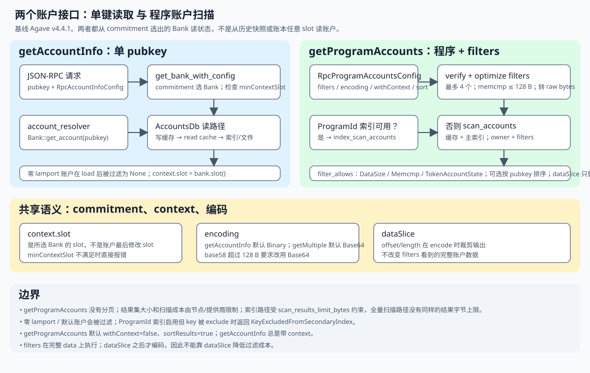

## 1. 具体问题与结论 {#question}

`getAccountInfo` 和 `getProgramAccounts` 看起来都是“查账户”，但它们回答的不是同一个问题：

- `getAccountInfo`：**给定 pubkey，在某个 commitment 对应的 Bank 上读一个账户的当前可见值。**
- `getProgramAccounts`：**给定 program id，扫描该 Bank 可见的账户集合，在服务器端应用 filters，再返回匹配项。**

读完后应能回答：

- 返回的 `context.slot` 是什么，为什么不是账户最后修改的 slot；
- `minContextSlot` 到底是什么检查；
- 为什么 `getAccountInfo` 默认编码是 base58，而大账户会要求改用 base64；
- `getProgramAccounts` 的 filters 在服务端如何执行，`dataSlice` 为什么不能降低过滤成本；
- ProgramId 二级索引什么时候生效，没有索引时会发生什么；
- 为什么 `getProgramAccounts` 没有分页，结果集大小受什么限制；
- 零 lamport 账户、缓存中的未 flush 状态和分叉可见性如何影响结果。

本文固定 **Agave `v4.4.1`**，提交 [`5bb30402`](https://github.com/anza-xyz/agave/commit/5bb304027fe1a166b02cb26dc8c161593f416fca)。账户存储侧的实现见[AccountsDB 文章](./accounts-db.md)，本文只讲 RPC 接口到 AccountsDB 的调用链。

### 结论先行 {#conclusions}

1. **两者都从 commitment 选出的 Bank 读状态。** `get_bank_with_config` 先按 commitment 选 Bank，再检查 `minContextSlot`；不是从账本任意 slot 取历史账户快照。[`get_bank_with_config`][A-rpc-bankcfg]、[`bank`][A-rpc-bank]
2. **`context.slot` 是所选 Bank 的 slot。** `new_response` 用 `RpcResponseContext::new(bank.slot())`；它表示“这次查询看到的 Bank 状态在哪个 slot”，不是账户最后一次被修改的 slot。[`new_response`][A-new-response]
3. **`minContextSlot` 是下限检查，不是历史选择器。** 如果 Bank 的 slot 小于请求值，直接返回 `MinContextSlotNotReached`，不会等待或回退到更早/更晚的 slot。[`get_bank_with_config`][A-rpc-bankcfg]
4. **`getAccountInfo` 是单键读。** RPC 通过 `account_resolver` 调 `Bank::get_account(pubkey)`，再走 AccountsDB 的 cache-first 读路径；零 lamport 账户在 load 后被过滤为 `None`。[`get_encoded_account`][A-encoded]、[`Bank::get_account`][A-bank-get]
5. **`getProgramAccounts` 是扫描 + 服务器端过滤。** filters 最多 4 个，memcmp 最多 128 字节；`DataSize`、`Memcmp`、`TokenAccountState` 都在完整账户数据上执行。[`verify_filters`][A-verify]、[`filter_allows`][A-filter-eval]
6. **ProgramId 二级索引是可选的。** 启用 `AccountIndex::ProgramId` 时走 `index_scan_accounts`，否则回退到全量 `scan_accounts`；索引启用但 program id 被 include/exclude 排除时返回 `KeyExcludedFromSecondaryIndex`。[`get_filtered_program_accounts`][A-filtered-program]
7. **扫描会合并写缓存和主索引。** `scan_accounts` 先预扫描缓存中每个 pubkey 的最新可见版本，再扫描主索引，最后补上只在缓存中的 pubkey；因此未 flush 的状态也可能被 RPC 看到。[`scan_accounts`][A-scan]
8. **`dataSlice` 只影响输出编码。** filters 看到的是完整 data；`dataSlice` 在 `encode_ui_account` 里才裁剪。[`encode_ui_account`][A-encode-ui]、[`slice_data`][A-slice]
9. **`getProgramAccounts` 没有分页。** 默认 `withContext=false`、`sortResults=true`；结果大小和扫描成本由节点/提供商限制，索引路径在配置了 `scan_results_limit_bytes` 时受其结果字节上限约束，全量扫描路径没有同样的上限。[`get_program_accounts` 注册][A-rpc-reg]、[`get_filtered_program_accounts`][A-filtered-program]

### 版本与证据边界 {#versions}

| 对象 | 固定基线 | 本文能证明什么 |
| --- | --- | --- |
| Agave | `v4.4.1`，提交 [`5bb30402`](https://github.com/anza-xyz/agave/commit/5bb304027fe1a166b02cb26dc8c161593f416fca)，2026-11-05 | 该版本的 JSON-RPC 参数、Bank 选择、账户读取、filters、二级索引、编码与错误分支 |
| 实验 E1 | 2026-11-19，本地 sparse checkout | 24 项源码结构和顺序断言；不是 RPC 运行期测试 |
| 实验 E2 | 未执行 | 需要可用的 RPC 端点或本地 validator；文中标为待验证 |

## 2. 最小心智模型 {#model}



把两个接口放在同一条链上看：

```text
JSON-RPC 参数
  → commitment 选 Bank
  → minContextSlot 下限检查
  → getAccountInfo：单键 Bank::get_account
     或 getProgramAccounts：扫描 + filters
  → AccountsDB 读/扫描
  → UiAccount 编码 + context
```

| 对象 | 作用 | 不能由它单独推出的结论 |
| --- | --- | --- |
| `RpcAccountInfoConfig` | encoding、dataSlice、commitment、minContextSlot | 它不是“历史 slot 选择器” |
| `RpcProgramAccountsConfig` | filters + account config + withContext + sortResults | 它不提供分页或结果总数 |
| `RpcFilterType` | DataSize、Memcmp、TokenAccountState | 它不是 SQL；没有范围、排序或聚合 |
| `RpcResponseContext` | 返回 Bank 的 slot | 不是账户最后修改 slot，也不是最终确认等级本身 |
| `UiAccount` | lamports、data、owner、executable、rentEpoch、space | `space` 是完整 data 长度，不是 dataSlice 后的长度 |
| `OptionalContext` | `getProgramAccounts` 可带/不带 context | 默认不带 context，返回裸数组 |
| Bank | 某条父链上的本地状态视图 | 已提交/freeze 不等于网络 finalized |
| AccountsDB | cache-first 读 + 主索引/文件 + 扫描 | 索引是派生数据，不保证跨节点顺序 |

## 3. 状态与语义 {#state}

### 3.1 `context.slot`、commitment 与 `minContextSlot` {#context}

`get_bank_with_config` 做两件事：

1. `self.bank(commitment)`：按 commitment 选择 Bank；
2. 如果请求带 `min_context_slot`，且 `bank.slot() < min_context_slot`，返回 `MinContextSlotNotReached { context_slot: bank.slot() }`。

[`get_bank_with_config`][A-rpc-bankcfg]

`bank(commitment)` 的选择逻辑：

- `confirmed` 使用 `optimistically_confirmed_bank`；
- 其他 commitment 从 `block_commitment_cache.slot_with_commitment(...)` 取 slot，再从 `BankForks` 取对应 Bank；
- 如果该 slot 的 Bank 已被清理，回退到 root bank 并记 warn。

[`bank`][A-rpc-bank]

因此：

- `context.slot` 是这次实际读到的 Bank 的 slot；
- `minContextSlot` 只保证“我看到的 Bank 至少这么新”，不是“请给我那个 slot 的历史账户”；
- 同一个账户在不同 commitment 下可能返回不同值，因为读到的是不同 Bank 的可见状态。

### 3.2 `UiAccount` 与 `space` {#ui-account}

`UiAccount` 的字段是：

```text
lamports, data, owner, executable, rentEpoch, space
```

`space` 来自 `account.data().len()`，是**完整账户数据长度**；`dataSlice` 只裁剪 `data`，不会改变 `space`。[`encode_ui_account`][A-encode-ui]

`dataSlice` 的边界行为：

- `offset >= data.len()` → 空切片；
- `length > data.len() - offset` → 取到末尾；
- 否则取 `[offset, offset + length)`。

[`slice_data`][A-slice]

### 3.3 零 lamport 账户 {#zero}

AccountsDB 的 `load` 在最后过滤零 lamport 账户：

```rust
.filter(|(account, _)| !account.is_zero_lamport())
```

因此 `getAccountInfo` 对零 lamport 账户返回 `None`，`getProgramAccounts` 的扫描也不会返回它们；这不是 RPC 层单独判断，而是账户读取/扫描路径的语义。[`AccountsDb::load`][A-load]

## 4. `getAccountInfo` 主路径 {#get-account-info}

### 4.1 参数与默认值 {#account-config}

JSON-RPC 注册：

```text
getAccountInfo(pubkey, config?)
```

`RpcAccountInfoConfig` 字段：

- `encoding`
- `dataSlice`
- `commitment`（flatten）
- `minContextSlot`

[`RpcAccountInfoConfig`][A-config]、[注册][A-rpc-account]

处理函数：

1. `config.unwrap_or_default()`；
2. `get_bank_with_config({commitment, min_context_slot})`；
3. `encoding` 未指定时默认 **`UiAccountEncoding::Binary`**（legacy base58）；
4. `runtime.spawn_blocking` 中调用 `get_encoded_account`；
5. 用 `new_response(&bank, response)` 包上 `context.slot`。

[`get_account_info`][A-rpc-account]

注意 `getMultipleAccounts` 的默认编码不同：未指定时是 **Base64**。[`get_multiple_accounts`][A-rpc-multiple]

### 4.2 从 pubkey 到账户 {#account-load}

`get_encoded_account`：

```text
account_resolver::get_account_from_overwrites_or_bank(pubkey, bank, overwrite_accounts)
  → 有 simulation overwrite 就用 overwrite
  → 否则 bank.get_account(pubkey)
```

[`get_encoded_account`][A-encoded]、[`account_resolver`][A-resolver]

`Bank::get_account` 调 `get_account_modified_slot` → `load_slow` → `Accounts::load_without_fixed_root(ancestors, pubkey)`。这是一条 RPC 用的非 fixed-root 读路径；账户可见性由该 Bank 的 `Ancestors` 和 root 决定。[`Bank::get_account`][A-bank-get]

最终进入 AccountsDB 的 `load`：

1. 先查写缓存；
2. 未命中查 read-only cache；
3. 再查主索引，按 ancestors 选可见 slot；
4. 按 `store_id + offset` 读 AppendVec；
5. 竞争失败重试；
6. 过滤零 lamport。

[`AccountsDb::load`][A-load]

### 4.3 编码与 base58 限制 {#encoding}

`encode_account` 对 `Binary` / `Base58` 有一条硬限制：

- 如果最终输出的 data 长度（考虑 `dataSlice`）超过 `MAX_BASE58_BYTES = 128`，返回 invalid request，提示改用 Base64。

[`encode_account`][A-encode]、[`MAX_BASE58_BYTES`][A-decoder]

因此：

- 默认 `getAccountInfo` 读取大账户（如程序账户、较大 Token 账户）可能直接报错，需要显式传 `encoding: "base64"`；
- `dataSlice` 可以把输出压到 128 字节以内，从而让 base58 路径成功，但它不改变账户真实 data 长度；
- `getMultipleAccounts` 默认 Base64，不受这条限制影响。

`encode_ui_account` 支持：

- `Binary`：legacy base58 字符串；
- `Base58`：`Binary` 编码标签；
- `Base64`；
- `Base64Zstd`：压缩后 Base64；
- `JsonParsed`：对已知程序尝试解析，失败时回退 Base64。

[`encode_ui_account`][A-encode-ui]

### 4.4 `JsonParsed` 的实际行为 {#json-parsed}

`get_encoded_account` 先判断 `account.owner()` 是否是已知 SPL Token program：

- 是且 `encoding == JsonParsed`：走 `get_parsed_token_account`；
- 否则走 `encode_account` → `encode_ui_account`，后者对已知程序尝试 `parse_account_data_v3`，失败则回退 Base64。

[`get_encoded_account`][A-encoded]、[`encode_ui_account`][A-encode-ui]

所以 `JsonParsed` 不是“永远返回 JSON”：不认识的 owner、解析失败或字段不完整时，实际可能拿到 Base64。

## 5. `getProgramAccounts` 主路径 {#get-program-accounts}

### 5.1 参数、默认值与 filters 校验 {#program-config}

JSON-RPC 注册：

```text
getProgramAccounts(programId, config?)
```

`RpcProgramAccountsConfig` 字段：

- `filters: Option<Vec<RpcFilterType>>`
- `account_config: RpcAccountInfoConfig`（flatten）
- `withContext: Option<bool>`
- `sortResults: Option<bool>`

[`RpcProgramAccountsConfig`][A-program-config]

注册处理逻辑：

- `filters` 缺省为空；
- `withContext` 缺省 **false**；
- `sortResults` 缺省 **true**；
- `verify_filters(&filters)` 在进入扫描前校验。

[`get_program_accounts` 注册][A-rpc-reg]

校验规则：

- filters 最多 **4** 个（`MAX_GET_PROGRAM_ACCOUNT_FILTERS = 4`）；
- `Memcmp` 的原始字节最多 **128** 字节；base58/base64 编码字符串也分别有长度上限；
- 无效编码/超长直接 `invalid params`。

[`verify_filters`][A-verify]、[`MAX_GET_PROGRAM_ACCOUNT_FILTERS`][A-max-filters]、[`RpcFilterType::verify`][A-filter-types]

### 5.2 filters 的语义 {#filters}

`filter_allows` 只有三种：

| filter | 语义 | 注意 |
| --- | --- | --- |
| `DataSize(size)` | `account.data().len() == size` | 精确匹配，不支持范围 |
| `Memcmp(compare)` | 在 `offset` 处按字节比较 | `offset > len` 或剩余长度不足时返回 false |
| `TokenAccountState` | SPL Token account data 合法 | 不是“owner 是 token program”的同义词 |

[`filter_allows`][A-filter-eval]、[`Memcmp::bytes_match`][A-bytes-match]

`optimize_filters` 会把 base58/base64 的 memcmp 转换成 raw bytes，方便后续匹配和 token 过滤优化。[`optimize_filters`][A-optimize]

**filters 在完整账户数据上执行。** `dataSlice` 只影响最终编码，不会减少过滤时需要读取/比较的字节数。

### 5.3 ProgramId 二级索引：可选路径 {#program-index}

`get_filtered_program_accounts` 先看 RPC 配置：

```rust
if self.config.account_indexes.contains(&AccountIndex::ProgramId) {
    if !self.config.account_indexes.include_key(&program_id) {
        return Err(KeyExcludedFromSecondaryIndex { ... });
    }
    self.get_filtered_indexed_accounts(...)
} else {
    bank.get_filtered_program_accounts(program_id, |account| {
        filters.iter().all(|f| filter_allows(f, account))
    })
}
```

[`get_filtered_program_accounts`][A-filtered-program]

两条路径：

1. **有 ProgramId 索引**：`get_filtered_indexed_accounts` → `Bank::get_filtered_indexed_accounts` → `Accounts::load_by_index_key_with_filter` → `AccountsDb::index_scan_accounts`。
2. **没有索引**：`Bank::get_filtered_program_accounts` → `Accounts::load_by_program_with_filter` → `AccountsDb::scan_accounts`，对每个账户检查 `owner == program_id && filters`。

[`get_filtered_indexed_accounts`][A-filtered-indexed]、[`Bank::get_filtered_indexed_accounts`][A-bank-indexed]、[`Bank::get_filtered_program_accounts`][A-bank-program]

索引路径还会额外检查 `account.owner() == program_id`，并应用 filters。源码注释解释了原因：账户可能以零 lamport/default 形态短暂残留，索引本身不足以完全排除它们。[`get_filtered_indexed_accounts`][A-filtered-indexed]

### 5.4 SPL Token 的过滤优化 {#token-optimization}

`get_program_accounts` 在通用扫描前，会尝试识别 SPL Token 的 owner/mint 过滤：

- `get_spl_token_owner_filter`：如果 filters 能证明结果是某个 owner 的子集，走 `SplTokenOwner` 索引（若启用）；
- `get_spl_token_mint_filter`：类似地走 `SplTokenMint` 索引；
- 否则走通用 ProgramId 路径。

[`get_program_accounts`][A-rpc-program]、[`get_spl_token_owner_filter`][A-token-owner]

即使走 token 索引，代码仍会追加 `TokenAccountState` 和 owner/mint memcmp 过滤，以避免零 lamport/default 残留账户被返回。

### 5.5 扫描：缓存 + 主索引 {#scan}

`AccountsDb::scan_accounts` 分三步：

1. **预扫描缓存**：遍历缓存中每个 pubkey，用 `load_latest` 找当前 ancestors 可见的最新缓存版本，保存 `Arc<CachedAccount>`；
2. **扫描主索引**：对每个 pubkey，如果缓存版本比索引版本更新，用缓存；否则按 `store_id + offset` 读文件；
3. **补缓存独有项**：只在缓存、不在主索引的 pubkey，直接回调。

[`scan_accounts`][A-scan]

这解释了为什么 RPC 可能看到“尚未 flush 但已 commit 到 Bank”的账户：扫描不是只读主索引/文件。

`index_scan_accounts` 走二级索引：

- 如果 `account_indexes.include_key(key)` 为 false，回退到完整的 `scan_accounts`；
- 否则遍历 `get_index_key_pubkeys(&index_key)`，对每个 pubkey 调 `do_load`（cache-first）取当前可见版本；
- 扫描期间用 `ScanGuard` 防止相关 root 被 clean 掉；Bank 被移除时返回 `SlotRemoved`。

[`index_scan_accounts`][A-index-scan]

### 5.6 结果过滤、排序与输出 {#output}

- 通用路径：每个账户先过 `owner == program_id`，再过所有 filters；
- 索引路径：同样有 owner + filters 的冗余检查；
- `sort_results` 为 true 时按 pubkey 排序（`Ord::cmp`，二进制 pubkey 顺序）；
- `with_context` 为 true 时返回 `{context, value}`，否则返回裸数组；
- 每个账户用 `encode_account` 按 `encoding` + `dataSlice` 编码；
- 若 program 是已知 SPL Token 且 `encoding == JsonParsed`，走 `get_parsed_token_accounts`，否则走通用编码。

[`get_program_accounts`][A-rpc-program]、[`get_filtered_program_accounts`][A-filtered-program]

## 6. 源码定位 {#source}

以下链接固定到 `v4.4.1` 提交。

| 主题 | 文件与入口 | 作用 |
| --- | --- | --- |
| `getAccountInfo` 处理 | [`rpc.rs`][A-rpc-account] `get_account_info` | commitment、默认编码、单键读取、context |
| `getMultipleAccounts` | [`rpc.rs`][A-rpc-multiple] `get_multiple_accounts` | 默认 Base64；逐 key 读取 |
| `getProgramAccounts` 处理 | [`rpc.rs`][A-rpc-program] `get_program_accounts` | filters、token 优化、编码、context |
| RPC 注册与默认值 | [`rpc.rs`][A-rpc-reg] `AccountsScan` | withContext=false、sortResults=true、filters 校验 |
| Bank 选择 | [`rpc.rs`][A-rpc-bankcfg] `get_bank_with_config` | commitment + minContextSlot |
| 单键账户解析 | [`account_resolver.rs`][A-resolver] | overwrite 或 `Bank::get_account` |
| 账户读取 | [`bank.rs`][A-bank-get] `Bank::get_account` | 非 fixed-root 的 AccountsDB load |
| 账户编码 | [`rpc.rs`][A-encode] `encode_account` | base58 128 B 限制 |
| UI 编码 | [`account-decoder`][A-encode-ui] `encode_ui_account` | Base58/Base64/Zstd/JsonParsed |
| 数据切片 | [`account-decoder`][A-slice] `slice_data` | offset/length 边界 |
| filters 校验 | [`rpc.rs`][A-verify] `verify_filters` | 最多 4 个、memcmp 128 B |
| filter 语义 | [`filter.rs`][A-filter-eval] `filter_allows` | DataSize/Memcmp/TokenAccountState |
| memcmp 匹配 | [`rpc-client-types`][A-bytes-match] `Memcmp::bytes_match` | offset/长度边界 |
| ProgramId 索引判断 | [`rpc.rs`][A-filtered-program] `get_filtered_program_accounts` | 索引/全量扫描、key 排除错误 |
| 索引扫描 | [`bank.rs`][A-bank-indexed] / [`accounts.rs`][A-load-index] | 二级索引到 AccountsDB |
| 全量扫描 | [`bank.rs`][A-bank-program] / [`accounts.rs`][A-load-program] | owner + filters |
| 缓存+索引扫描 | [`accounts_db.rs`][A-scan] `scan_accounts` | 未 flush 状态与主索引合并 |
| 索引扫描实现 | [`accounts_db.rs`][A-index-scan] `index_scan_accounts` | 二级索引、回退全量、ScanGuard |
| 结果上下文 | [`rpc-client-types`][A-optional] `OptionalContext` | 带/不带 context 的返回形状 |

### 6.1 `getAccountInfo` 关键片段 {#snippet-account}

```rust
// rpc/src/rpc.rs (v4.4.1)
let bank = self.get_bank_with_config(RpcContextConfig {
    commitment,
    min_context_slot,
})?;
let encoding = encoding.unwrap_or(UiAccountEncoding::Binary);

let response = self.runtime.spawn_blocking({
    let bank = Arc::clone(&bank);
    move || get_encoded_account(&bank, &pubkey, encoding, data_slice, None)
}).await?;
Ok(new_response(&bank, response))
```

### 6.2 `getProgramAccounts` 的索引/全量分支 {#snippet-program}

```rust
// rpc/src/rpc.rs (v4.4.1)
if self.config.account_indexes.contains(&AccountIndex::ProgramId) {
    if !self.config.account_indexes.include_key(&program_id) {
        return Err(RpcCustomError::KeyExcludedFromSecondaryIndex { ... });
    }
    self.get_filtered_indexed_accounts(...).await
} else {
    bank.get_filtered_program_accounts(&program_id, |account| {
        filters.iter().all(|filter_type| filter_allows(filter_type, account))
    })
}
```

### 6.3 filter 匹配的边界 {#snippet-filter}

```rust
// rpc-client-types/src/filter.rs (v4.4.1)
pub fn bytes_match(&self, data: &[u8]) -> bool {
    match self.bytes() {
        Some(bytes) => {
            if self.offset > data.len() { return false; }
            if data[self.offset..].len() < bytes.len() { return false; }
            data[self.offset..self.offset + bytes.len()] == bytes[..]
        }
        None => false,
    }
}
```

## 7. 失败与边界 {#failures}

### 7.1 `minContextSlot` 不满足 {#failure-min-slot}

如果选中的 Bank slot 小于请求的 `minContextSlot`，直接返回 `MinContextSlotNotReached`。它不是“等到该 slot 再返回”，也不是“查询该 slot 的历史状态”。客户端应把 `context.slot` 与请求下限比较，必要时重试。

### 7.2 base58 超过 128 字节 {#failure-base58}

`getAccountInfo` 默认 `Binary`；如果 data（考虑 `dataSlice` 后）超过 128 字节，返回 invalid request。解决方式：

- 显式 `encoding: "base64"`；
- 或使用 `dataSlice` 把输出压到 128 字节以内。

`getMultipleAccounts` 默认 Base64，不会遇到同样的默认编码问题。[`encode_account`][A-encode]

### 7.3 filters 超限或越界 {#failure-filters}

- filters 超过 4 个 → invalid params；
- memcmp 字节超过 128 → invalid params；
- memcmp `offset` 超出 data 或剩余长度不足 → 不匹配（不是错误）；
- `dataSlice` 不会让 filters 只看切片，filters 始终看完整 data。

[`verify_filters`][A-verify]、[`Memcmp::bytes_match`][A-bytes-match]

### 7.4 ProgramId 索引被排除 {#failure-index-excluded}

如果启用了 ProgramId 索引，但 `account_indexes.include_key(&program_id)` 为 false，返回 `KeyExcludedFromSecondaryIndex`，不会静默走全量扫描。[`get_filtered_program_accounts`][A-filtered-program]

如果根本没有启用 ProgramId 索引，则走全量 `scan_accounts`；这通常更慢，也更依赖节点的资源限制。

### 7.5 扫描结果过大 {#failure-scan-limit}

索引路径会把配置项 `scan_results_limit_bytes`（若设置）传给 `load_by_index_key_with_filter`；累计结果超过限制时，`ScanConfig` 被 abort，返回 `ScanError::Aborted`，RPC 包装为 `ScanError`。[`get_filtered_indexed_accounts`][A-filtered-indexed]、[`load_by_index_key_with_filter`][A-load-index]

全量扫描路径没有同样的结果字节上限；源码注释明确说这条路径“不需要 mb limit，因为只想支持二级索引”。[`get_filtered_program_accounts`][A-filtered-program]

### 7.6 没有分页 {#failure-pagination}

`getProgramAccounts` 返回匹配数组，没有 `limit`/`cursor`。结果集很大时：

- 节点可能因扫描时间、内存、结果字节限制而失败或变慢；
- RPC 提供商通常会在网关层限制或禁用该接口；
- 客户端应尽量用 `DataSize` / `Memcmp` / owner/mint 过滤缩小结果，而不是拉全量。

### 7.7 零 lamport、分叉与缓存 {#failure-visibility}

- 零 lamport 账户会被过滤；不能用 `getProgramAccounts` 观察“曾经存在但已归零”的账户。
- 扫描使用 Bank 的 ancestors/root 可见性；不同 fork 的账户不会混在一起。
- `scan_accounts` 会合并写缓存；对 `processed` Bank，可能看到尚未 flush 的最新状态；对 finalized root，通常已 flush。
- `ScanGuard` 防止扫描期间相关 root 被 clean；Bank 被移除时返回 `SlotRemoved`。

[`scan_accounts`][A-scan]、[`index_scan_accounts`][A-index-scan]

### 7.8 `JsonParsed` 不是保证 {#failure-json}

`JsonParsed` 对已知程序尝试解析；解析失败、owner 不认识或字段不完整时，实际可能回退 Base64。消费方应允许 `data` 以字符串（Base64）形式出现，而不是假设一定是 JSON 对象。

## 8. 复现实验 {#experiments}

### E1：v4.4.1 源码断言（已执行） {#e1}

目的：验证本文引用的 RPC 参数、默认值、索引分支和过滤边界确实存在于 `v4.4.1` 提交。

环境：macOS，本地 sparse checkout；只读取源码，不启动 validator。

```bash
git clone --depth 1 --branch v4.4.1 --filter=blob:none --sparse \
  https://github.com/anza-xyz/agave.git /tmp/agave-v4.4.1
cd /tmp/agave-v4.4.1
git sparse-checkout set rpc/src rpc-client-types/src account-decoder/src \
  accounts-db/src runtime/src

```


| 检查项 | 结果 |
| --- | --- |
| 提交是否为 `5bb30402...` | PASS |
| 两个 RPC 方法注册、config 字段 | PASS |
| `getAccountInfo` 默认 Binary、`getMultipleAccounts` 默认 Base64 | PASS |
| `minContextSlot` 下限检查、`context.slot = bank.slot()` | PASS |
| account_resolver → `Bank::get_account` | PASS |
| base58 128 B 限制、dataSlice 编码期生效 | PASS |
| filters 最多 4 个、memcmp 128 B、三种 filter 语义 | PASS |
| ProgramId 索引可选、key 排除错误、全量扫描回退 | PASS |
| 索引扫描检查 owner、scan 合并缓存+索引 | PASS |
| 默认 sortResults=true、withContext=false、按 pubkey 排序 | PASS |
| 索引扫描结果字节限制 | PASS |
| **总计** | **24 PASS / 0 FAIL** |

这次检查能证明源码结构和分支存在，不能证明某个具体 RPC 端点在某个 slot 的返回内容。后者需要运行期实验。

### E2：RPC 观察（未执行） {#e2}

本次环境没有可用的本地 validator，也没有对公共 RPC 发起会改变状态的请求；因此以下步骤标为待验证：

1. 对一个已知账户调用 `getAccountInfo`，分别使用默认编码、`base64`、`base64+zstd`、`dataSlice`；
2. 对一个较大账户使用默认 `Binary`，确认是否需要改用 Base64；
3. 对一个 SPL Token program 调用 `getProgramAccounts`，分别使用 `dataSize`、owner memcmp、mint memcmp、`TokenAccountState`；
4. 对比 `withContext=false/true` 的返回形状，确认 `context.slot` 与 `minContextSlot` 行为；
5. 在启用/未启用 ProgramId 索引的节点上对比同一查询的耗时与结果；
6. 对一个会超过结果限制的查询，观察错误类型与节点日志。

预期现象（待验证）：默认 Binary 的大账户报错；`dataSlice` 只改输出长度；filters 看完整 data；索引路径快于全量扫描，但受结果字节限制；`context.slot` 随 commitment 变化。

## 9. 工程取舍与资料 {#tradeoffs}

### 9.1 设计取舍 {#why}

| 选择 | 收益 | 代价 |
| --- | --- | --- |
| 两个接口都按 commitment 选 Bank | 语义统一；读到的是该 Bank 的可见状态 | 不提供任意历史 slot 的账户快照 |
| `getAccountInfo` 单键 cache-first 读 | 快；不需要扫描 | 大账户默认 base58 受限；需要客户端选编码 |
| `getProgramAccounts` 服务器端 filters | 减少网络传输；客户端无需拉全量 | 过滤仍要读完整 data；扫描成本在服务端 |
| ProgramId 二级索引可选 | 有索引时避免全量扫描 | 索引占内存/磁盘；未启用时全量扫描更慢 |
| 索引路径限制结果字节 | 防止单次查询拖垮节点 | 全量扫描路径没有同样限制；提供商仍需网关限流 |
| `withContext` 默认 false | 兼容旧返回形状、减少开销 | 调用方容易忽略 `context.slot` |
| `sortResults` 默认 true | 输出稳定、便于测试 | 大结果集排序有额外成本 |
| `dataSlice` 只裁剪输出 | 减少传输；保留完整过滤语义 | 不能降低服务端过滤/扫描成本 |

### 9.2 哪些是源码证明，哪些是推断 {#evidence}

- **源码直接证明**：参数默认值、commitment 选 Bank、minContextSlot 检查、账户读取路径、filters 校验与匹配、索引分支、排序、context 构造、编码与 128 B 限制。
- **源码 + 运行语义推断**：实际 RPC 延迟、索引是否启用、全量扫描的资源消耗、提供商限流、缓存可见性在 processed/confirmed/finalized 下的差异。这些需要运行期实验或运维数据确认。
- **不应从本文推出**：某个 RPC 提供商是否开放 `getProgramAccounts`、其历史账户保留能力、其网关限制的具体数值。接口结构解释不了部署策略。

## 10. 相关阅读与资料 {#sources}

- [Solana AccountsDB（v4.4.1）](./accounts-db.md)：写缓存、索引、tombstone、快照与 LtHash。
- [Solana SVM（v4.4.1）](./svm.md)：交易批处理、账户上下文、CPI 与程序运行时。
- [Solana 交易与数据路径](./data-path.md)：Leader、shred、重放、Geyser 与 RPC 的观察边界。
- Agave 仓库：[anza-xyz/agave](https://github.com/anza-xyz/agave)。
- 本文固定提交：[`5bb30402`](https://github.com/anza-xyz/agave/commit/5bb304027fe1a166b02cb26dc8c161593f416fca)。

[A-rpc-account]: https://github.com/anza-xyz/agave/blob/5bb304027fe1a166b02cb26dc8c161593f416fca/rpc/src/rpc.rs#L538
[A-rpc-multiple]: https://github.com/anza-xyz/agave/blob/5bb304027fe1a166b02cb26dc8c161593f416fca/rpc/src/rpc.rs#L566
[A-rpc-program]: https://github.com/anza-xyz/agave/blob/5bb304027fe1a166b02cb26dc8c161593f416fca/rpc/src/rpc.rs#L607
[A-rpc-reg]: https://github.com/anza-xyz/agave/blob/5bb304027fe1a166b02cb26dc8c161593f416fca/rpc/src/rpc.rs#L3502
[A-rpc-bankcfg]: https://github.com/anza-xyz/agave/blob/5bb304027fe1a166b02cb26dc8c161593f416fca/rpc/src/rpc.rs#L275
[A-rpc-bank]: https://github.com/anza-xyz/agave/blob/5bb304027fe1a166b02cb26dc8c161593f416fca/rpc/src/rpc.rs#L351
[A-new-response]: https://github.com/anza-xyz/agave/blob/5bb304027fe1a166b02cb26dc8c161593f416fca/rpc/src/rpc.rs#L146
[A-filtered-indexed]: https://github.com/anza-xyz/agave/blob/5bb304027fe1a166b02cb26dc8c161593f416fca/rpc/src/rpc.rs#L310
[A-filtered-program]: https://github.com/anza-xyz/agave/blob/5bb304027fe1a166b02cb26dc8c161593f416fca/rpc/src/rpc.rs#L2296
[A-optimize]: https://github.com/anza-xyz/agave/blob/5bb304027fe1a166b02cb26dc8c161593f416fca/rpc/src/rpc.rs#L2504
[A-verify]: https://github.com/anza-xyz/agave/blob/5bb304027fe1a166b02cb26dc8c161593f416fca/rpc/src/rpc.rs#L2515
[A-encoded]: https://github.com/anza-xyz/agave/blob/5bb304027fe1a166b02cb26dc8c161593f416fca/rpc/src/rpc.rs#L2613
[A-encode]: https://github.com/anza-xyz/agave/blob/5bb304027fe1a166b02cb26dc8c161593f416fca/rpc/src/rpc.rs#L2636
[A-token-owner]: https://github.com/anza-xyz/agave/blob/5bb304027fe1a166b02cb26dc8c161593f416fca/rpc/src/rpc.rs#L2668
[A-filter-eval]: https://github.com/anza-xyz/agave/blob/5bb304027fe1a166b02cb26dc8c161593f416fca/rpc/src/filter.rs#L5
[A-resolver]: https://github.com/anza-xyz/agave/blob/5bb304027fe1a166b02cb26dc8c161593f416fca/rpc/src/rpc/account_resolver.rs#L6
[A-decoder]: https://github.com/anza-xyz/agave/blob/5bb304027fe1a166b02cb26dc8c161593f416fca/account-decoder/src/lib.rs#L32
[A-encode-ui]: https://github.com/anza-xyz/agave/blob/5bb304027fe1a166b02cb26dc8c161593f416fca/account-decoder/src/lib.rs#L46
[A-slice]: https://github.com/anza-xyz/agave/blob/5bb304027fe1a166b02cb26dc8c161593f416fca/account-decoder/src/lib.rs#L125
[A-config]: https://github.com/anza-xyz/agave/blob/5bb304027fe1a166b02cb26dc8c161593f416fca/rpc-client-types/src/config.rs#L159
[A-program-config]: https://github.com/anza-xyz/agave/blob/5bb304027fe1a166b02cb26dc8c161593f416fca/rpc-client-types/src/config.rs#L169
[A-filter-types]: https://github.com/anza-xyz/agave/blob/5bb304027fe1a166b02cb26dc8c161593f416fca/rpc-client-types/src/filter.rs#L14
[A-bytes-match]: https://github.com/anza-xyz/agave/blob/5bb304027fe1a166b02cb26dc8c161593f416fca/rpc-client-types/src/filter.rs#L183
[A-max-filters]: https://github.com/anza-xyz/agave/blob/5bb304027fe1a166b02cb26dc8c161593f416fca/rpc-client-types/src/request.rs#L159
[A-optional]: https://github.com/anza-xyz/agave/blob/5bb304027fe1a166b02cb26dc8c161593f416fca/rpc-client-types/src/response.rs#L55
[A-bank-get]: https://github.com/anza-xyz/agave/blob/5bb304027fe1a166b02cb26dc8c161593f416fca/runtime/src/bank.rs#L5310
[A-bank-program]: https://github.com/anza-xyz/agave/blob/5bb304027fe1a166b02cb26dc8c161593f416fca/runtime/src/bank.rs#L5385
[A-bank-indexed]: https://github.com/anza-xyz/agave/blob/5bb304027fe1a166b02cb26dc8c161593f416fca/runtime/src/bank.rs#L5398
[A-load-program]: https://github.com/anza-xyz/agave/blob/5bb304027fe1a166b02cb26dc8c161593f416fca/accounts-db/src/accounts.rs#L351
[A-load-index]: https://github.com/anza-xyz/agave/blob/5bb304027fe1a166b02cb26dc8c161593f416fca/accounts-db/src/accounts.rs#L409
[A-scan]: https://github.com/anza-xyz/agave/blob/5bb304027fe1a166b02cb26dc8c161593f416fca/accounts-db/src/accounts_db.rs#L2491
[A-index-scan]: https://github.com/anza-xyz/agave/blob/5bb304027fe1a166b02cb26dc8c161593f416fca/accounts-db/src/accounts_db.rs#L2585
[A-load]: https://github.com/anza-xyz/agave/blob/5bb304027fe1a166b02cb26dc8c161593f416fca/accounts-db/src/accounts_db.rs#L2736
