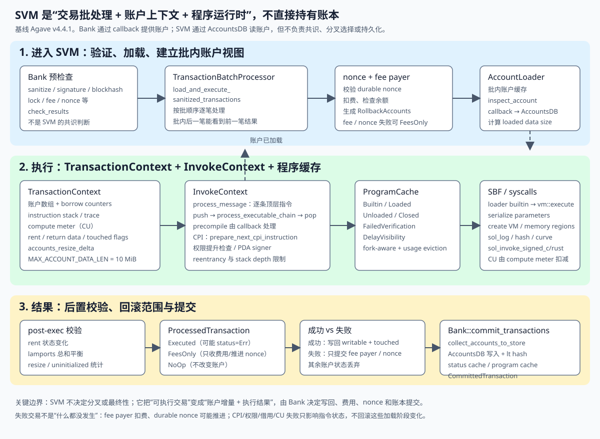

## 1. 具体问题与结论 {#question}

Solana 的 SVM（Solana Virtual Machine）经常被描述成“执行交易的虚拟机”，但真正的源码边界比这个名字更具体：

- 它不持有账本，也不决定分叉或最终性；
- 它不直接拥有 AccountsDB，而是通过 `TransactionProcessingCallback` 向 Bank 要账户；
- 它负责把一批已 sanitize 的交易，从 nonce/fee payer 校验、账户加载、指令执行，推进到“账户增量 + 执行结果”；
- 最后由 Bank 决定哪些账户写回、哪些账户因失败只保留 fee/nonce 变化。

本文固定 **Agave `v4.4.1`**，提交 [`5bb30402`](https://github.com/anza-xyz/agave/commit/5bb304027fe1a166b02cb26dc8c161593f416fca)。

### 结论先行 {#conclusions}

1. **SVM 的批处理入口是 `TransactionBatchProcessor::load_and_execute_sanitized_transactions`。** Bank 先做交易级预检查，再把 sanitized transactions、`check_results`、运行环境和配置交给它。[`TransactionBatchProcessor`][A-txproc]、[Batch 入口][A-entry]、[Bank 调用][A-bank-call]
2. **SVM 仍然要重新校验 nonce 和 fee payer。** 因为同一批内前一笔交易可能改变 nonce/fee payer 状态；`check_results` 只是 Bank 的预检查，不是最终结论。[`validate_transaction_nonce_and_fee_payer`][A-validate]
3. **账户由 Bank 的 callback 提供。** `AccountLoader` 包装 `TransactionProcessingCallback`，在批内缓存账户；Bank 的实现通过 AccountsDB 的 `load_with_fixed_root` 读取账户。[`AccountLoader`][A-loader]、[`Bank` callback][A-bank-cb]
4. **执行上下文是 `TransactionContext` + `InvokeContext`。** `TransactionContext` 保存账户、借用计数、compute meter、指令栈/跟踪；`InvokeContext` 负责逐条执行顶层指令、处理 precompile、CPI 和程序缓存查找。[`TransactionContext`][A-ctx]、[`InvokeContext`][A-invoke]
5. **账户权限由 `BorrowedInstructionAccount` 强制。** 读/写借用互斥；修改 data 需要 writable 且 owner 匹配；lamports、owner、executable 各有额外规则；data resize 有单账户和单交易上限。[`BorrowedInstructionAccount`][A-borrow]、[`can_data_be_changed`][A-canmod]
6. **CPI 不是普通函数调用。** 它要消耗 invoke CU、翻译账户、检查 signer/writable 权限是否被提升、解析 PDA seeds，并在调用前后同步 caller/callee 的账户内存。[`cpi_common`][A-cpi]、[`prepare_next_cpi_instruction`][A-cpi-prep]
7. **程序缓存是 fork-aware 的、按批隔离的。** 全局 `ProgramCache` 负责跨 slot 的程序版本、可见性和驱逐；每批拿到一个 `ProgramCacheForTxBatch` 视图，批内修改先合并回本地，再由 Bank 合并到全局。[`ProgramCache`][A-cache]、[`ProgramCacheForTxBatch`][A-batchcache]
8. **执行结果是 `ProcessedTransaction`，不是最终账本状态。** 成功、失败、FeesOnly、NoOp 是不同分支；失败交易的指令状态被丢弃，只保留 fee payer / nonce 的 rollback accounts。[`ProcessedTransaction`][A-result]、[`RollbackAccounts`][A-rollback]
9. **Bank 才负责提交。** `commit_transactions` 收集成功交易的 writable + touched 账户，失败交易只收集 rollback accounts；随后把 lt hash 更新入队、写入 AccountsDB，并更新 status cache 和程序缓存。[`commit_transactions`][A-bank-commit]、[`collect_accounts_to_store`][A-saver]

### 版本与证据边界 {#versions}

| 对象 | 固定基线 | 本文能证明什么 |
| --- | --- | --- |
| Agave | `v4.4.1`，提交 [`5bb30402`](https://github.com/anza-xyz/agave/commit/5bb304027fe1a166b02cb26dc8c161593f416fca)，2026-11-05 | 该版本的 SVM batch、账户加载、InvokeContext、CPI、程序缓存、CU 与提交路径 |
| 实验 E1 | 2026-11-19，本地 sparse checkout | 31 项源码结构和顺序断言；不是运行期执行测试 |
| 实验 E2 | 未执行 | 需要本地 validator 或可运行测试环境；文中标为待验证 |

## 2. 最小心智模型 {#model}



把 SVM 想成三层：

| 层 | 主要对象 | 负责 | 不负责 |
| --- | --- | --- | --- |
| 批处理层 | `TransactionBatchProcessor`、`AccountLoader` | 逐笔验证 nonce/fee payer、加载账户、维护批内账户视图 | 不决定分叉、最终性、持久化 |
| 执行层 | `TransactionContext`、`InvokeContext` | 指令栈、CPI、权限、借用、CU、return data | 不直接读 AccountsDB |
| 程序层 | `ProgramCache`、`ProgramRuntimeEnvironment`、syscalls、VM | 找程序、验证/加载 ELF、注册 syscall、执行 SBF | 不持有账户状态 |

Bank 与 SVM 的接口是回调：

```rust
pub trait TransactionProcessingCallback {
    fn get_account_shared_data(&self, pubkey: &Pubkey) -> Option<AccountSharedData>;
    fn inspect_account(&self, address: &Pubkey, state: AccountState, is_writable: bool);
}
```

[`TransactionProcessingCallback`][A-callback]

这使 SVM 可以脱离 AccountsDB 单测、做 conformance，也可以被 simulation 复用；代价是账户可见性、commitment 和写回语义必须由 Bank 侧保证。

## 3. 状态与不变量 {#state}

### 3.1 批内账户视图 {#account-loader}

`AccountLoader` 是 SVM 内部的批级账户缓存：

- `get_account_shared_data` 先看已加载 map，再回退到外部 callback；
- 如果缓存的账户 lamports 为 0，视为“已被前一笔交易删除”，返回 `None`，让后续交易可以重新创建；
- **永远不会从 map 删除条目**，否则会从 AccountsDB 重新读到旧状态；
- 成功交易后，把 writable + touched 账户写回 map；失败交易只写回 rollback accounts。

[`AccountLoader`][A-loader]、[`update_accounts_for_successful_tx`][A-loader]

这就是为什么“同一批交易必须按顺序执行”：后一笔交易可能依赖前一笔交易的账户状态。

### 3.2 `TransactionContext` {#transaction-context}

`TransactionContext` 是一次交易执行的可变上下文：

| 字段/能力 | 作用 |
| --- | --- |
| `accounts: Rc<TransactionAccounts>` | 账户数组、借用计数、touched flags、lamports/resize 累计 |
| `instruction_stack` / `instruction_trace` | 顶层指令与 CPI 的嵌套、调用者索引、stack height |
| `compute_meter` | 剩余 CU；syscall、CPI、heap 等从这里扣 |
| `return_data` | 程序返回数据，供 CPI 调用者读取 |
| `rent` | 后置 rent 状态检查 |
| `deduplication_maps` | 指令内重复账户去重 |
| `instruction_accounts` | 每条指令的 signer/writable 视图 |

[`TransactionContext`][A-ctx]

账户数据模型是“共享 + 写时复制”的：从 AccountsDB 读出的账户最初是共享的，第一次写入时才 unshare/扩容；`touched_flags` 记录哪些账户真的被写过，提交时用来跳过未修改的 writable 账户。

### 3.3 账户借用与权限 {#borrow}

`TransactionAccounts` 为每个账户维护 borrow counter：

- 可以有多个只读借用；
- 可变借用必须独占；已有读/写借用时再借可变会返回 `AccountBorrowFailed`；
- `BorrowedInstructionAccount` 是程序可见的写入口，负责权限检查。

[`TransactionAccounts`][A-acct]、[`try_borrow_mut`][A-tryborrow]

权限规则（节选）：

| 操作 | 检查 |
| --- | --- |
| 修改 data | 必须 writable，且当前程序是 owner（否则 `ReadonlyDataModified` / `ExternalAccountDataModified`） |
| 减少 lamports | 非 owner 账户不能减少（`ExternalAccountLamportSpend`）；只读账户不能变（`ReadonlyLamportChange`） |
| 修改 owner | 只有 owner、writable、data 全零时才允许 |
| 设置 executable | 必须 rent exempt、owner、writable |
| resize data | 单账户最大 10 MiB；单交易累计增长最多 2×10 MiB |

[`can_data_be_changed`][A-canmod]、[`can_data_be_resized`][A-resize]、[`MAX_ACCOUNT_DATA_LEN`][A-limits]

这些错误都会作为 `InstructionError` 返回，导致当前交易失败；失败后只保留 fee/nonce 的 rollback。

### 3.4 Compute budget {#budget}

`SVMTransactionExecutionBudget` 包含：

- `compute_unit_limit`：协议允许的最大上限为 `1_400_000` CU；`DEFAULT_INSTRUCTION_COMPUTE_UNIT_LIMIT` 为 200,000，实际交易还会受 compute budget 指令和单指令限制影响；
- `max_instruction_stack_depth`：默认 5，SIMD-0268 后 9；
- `max_instruction_trace_length`；
- `max_call_depth`：SBF 内部调用深度；
- `heap_size`；
- `sha256_max_slices`。

[`SVMTransactionExecutionBudget`][A-budget]

`SVMTransactionExecutionCost` 定义各类操作的 CU 成本，例如：

- CPI invoke 946 CU；
- syscall base 100 CU；
- heap 每 32 KiB 8 CU；
- `create_program_address` 1500 CU；
- 各类 curve/hash 操作有独立成本。

[`SVMTransactionExecutionCost`][A-cost]

CU 不是“事后统计”，而是在执行路径中通过 `consume_checked` 实时扣减；不足时立即返回错误。

### 3.5 程序缓存状态 {#program-cache}

`ProgramCacheEntryType` 包含：

| 状态 | 含义 |
| --- | --- |
| `Builtin` | 编译进 validator 的内置程序 |
| `Loaded` | 已验证、可执行的 SBF 程序 |
| `Unloaded` | 有程序账户，但 executable 已被驱逐 |
| `FailedVerification` | 当前 feature set 下验证失败的 tombstone |
| `Closed` | 已关闭/未部署 |
| `DelayVisibility` | 刚部署但尚未到可见 slot |

[`ProgramCacheEntryType`][A-entrycache]

全局 `ProgramCache` 是 fork-aware 的：按 slot/loader 管理程序版本、延迟可见性、使用统计和驱逐；它不持久化，冷启动需要重新加载。[`ProgramCache`][A-cache]

每批拿到一个 `ProgramCacheForTxBatch`：

- 预填充 builtin；
- 执行前把缺失程序加载进来；
- 批内程序管理指令的修改先写入 `modified_entries`；
- 批结束后由 Bank 合并回全局缓存。

[`ProgramCacheForTxBatch`][A-batchcache]

## 4. 完整主路径 {#path}

### 4.1 Bank → SVM batch {#bank-to-svm}

Bank 的 `do_load_and_execute_transactions`：

1. 对交易做 pre-check，生成 `check_results`；
2. 组装 `TransactionProcessingEnvironment`（blockhash、feature set、rent、program runtime environments 等）；
3. 调用 `transaction_processor.load_and_execute_sanitized_transactions(self, sanitized_txs, check_results, ...)`。

[`Bank` 调用][A-bank-call]

SVM 的批处理循环按交易顺序执行：

```text
for (tx, check_result) in txs.zip(check_results):
    validate nonce + fee payer
    load accounts
    execute loaded transaction
    update AccountLoader for next tx
```

[`load_and_execute_sanitized_transactions`][A-entry]

### 4.2 nonce 与 fee payer {#validate}

`validate_transaction_nonce_and_fee_payer` 先处理 durable nonce（如果有），再无条件校验 fee payer：

- nonce：writable、System owner、`State::Initialized`、durable nonce 匹配、authority 签名、下一 nonce 可推进；
- fee payer：加载账户、更新 rent epoch、检查余额、扣费；
- 生成 `RollbackAccounts`：fee payer，必要时加上 nonce 账户；如果 nonce 就是 fee payer，则合并为一个账户。

[`validate_transaction_nonce_and_fee_payer`][A-validate]、[`RollbackAccounts`][A-rollback]

失败分支：

- nonce 失败 → `Unprocessable`；
- fee payer 失败 → 通常 `Unprocessable`；在 SIMD-0290 下，blockhash 交易可以变成 `NoOp`，但 leader 侧可以通过 `drop_on_failure` / `drop_noop_transactions` 丢弃。

### 4.3 加载账户 {#load}

`load_transaction_accounts`：

- fee payer 已在验证阶段加载，直接复用；
- 其余账户通过 `AccountLoader` 加载；
- `instructions` sysvar 由 SVM 动态构造，不从 AccountsDB 读；
- 累计 `loaded_accounts_data_size`：每个账户至少 64 B 基础大小 + data，ALT 额外 8248 B，LoaderV3 programdata 有 floor；
- 超过 `loaded_accounts_data_size_limit` → `MaxLoadedAccountsDataSizeExceeded`；
- 校验每个 program id 的账户存在，owner 必须是 native loader 或合法 program loader。

[`load_transaction`][A-loadtx]、[`LoadedTransactionDataSize`][A-size]、[`load_transaction_accounts`][A-loadtx]

加载失败不是“交易没发生”：会进入 `FeesOnly`，费用仍扣、nonce 仍可能推进。

### 4.4 执行 {#execute}

`execute_loaded_transaction`：

1. 用加载后的账户、rent、stack/trace 上限、CU meter 构造 `TransactionContext`；
2. 记录 pre-exec 的 writable 账户 rent/balance/data size；
3. 创建 `LogCollector`、`InvokeContext`；
4. `invoke_context.process_message(tx, ...)`；
5. 成功后做 post-exec rent/lamport 校验；
6. 从 `TransactionContext` 取出 accounts、touched flags、return data、inner instructions、resize delta；
7. 返回 `ExecutedTransaction`。

[`execute_loaded_transaction`][A-execute]

`process_message`：

- 先为每个顶层指令建立 instruction trace；
- 逐条指令：
  - precompile → 调 `InvokeContextCallback::process_precompile`；
  - 普通程序 → `process_instruction`；
- `process_instruction` 必须 `push` 成功才 `pop`，确保失败也能正确清理栈帧。

[`process_message`][A-processmsg]、[`process_instruction`][A-processix]

### 4.5 程序执行：builtin、loader、SBF {#program-execution}

`process_executable_chain` 根据 program account 的 owner 判断：

- `native_loader` → program id 本身是 builtin；
- `bpf_loader_deprecated` / `bpf_loader` / `bpf_loader_upgradeable` / `loader_v4` → 先调用 loader 的 builtin 入口；
- 其他 owner → `UnsupportedProgramId`。

[`process_executable_chain`][A-chain]

对 SBF 程序，loader builtin 从 `ProgramCacheForTxBatch` 找到目标 program id 的 `ProgramCacheEntry`：

- `Loaded(executable)` → `vm::execute(...)`；
- `FailedVerification` / `Closed` / `DelayVisibility` → 不可执行；
- `Unloaded` / 其他 → 不可执行或需要先加载。

[`bpf_loader` 执行分支][A-bpfloader]

`vm::execute` 会：

1. 把当前指令账户序列化为 SBF 参数区；
2. 建立 rodata/stack/heap/account 内存区域；
3. 创建 `EbpfVm`，设置 `r1` 输入区、`r2` 指令数据；
4. `execute_program`；
5. 回收 stack/heap/call frames。

[`vm::execute`][A-vm]

### 4.6 CPI {#cpi}

SBF 调用 `sol_invoke_signed_c` / `sol_invoke_signed_rust` → `cpi_common`：

1. 扣 `invoke_units`（默认 946 CU）；
2. 翻译 instruction、account infos、signer seeds；
3. `check_authorized_program`；
4. `prepare_next_cpi_instruction`：
   - 找到被调用账户在 transaction/instruction 中的索引；
   - 对重复账户去重；
   - **readonly 不能变成 writable**；
   - **signer 必须是 caller signer，或由 caller program 的 PDA seeds 派生**；
   - 被调用 program account 必须存在且在指令账户中；
5. 把 caller 已修改的账户数据同步给 callee；
6. `process_instruction` 执行 callee；
7. 把 callee 修改同步回 caller；
8. 返回。

[`cpi_common`][A-cpi]、[`prepare_next_cpi_instruction`][A-cpi-prep]

`InvokeContext::push` 还禁止非自调用的重入：调用栈上已有同一个 program id 且不是直接自调用时，返回 `ReentrancyNotAllowed`。[`InvokeContext::push`][A-invoke]

### 4.7 后置校验与结果 {#post}

执行后：

- `TransactionAccountStateInfo::new_post_exec` 计算每个 writable 账户的 post rent state；
- `verify_changes` 检查非法 rent 状态转换；
- 检查交易前后 lamports 总和是否平衡（fee 已在 VM 外扣除）；
- 成功时才生成 `accounts_deltas`（resize/uninitialized 统计）；
- 失败时 `accounts_deltas = None`。

[`post-exec 校验`][A-post]

`ProcessedTransaction` 有三种：

| 变体 | 含义 | 是否有账户增量 |
| --- | --- | --- |
| `Executed(Box<ExecutedTransaction>)` | 进入过 VM；`status` 可能 Ok 或 Err | 成功有；失败只有 rollback |
| `FeesOnly(Box<FeesOnlyTransaction>)` | 账户加载失败，但费用/nonce 可处理 | 只有 rollback |
| `NoOp(Box<NoOpTransaction>)` | 不改变账户（如 SIMD-0290 fee payer 失败） | 无 |

[`ProcessedTransaction`][A-result]

失败交易在 processor 中会调用 `account_loader.update_accounts_for_failed_tx(&rollback_accounts, slot)`，让同一批的后续交易看到 fee/nonce 变化，而不是看到失败指令的中间状态。[`transaction_processor`][A-execute]

### 4.8 Bank 提交 {#commit}

`commit_transactions`：

1. 更新交易计数、签名数、错误计数；
2. `collect_accounts_to_store`：
   - 成功 → writable + touched 账户，跳过 invoked 但不在 instruction accounts 中的账户；
   - 失败 → 只收集 rollback accounts；
   - NoOp → 不收集；
3. 先把本批账户变更入队到 lt hash 更新（`enqueue_on_chain_accounts_lt_hash_updates`），再调用 AccountsDB 的 `store_accounts`；
4. 更新 stake cache、program cache、transaction status；
5. 生成 `CommittedTransaction`。

[`commit_transactions`][A-bank-commit]、[`collect_accounts_to_store`][A-saver]

`CommittedTransaction` 包含 status、logs、inner instructions、return data、executed units、fee details、loaded accounts stats、fee payer post balance。[`CommittedTransaction`][A-commitres]

## 5. 源码定位 {#source}

以下链接固定到 `v4.4.1` 提交。

| 主题 | 文件与入口 | 作用 |
| --- | --- | --- |
| Batch 入口 | [`transaction_processor.rs`][A-entry] | 逐笔验证、加载、执行、更新批内视图 |
| 账户加载 | [`account_loader.rs`][A-loader] | 批内缓存、callback、inspect、rollback |
| nonce/fee | [`transaction_processor.rs`][A-validate] | durable nonce、fee payer、rollback |
| 账户大小 | [`account_loader.rs`][A-size] | loaded data size 上限与 programdata floor |
| 执行上下文 | [`transaction-context`][A-ctx] | 账户、借用、CU、栈/跟踪 |
| 指令执行 | [`invoke_context.rs`][A-processmsg] | process_message / process_instruction |
| CPI | [`cpi.rs`][A-cpi] | 翻译、权限、调用者/被调用者同步 |
| 权限/借用 | [`instruction_accounts.rs`][A-borrow] | writable/owner/lamport/resize 检查 |
| CU | [`execution_budget.rs`][A-budget] | CU 上限、默认值、各操作成本 |
| 程序缓存 | [`loaded_programs.rs`][A-cache] | 全局/批内视图、延迟可见性、驱逐 |
| 程序条目 | [`program_cache_entry.rs`][A-entrycache] | Builtin/Loaded/Unloaded/tombstone |
| SBF 执行 | [`vm.rs`][A-vm] | 序列化、内存区域、VM 执行 |
| syscall | [`syscalls`][A-syscalls] | 注册系统调用与 CPI 入口 |
| 结果 | [`transaction_processing_result.rs`][A-result] | Executed/FeesOnly/NoOp |
| 提交 | [`bank.rs`][A-bank-commit] | 收集账户、写 AccountsDB、lt hash |

### 5.1 batch 循环片段 {#snippet-batch}

```rust
// svm/src/transaction_processor.rs (v4.4.1)
for (tx, check_result) in sanitized_txs.iter().zip(check_results) {
    let validate_result = Self::validate_transaction_nonce_and_fee_payer(...);
    let load_result = load_transaction(&mut account_loader, tx, validate_result, ...);
    let processing_result = match load_result {
        TransactionLoadResult::Unprocessable(e) => Err(e),
        TransactionLoadResult::FeesOnly(fees_only_tx) => { ... }
        TransactionLoadResult::Loaded(loaded_transaction) => {
            let executed_tx = self.execute_loaded_transaction(...);
            ...
        }
    };
}
```

### 5.2 权限检查片段 {#snippet-permission}

```rust
// transaction-context/src/instruction_accounts.rs (v4.4.1)
pub fn can_data_be_changed(&self) -> Result<(), InstructionError> {
    if !self.is_writable() {
        return Err(InstructionError::ReadonlyDataModified);
    }
    if !self.is_owned_by_current_program() {
        return Err(InstructionError::ExternalAccountDataModified);
    }
    Ok(())
}
```

### 5.3 CPI 权限提升片段 {#snippet-cpi}

```rust
// program-runtime/src/invoke_context.rs (v4.4.1)
if instruction_account.is_writable() && !caller_instruction_account.is_writable() {
    return Err(InstructionError::PrivilegeEscalation);
}
if instruction_account.is_signer()
    && !(caller_instruction_account.is_signer() || signers.contains(account_key))
{
    return Err(InstructionError::PrivilegeEscalation);
}
```

## 6. 失败与边界 {#failures}

### 6.1 失败交易的提交范围 {#failure-rollback}

失败交易不是“全部回滚”：

- 指令产生的账户状态被丢弃；
- fee payer 的扣费保留；
- durable nonce 的推进保留；
- `FeesOnly` 也只有 rollback accounts。

`RollbackAccounts` 明确列出 fee payer、nonce、或二者合并的三种情况。[`RollbackAccounts`][A-rollback]

### 6.2 CU 耗尽 {#failure-cu}

CU 是实时扣减的；syscall、CPI、heap、curve/hash 等都会消耗 CU。耗尽时返回错误，指令状态丢弃，但 fee/nonce 仍按加载阶段结果处理。[`SVMTransactionExecutionCost`][A-cost]

### 6.3 权限提升、重入与借用失败 {#failure-permission}

- readonly → writable：`PrivilegeEscalation`；
- 非 signer → signer：`PrivilegeEscalation`，除非由 caller program 的 PDA seeds 派生；
- 同一 program 非自调用重入：`ReentrancyNotAllowed`；
- 读借用未释放时再借可变：`AccountBorrowFailed`；
- 修改非 owner 账户 data：`ExternalAccountDataModified`；
- 减少非 owner 账户 lamports：`ExternalAccountLamportSpend`。

这些错误都导致当前交易失败，但不会回滚 fee/nonce。

### 6.4 账户大小限制 {#failure-size}

- 单账户 data 最大 10 MiB；
- 单交易累计 data 增长最大 20 MiB；
- 超过 loaded accounts data size（默认 64 MiB 上限，可由 compute budget 指令调整）→ 加载失败，进入 `FeesOnly`。

[`MAX_ACCOUNT_DATA_LEN`][A-limits]、[`load_transaction_accounts`][A-loadtx]

### 6.5 后置 rent/lamport 校验 {#failure-post}

即使指令都执行完，post-exec 校验仍可能失败：

- 非法 rent 状态转换 → `InvalidRentPayingAccount` / `InsufficientFundsForRent`；
- lamports 总和不平衡 → `UnbalancedTransaction`。

这类失败同样只保留 rollback accounts。[`post-exec 校验`][A-post]

### 6.6 程序缓存与缺失程序 {#failure-program}

- 缺失程序在批执行前加载；加载失败会生成 tombstone 或导致交易失败；
- `DelayVisibility` 表示程序刚部署但当前 slot 还不可见；
- `ProgramCacheHitMaxLimit` 会让整个 batch 直接返回错误；
- 全局缓存不持久化，冷启动需要重新加载程序。

[`ProgramCache`][A-cache]、[`ProgramCacheEntryType`][A-entrycache]

### 6.7 Leader 侧丢弃策略 {#failure-drop}

`TransactionProcessingConfig` 有多个 leader-only 策略：

- `drop_on_failure`：失败交易不收费、不提交；
- `all_or_nothing`：任一笔失败则整批取消；
- `drop_noop_transactions`：不提交 NoOp；
- `drop_bail_out_transactions`：丢弃程序 runtime bail-out；
- `strict_nonce_size_check`：要求 durable nonce 账户为规范大小。

这些必须只用于出块，不能用于 replay，否则会改变账本语义。[`TransactionProcessingConfig`][A-txproc]

## 7. 复现实验 {#experiments}

### E1：v4.4.1 源码断言（已执行） {#e1}

目的：验证本文引用的 SVM batch、账户加载、执行上下文、CPI、CU、程序缓存和提交路径确实存在于固定提交。

环境：macOS，本地 sparse checkout；只读取源码，不启动 validator。

```bash
git clone --depth 1 --branch v4.4.1 --filter=blob:none --sparse \
  https://github.com/anza-xyz/agave.git /tmp/agave-v4.4.1
cd /tmp/agave-v4.4.1
git sparse-checkout set svm/src svm-callback/src program-runtime/src \
  transaction-context/src syscalls/src programs/bpf_loader/src runtime/src

```


| 检查项 | 结果 |
| --- | --- |
| 提交是否为 `5bb30402...` | PASS |
| BatchProcessor / batch 入口 / Bank 调用 | PASS |
| AccountLoader、inspect、callback → AccountsDB | PASS |
| nonce/fee payer 校验、rollback accounts | PASS |
| loaded accounts data size 上限 | PASS |
| TransactionContext、InvokeContext、process_message | PASS |
| push/pop、CPI 权限提升、caller/callee 同步 | PASS |
| 借用互斥、writable/owner、resize 上限 | PASS |
| CU 上限、默认值、CPI/syscall 成本 | PASS |
| 程序缓存状态、批内视图、SBF loader → vm::execute | PASS |
| Executed/FeesOnly/NoOp、失败只提交 rollback | PASS |
| post-exec rent/lamport、ProgramCacheHitMaxLimit | PASS |
| **总计** | **31 PASS / 0 FAIL** |

这次检查能证明源码结构和分支存在，不能证明某个具体程序、某个 CU 数值或某次 commit 的运行结果。后者需要运行期实验。

### E2：本地执行观察（未执行） {#e2}

以下实验需要本地 validator 或可运行的 Agave 测试环境；本次没有执行，也不把预期结果写成实测结论：

1. 构造一笔成功转账，观察 `ProcessedTransaction::Executed`、touched flags、fee payer 余额变化；
2. 构造指令失败（如除零/权限错误），确认只保留 fee/nonce，其他账户不变；
3. 构造 CU 耗尽、`PrivilegeEscalation`、`AccountBorrowFailed`，对比日志和 `InstructionError`；
4. 构造 durable nonce 交易，确认 nonce 推进与 rollback accounts；
5. 观察 CPI 的 `sol_invoke_signed_*` 成本与 caller/callee 账户同步；
6. 观察程序缓存冷启动、缺失程序加载、`DelayVisibility` 和 `ProgramCacheHitMaxLimit`。

预期现象（待验证）：失败指令状态不落账；fee/nonce 仍变化；CU/权限/借用错误在 instruction error 中体现；SBF 程序的账户数据通过序列化参数区和 syscall 翻译访问。

## 8. 工程取舍 {#tradeoffs}

| 选择 | 收益 | 代价 |
| --- | --- | --- |
| SVM 通过 callback 读账户 | 与 AccountsDB 解耦；可单测/conformance/simulation | 账户可见性和一致性由 Bank 保证 |
| 批内 AccountLoader 缓存 | 同一批只从 AccountsDB 读一次；后一笔看到前一笔结果 | 必须严格按序执行；缓存失效/零 lamport 语义要小心 |
| 失败只提交 rollback | 保留 fee/nonce 的经济与重放语义 | 调用方不能假设失败交易“完全无变化” |
| 账户借用 + 权限检查放在 runtime | 程序无法越权改账户 | 每次修改都有检查与借用开销 |
| CU 实时扣减 | 资源使用可预测、可计费 | 程序需要显式管理 CU；syscall/CPI 成本影响设计 |
| fork-aware 程序缓存 | 支持升级、延迟可见性、驱逐 | 冷启动慢；缓存状态复杂；不持久化 |
| CPI 序列化/翻译 | 统一 Rust/C/SBF 调用边界 | 有序列化和内存同步成本 |

### 8.1 哪些是源码证明，哪些是推断 {#evidence}

- **源码直接证明**：批处理顺序、验证/加载/执行分支、借用与权限规则、CU 常量、程序缓存状态、CPI 权限检查、rollback accounts、Bank 提交范围。
- **源码 + 运行语义推断**：实际 CU 消耗、程序冷启动延迟、缓存命中率、CPI 序列化成本、失败交易的日志表现。这些需要运行期实验或性能数据。
- **不应从本文推出**：某个 program 的具体 CU 需求、某个 RPC 节点的执行策略、某个版本之后的 CU 参数是否变化。SVM 结构解释不了这些部署/版本差异。

## 9. 相关阅读与资料 {#sources}

- [Solana AccountsDB（v4.4.1）](./accounts-db.md)：账户存储、索引、tombstone、快照与 lt hash。
- [Solana RPC：getAccountInfo 与 getProgramAccounts](./rpc-account-queries.md)：账户查询如何从 Bank 读状态。
- [Solana 交易与数据路径](./data-path.md)：Leader、shred、重放与 Geyser 的边界。
- Agave 仓库：[anza-xyz/agave](https://github.com/anza-xyz/agave)。
- 本文固定提交：[`5bb30402`](https://github.com/anza-xyz/agave/commit/5bb304027fe1a166b02cb26dc8c161593f416fca)。

[A-txproc]: https://github.com/anza-xyz/agave/blob/5bb304027fe1a166b02cb26dc8c161593f416fca/svm/src/transaction_processor.rs#L197
[A-entry]: https://github.com/anza-xyz/agave/blob/5bb304027fe1a166b02cb26dc8c161593f416fca/svm/src/transaction_processor.rs#L454
[A-validate]: https://github.com/anza-xyz/agave/blob/5bb304027fe1a166b02cb26dc8c161593f416fca/svm/src/transaction_processor.rs#L750
[A-execute]: https://github.com/anza-xyz/agave/blob/5bb304027fe1a166b02cb26dc8c161593f416fca/svm/src/transaction_processor.rs#L1097
[A-post]: https://github.com/anza-xyz/agave/blob/5bb304027fe1a166b02cb26dc8c161593f416fca/svm/src/transaction_processor.rs#L1192
[A-loader]: https://github.com/anza-xyz/agave/blob/5bb304027fe1a166b02cb26dc8c161593f416fca/svm/src/account_loader.rs#L187
[A-loadtx]: https://github.com/anza-xyz/agave/blob/5bb304027fe1a166b02cb26dc8c161593f416fca/svm/src/account_loader.rs#L422
[A-size]: https://github.com/anza-xyz/agave/blob/5bb304027fe1a166b02cb26dc8c161593f416fca/svm/src/account_loader.rs#L474
[A-result]: https://github.com/anza-xyz/agave/blob/5bb304027fe1a166b02cb26dc8c161593f416fca/svm/src/transaction_processing_result.rs#L22
[A-commitres]: https://github.com/anza-xyz/agave/blob/5bb304027fe1a166b02cb26dc8c161593f416fca/svm/src/transaction_commit_result.rs#L12
[A-rollback]: https://github.com/anza-xyz/agave/blob/5bb304027fe1a166b02cb26dc8c161593f416fca/svm/src/rollback_accounts.rs#L12
[A-callback]: https://github.com/anza-xyz/agave/blob/5bb304027fe1a166b02cb26dc8c161593f416fca/svm-callback/src/lib.rs#L36
[A-ctx]: https://github.com/anza-xyz/agave/blob/5bb304027fe1a166b02cb26dc8c161593f416fca/transaction-context/src/transaction.rs#L103
[A-acct]: https://github.com/anza-xyz/agave/blob/5bb304027fe1a166b02cb26dc8c161593f416fca/transaction-context/src/transaction_accounts.rs#L235
[A-borrow]: https://github.com/anza-xyz/agave/blob/5bb304027fe1a166b02cb26dc8c161593f416fca/transaction-context/src/instruction_accounts.rs#L61
[A-canmod]: https://github.com/anza-xyz/agave/blob/5bb304027fe1a166b02cb26dc8c161593f416fca/transaction-context/src/instruction_accounts.rs#L338
[A-resize]: https://github.com/anza-xyz/agave/blob/5bb304027fe1a166b02cb26dc8c161593f416fca/transaction-context/src/transaction_accounts.rs#L320
[A-limits]: https://github.com/anza-xyz/agave/blob/5bb304027fe1a166b02cb26dc8c161593f416fca/transaction-context/src/lib.rs#L19
[A-tryborrow]: https://github.com/anza-xyz/agave/blob/5bb304027fe1a166b02cb26dc8c161593f416fca/transaction-context/src/transaction_accounts.rs#L341
[A-invoke]: https://github.com/anza-xyz/agave/blob/5bb304027fe1a166b02cb26dc8c161593f416fca/program-runtime/src/invoke_context.rs#L196
[A-processmsg]: https://github.com/anza-xyz/agave/blob/5bb304027fe1a166b02cb26dc8c161593f416fca/program-runtime/src/invoke_context.rs#L474
[A-processix]: https://github.com/anza-xyz/agave/blob/5bb304027fe1a166b02cb26dc8c161593f416fca/program-runtime/src/invoke_context.rs#L574
[A-chain]: https://github.com/anza-xyz/agave/blob/5bb304027fe1a166b02cb26dc8c161593f416fca/program-runtime/src/invoke_context.rs#L605
[A-cpi-prep]: https://github.com/anza-xyz/agave/blob/5bb304027fe1a166b02cb26dc8c161593f416fca/program-runtime/src/invoke_context.rs#L320
[A-cpi]: https://github.com/anza-xyz/agave/blob/5bb304027fe1a166b02cb26dc8c161593f416fca/program-runtime/src/cpi.rs#L789
[A-budget]: https://github.com/anza-xyz/agave/blob/5bb304027fe1a166b02cb26dc8c161593f416fca/program-runtime/src/execution_budget.rs#L50
[A-cost]: https://github.com/anza-xyz/agave/blob/5bb304027fe1a166b02cb26dc8c161593f416fca/program-runtime/src/execution_budget.rs#L94
[A-cache]: https://github.com/anza-xyz/agave/blob/5bb304027fe1a166b02cb26dc8c161593f416fca/program-runtime/src/loaded_programs.rs#L252
[A-batchcache]: https://github.com/anza-xyz/agave/blob/5bb304027fe1a166b02cb26dc8c161593f416fca/program-runtime/src/loaded_programs.rs#L281
[A-entrycache]: https://github.com/anza-xyz/agave/blob/5bb304027fe1a166b02cb26dc8c161593f416fca/program-runtime/src/program_cache_entry.rs#L101
[A-vm]: https://github.com/anza-xyz/agave/blob/5bb304027fe1a166b02cb26dc8c161593f416fca/program-runtime/src/vm.rs#L184
[A-syscalls]: https://github.com/anza-xyz/agave/blob/5bb304027fe1a166b02cb26dc8c161593f416fca/syscalls/src/lib.rs#L314
[A-bpfloader]: https://github.com/anza-xyz/agave/blob/5bb304027fe1a166b02cb26dc8c161593f416fca/programs/bpf_loader/src/lib.rs#L137
[A-bank-call]: https://github.com/anza-xyz/agave/blob/5bb304027fe1a166b02cb26dc8c161593f416fca/runtime/src/bank.rs#L4291
[A-bank-commit]: https://github.com/anza-xyz/agave/blob/5bb304027fe1a166b02cb26dc8c161593f416fca/runtime/src/bank.rs#L4548
[A-bank-cb]: https://github.com/anza-xyz/agave/blob/5bb304027fe1a166b02cb26dc8c161593f416fca/runtime/src/bank.rs#L6987
[A-saver]: https://github.com/anza-xyz/agave/blob/5bb304027fe1a166b02cb26dc8c161593f416fca/runtime/src/account_saver.rs#L49
